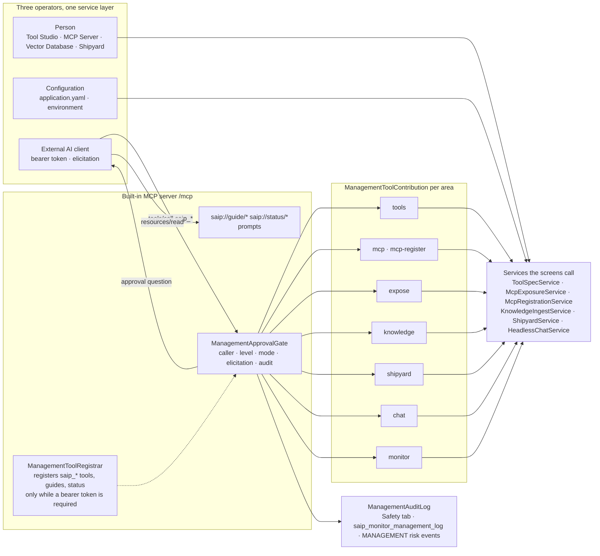
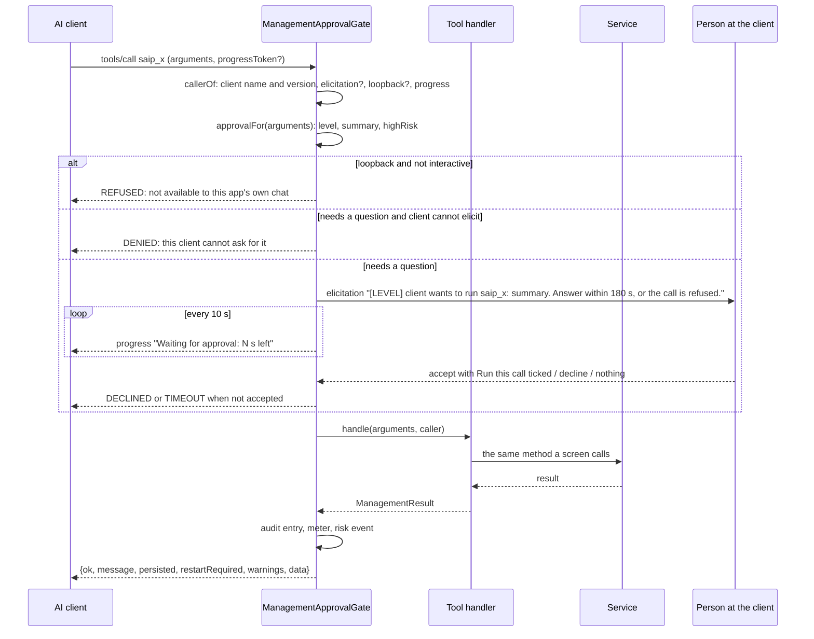
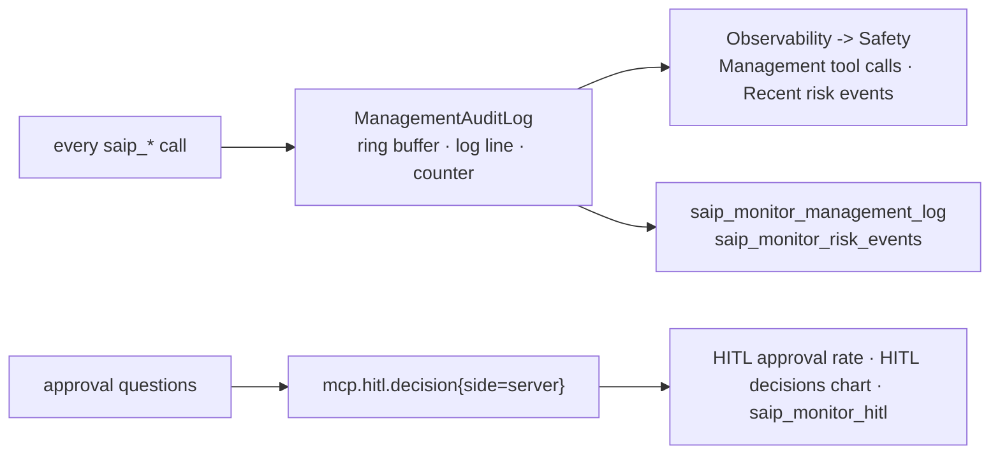

# AI Operations Architecture

A person operates the app from its screens. A configuration file operates it at startup. The third operator is an **external AI**: ChatGPT, Claude Code, Cursor, or any MCP client that can ask its user a question. It connects to the built-in MCP server with a bearer token and finds, next to your tools, a set of **management tools** named `saip_<area>_<verb>` through which it authors tools, registers and proxies servers, builds knowledge, ships servers and reads the monitoring.

The design rule is that the three operators are the same operation. A button on a screen, a key in `application.yaml` and a management tool call reach the same service method, so what an AI sets up is what you see on the screens, and what you would refuse a person is refused to the AI by the same code. What the AI adds is a gate in front of every call: the question comes back to the person at the AI's own client before anything that matters changes, and every call lands on an audit trail.

Pages this architecture connects to:

- [Management Tools](features/mcp-server/management-tools.md) - the tool areas, the day-to-day rules and how to connect each client
- [Shipyard Architecture](shipyard-architecture.md) - what the `saip_shipyard_*` and `saip_knowledge_*` tools build
- [Human-in-the-Loop Approval](hitl-architecture.md) - the gate family this gate belongs to, and the one approval wait
- [MCP Server Safety](mcp-server-safety.md) - the risk cap and fingerprint ledger the `expose` tools enforce
- [AI Agent Observability](observability-architecture.md) - where the audit trail and the approval counters live
- [Configuration](getting-started/configuration.md#management) - the `spring.ai.playground.management.*` keys
- [Application](architecture.md) - where the management layer sits in the runtime

## Overview { #overview }

Four pieces are new; everything else is the app as it already is.

1. **Registration** (`ManagementToolRegistrar`): the tools exist on the built-in server only while the conditions in the next section hold, and they come and go with the bearer token at run time.
2. **One gate** (`ManagementApprovalGate`): every management call passes through the same function, which identifies the caller, decides whether to ask, asks through MCP elicitation, waits the shared approval wait, and records the outcome.
3. **Contributions** (`ManagementToolContribution`): one bean per area declares its tools with an approval level and a handler that calls a service. The handlers hold no business logic of their own.
4. **Guides and status** (`saip://guide/*`, `saip://status/*`): the app teaches the AI its own procedures and lets it poll state without a tool call.

## Registration { #registration }

`ManagementToolRegistrar.refresh()` runs when the application is ready and again every time `McpServerAuthTokenService` publishes an `AuthTokenChangedEvent`. It computes the wanted tool set and diffs it against what is registered. The first blocker that matches turns the surface off and becomes the reason the MCP Server drawer and the Safety tab show:

| Blocker | Reason text |
|---|---|
| `spring.ai.playground.management.enabled=false` | `disabled by spring.ai.playground.management.enabled=false` |
| The home holds a `saip-bundle.json` | `not offered by a shipped server bundle` (a [shipped server](shipyard-architecture.md#container) never carries management tools) |
| The server runs over stdio | `not offered in stdio mode` |
| No synchronous MCP server bean | `no synchronous MCP server is running` |
| The built-in server does not require a bearer token | `no bearer token on the built-in server` |

With no blocker, the registrar takes every `ManagementToolContribution` bean whose category is enabled (`spring.ai.playground.management.tools`; every category but `mcp-register` when the list is empty), drops the names in `management.exclude`, and registers the rest as raw `SyncToolSpecification`s through `ToolSpecService.addServedTools`. Resources, resource templates and prompts are diffed and registered the same way. Switching the token off removes all of them. The MCP SDK sends the `list_changed` notifications on each add and remove; whether a client acts on them is the client's business (Codex, for one, reads a server's tool list once per chat).

`saip_` is a reserved prefix everywhere a name can be chosen: Tool Studio names, exposure aliases and knowledge tool names are refused with `starts with 'saip_', which is reserved for this app's own management tools`. The self-loopback client that Agentic Chat uses filters `saip_` tools out, so the app's own chat model never sees them.

## One call through the gate { #gate }

`ManagementApprovalGate.wrap` turns each `ManagementTool` into an MCP tool whose annotations follow its level (`readOnlyHint` for READ, `destructiveHint` for DESTRUCTIVE, plus the `idempotent` and `openWorld` hints the tool declares) and whose call handler is `execute`. The sequence for one call:

**The caller.** `ManagementCaller` carries the client's name and version from the MCP handshake (`codex-mcp-client 0.166.0`, `claude-code 2.1.314`), whether it advertised the `elicitation` capability, whether it is this app's own loopback client, and two channels: a progress reporter bound to the request's `progressToken`, and an elicitation channel the handler may use for questions of its own (the chat tool does).

**Whether to ask.** Each tool declares a level, and a tool may compute its approval from the arguments: `saip_expose_add_tools` summarizes what is added and which tools will have no human approval, `saip_shipyard_run` quotes the exact `docker compose` command, `saip_mcp_add_custom` names the transport and URL and a stdio command if any. The decision then follows `spring.ai.playground.management.approval`:

| Level | `destructive` (default) | `all` | `none` |
|---|---|---|---|
| READ (lists, previews, status, monitoring) | never asks | never asks | never asks |
| WRITE (drafts, tests, ingests, pipelines, ships, stops, reconnects, chat turns) | never asks | asks | never asks |
| DESTRUCTIVE (publish, delete, exposure changes, register and remove servers, run and delete shipped servers, delete knowledge) | asks | asks | never asks |

A **high-risk** action overrides the mode: a tool test or publish whose sandbox is above the baseline, a publish that weakens call approval, an exposure or registration whose inherent risk is L4 or higher always asks, and under `none` is refused outright (`this is a high-risk action and needs a human decision, but approval is disabled`). The mode is one global setting; `management.exclude` removes tools, it does not change their level.

**The question.** The elicitation text is `[LEVEL] <client name and version> wants to run <tool>: 
. Answer within <wait> s, or the call is refused.` with a schema of one required field, `approve`: a single choice, **Run this call**, that arrives already ticked, so a person reads the question and clicks **Accept**. The gate runs the call only when the answer is `ACCEPT` with that choice still ticked (`approve: ["run"]`), which keeps a client that fills in empty forms by itself from passing the gate without a person ([why](hitl-architecture.md#server-gate)). The wait is the one [approval wait](hitl-architecture.md#wait) every gate shares (`spring.ai.playground.hitl.approval-wait-seconds`, 180 by default). `ApprovalWaitCountdown` runs the elicitation on its own thread and reports `Waiting for approval: N s left` as MCP progress every 10 seconds, which is how a client that shows progress keeps its user informed and why the built-in server's request timeout is derived from the wait rather than the other way round.

**The outcomes.** `ManagementOutcome` is `OK`, `ERROR`, `REFUSED`, `DECLINED`, `DENIED` or `TIMEOUT`, and each refusal is a sentence the AI can act on:

| Outcome | What the AI receives |
|---|---|
| `DECLINED` | `Tool 'x' was not run: the user declined. Do not retry it for this request.` |
| `TIMEOUT` | `Tool 'x' was not run: no approval within 180 s. Do not retry it for this request; ask the user to run it from the app if it is still needed.` |
| `DENIED` | `Tool 'x' was not run: it needs human approval and this client cannot ask for it (no elicitation support). ...` |
| `REFUSED` | A rule refused before anything ran: the loopback chat, a high-risk action under `none`, a literal secret |
| `ERROR` | The service refused or failed: the message names the rule (`'cafe-desk' is managed by configuration; change it under ...`) or, for an unexpected failure, `Unexpected error: <masked message>` |

Every call that needs approval counts on the `mcp.hitl.decision` meter, tagged `side=server`: `approved`, `declined`, `timeout` or `elicit-failed` for a question, `denied` when the client cannot be asked, next to the chat gate's decisions. That is why the **HITL approval rate** on the Safety tab and `saip_monitor_hitl` show the person's clicks on management cards together with every other approval.

## The contributions { #contributions }

A contribution is a `@Component` implementing `ManagementToolContribution`: a category, its tools, and optionally resources, resource templates and prompts. A tool is built with `ManagementTool.named(name, category, Input.class)`, given a description, a level (`.write(summary)`, `.destructive(summary)`, or a custom `.approval(level, planner)` that may `markHighRisk()`), an optional typed `data` record for the result, and a handler. Arguments are bound strictly: an unknown property or a wrong shape is `Invalid arguments for 'x': ...`, never guessed.

| Category | Contribution | Tools and levels | Service behind them |
|---|---|---|---|
| `tools` | `ToolsManagementContribution`, `ToolAuthoringGuideContribution` | `list`, `get`, `check_risk`, `get_exposure` read; `save_draft`, `test` write; `publish`, `delete`, `set_exposure` destructive | `ToolSpecService`: the same draft, Local Pass, publish and exposure as Tool Studio |
| `mcp` | `McpManagementContribution` | `list_servers`, `catalog_search`, `preview_risk`, `server_tools` read | `McpServerOverviewService`, `McpRegistrationService` (preview only) |
| `mcp-register` (opt-in) | `McpRegisterManagementContribution` | `test_connection`, `reconnect` write; `add_from_catalog`, `add_custom`, `remove_server` destructive | `McpRegistrationService`: the MCP Server form's validation, including the refusal of this app's own `/mcp` as an upstream |
| `expose` | `ExposeManagementContribution`, `ProxyGuideContribution` | `get`, `preview` read; `add_tools`, `remove_tools`, `set_hitl`, `apply` destructive | `McpExposureService.plan` and `apply`: the Composed Tools drawer's rules, dry run first |
| `knowledge` | `KnowledgeManagementContribution` | `list_documents`, `list_pipelines`, `search`, `suggest_tools`, `status` read; `ingest_document`, `apply_pipeline` write; `delete_document`, `delete_pipeline` destructive | `KnowledgeIngestService`, `RagPipelineService`, `KnowledgeSearchService`, `KnowledgeSuggestService` |
| `shipyard` | `ShipyardManagementContribution` | `list_servers`, `list_shippable`, `validate`, `status`, `logs`, `targets` read; `ship`, `stop` write; `run`, `delete` destructive | `BundleExportService`, `RunPlanner`, `DeployTargetService`, `ShipyardService` ([Shipyard Architecture](shipyard-architecture.md#request)) |
| `monitor` | `MonitorManagementContribution`, `MonitorInsightsManagementContribution` | all read: `overview`, `mcp_status`, `tool_calls`, `proxied_calls`, `risk_events`, `hitl`, `management_log`, `traces`, `trace_get`, `system`, `logs_tail` | `ObservabilityQueryService`, the ring buffers, `SystemMetricsSnapshot`, `LogQueryService`, with secrets masked |
| `chat` | `ChatManagementContribution` | `ask` write; `list_conversations` read | `HeadlessChatService` (next section) |

The rules an AI runs into are the services' rules, phrased for an agent. A few that shape how an AI behaves:

- **Nothing is overwritten implicitly.** A published tool is not changed by a new draft of the same name (`Save the new version as a draft under another name, publish it, then delete the old tool`), a bundled tool cannot be published or deleted, a draft cannot be exposed.
- **Changed definitions are refused until acknowledged.** An exposed tool whose upstream description or schema changed is withheld by the [fingerprint ledger](mcp-server-safety.md#fingerprint-ledger); the AI must list it in `acknowledgeChanged` after reviewing it, where a person clicks **Accept new definition**.
- **The risk cap is not negotiable.** `Inherent risk L4 is above the cap L3 (HITL does not lift the cap).`
- **Configuration wins.** Documents, pipelines, composed tools and shipped servers declared in configuration are read-only to the AI, with the property to edit named in the refusal.
- **Secrets never pass through the interface.** A static variable, header or URL parameter that looks like a secret must be a `${ENV_NAME}` reference; `ManagementSecrets.requireReference` refuses a literal value and tells the AI to ask the person to set the variable.
- **Paths are explicit.** An ingest path must be absolute and inside an ingest root; a relative path comes back with the absolute path to use, a missing file is named as missing.

## What the app teaches the AI { #guides }

The AI does not need the documentation site. The contributions serve the guides as MCP resources, compressed from the pages a person reads. A guide is the procedure one layer above the management tools, the steps that string several of them together; the app builds and vets tools, and the guides only teach an AI to operate it:

| Resource | Served by | Covers |
|---|---|---|
| `saip://guide/tool-authoring` with `/runtime`, `/sandbox`, `/testing`, `/mistakes`, `/examples` and `saip://examples/{name}` | `ToolAuthoringGuideContribution` | From idea to published tool: the JS runtime, the sandbox baseline and what raises risk, the Local Pass, exposure, frequent mistakes, and bundled tools to copy from |
| `saip://guide/proxy`, `saip://guide/risk-levels` | `ProxyGuideContribution` | Choosing and combining upstream tools, HITL, the refusal rules, what L0 to L5 mean |
| `saip://guide/knowledge` | `KnowledgeManagementContribution` | Ingest by path, URL or text, when a pipeline is needed, search before shipping |
| `saip://guide/shipyard` | `ShipyardManagementContribution` | Validate, ship, run, status, connect |

Each area also has a prompt (`saip_create_tool`, `saip_proxy_server`, `saip_knowledge_server`, `saip_shipyard_server`) that starts its procedure: `saip_create_tool` carries the tool-authoring guide as an embedded resource, the other three tell the AI to read their guide first. The guides are the first thing the tutorials tell the AI to read, and they are versioned with the app, so an AI connected to an older build gets the rules of that build. [AI Guides, Templates and Samples](features/mcp-server/ai-guides.md) shows their full text and the prompts as the AI receives them.

Three **status resources** mirror the read-only views as JSON, serialized fresh on every read: `saip://status/servers` (registered servers with connection state and risk), `saip://status/exposure` (the exposed tools with HITL, fingerprint state and whether the upstream is connected) and `saip://status/shipyard` (shipped servers with state, endpoint, target and the out-of-date flag). An agent polls them after an apply or a run without a tool call and without a side effect; they are registered and removed with the tools.

## The chat as a sub-agent { #chat }

`saip_chat_ask` runs one turn of Agentic Chat without the screen. `HeadlessChatService` opens or continues a conversation through the same `ChatTurnService` and `AgentLoopManager` the chat view uses, with the published and exposed tools named in `tools` and an optional RAG source, and records the turn through the same `ChatTurnRecorder`, which is why it appears in the chat history as if typed.

What changes is who answers a gated tool inside the turn. The turn's `HumanQuestionHandler` is an `ElicitationQuestionHandler` bound to the caller's elicitation channel: a tool the model wants to run that needs approval becomes `[risk L2] Chat turn started by this client wants to run a tool. Run 'wiki_outline' with ...?` in the AI's own client, with the same wait. A client that cannot ask gets the tool declined without a prompt. The [HITL architecture](hitl-architecture.md#management-chat-gate) describes this as the third approval path, next to the chat dialog and the server-side elicitation. Management tools are never callable from a turn (`saip_` names are refused in `tools`), so a turn cannot start another turn.

## The audit trail { #audit }

`ManagementAuditLog.record` runs for every call, whatever its outcome, and writes three things:

- an **entry** in a bounded ring buffer (`spring.ai.playground.management.audit-capacity`, 500 by default): time, client label, tool, level, outcome, duration, and a summary of the arguments and the result with secrets masked (`Authorization`, tokens, keys and passwords become `***`, `Bearer <token>` becomes `Bearer ***`, `${ENV}` references stay);
- a **log line** `mgmt.call client=... tool=... level=... outcome=... durationMs=... summary=...` and a `mgmt.call{tool, outcome}` counter;
- a **risk event** of type `MANAGEMENT` in `McpRiskEventRingBuffer` for every call that was not a successful read, with severity `warn` for destructive calls and failures.

Three readers see the same rows: the **Safety** tab's *Management tool calls* list and *Recent risk events* timeline, the `saip_monitor_management_log` and `saip_monitor_risk_events` tools, and the application log. The point of the design is in [Tutorial 19, section 7](tutorials/19-knowledge-server-to-chatgpt.md#audit): the AI's own report of what it did and the person's dashboard are the same counters, so neither side can tell a different story.

## Trust boundaries { #boundaries }

- **No token, no surface.** The management tools exist only while `/mcp` requires a bearer token. The token is a shared secret by design; the person reads it in the app, and an AI is never handed one (`saip_shipyard_run` answers `The bearer token is shown to the person in the app, not here.`).
- **The app's own chat cannot operate the app.** The loopback client is refused by the gate and the `saip_` tools are filtered from its tool list, so a prompt injected into a chat turn cannot reach the management surface.
- **Headless means declined.** A client without elicitation (a `claude -p` script, a cron job) can read and can take write-level steps under the default mode, but every step that asks is denied, not silently approved. A client that answers questions without a person (Codex with its approvals switched off) is held to the same rule: the question carries a required `approve` field, and an answer without it is a decline.
- **The AI does not see the card.** The elicitation goes from the server to the client's UI and to the person; the model receives only the result afterwards, which is why an AI's report says no approval question appeared while the Safety tab counts it.
- **The same refusals as the screens.** Risk cap, fingerprint ledger, reserved names, configuration-managed items, literal secrets: nothing is relaxed for an agent, and the refusal text says what to do instead.

## Known limitations { #limitations }

- **One approval mode for all tools.** `management.approval` applies to every category; there is no per-tool override beyond excluding a tool.
- **`mcp-register` is a configuration decision.** An AI cannot turn registration on, and once it is on every registration asks the person under the `destructive` and `all` modes (under `none`, a registration rated L4 or higher is refused and the rest run without asking).
- **List changes depend on the client.** The SDK sends `list_changed` when tools are added or removed; a client that reads the list once per chat (Codex) sees a newly published tool in its next chat.
- **One turn at a time.** `saip_chat_ask` runs a single turn and blocks for its duration (`timeoutSeconds`, 300 by default, 1800 at most); file uploads and image references are not available in a turn run over MCP.
- **The guides use a private scheme.** They are plain MCP resources under `saip://`. The MCP Skills extension (`io.modelcontextprotocol/skills`, Beta) is the official way to publish such procedures as Agent Skills, listed through `skills/list` with per-file SHA-256 digests and conventionally addressed under `skill://`; serving the guides that way as well is a candidate for a later release, once the Java MCP SDK supports the extension. It would change how the guides are found, not the tools: those keep their Local Pass, risk level and approval.
- **The audit trail is in memory.** It starts empty with the app and holds the last `audit-capacity` calls; the application log keeps the rest.

## Configuration reference { #configuration }

| Property | Default | What it does |
|---|---|---|
| `spring.ai.playground.management.enabled` | `true` | Master switch |
| `spring.ai.playground.management.tools` | *(all but `mcp-register`)* | Categories offered: `tools`, `mcp`, `mcp-register`, `expose`, `knowledge`, `shipyard`, `monitor`, `chat` |
| `spring.ai.playground.management.exclude` | `[]` | Tool names left out |
| `spring.ai.playground.management.approval` | `destructive` | Which levels ask: `destructive`, `all`, `none` (high-risk actions always ask, and are refused under `none`) |
| `spring.ai.playground.management.audit-capacity` | `500` | Calls kept in the audit ring buffer |
| `spring.ai.playground.hitl.approval-wait-seconds` | `180` | The shared approval wait the questions use |
| `spring.ai.playground.mcp-server.auth-token` | *(unset)* | The bearer token that turns the surface on |

The full key list is in [Configuration -> Management tools](getting-started/configuration.md#management).

## Source map { #source-map }

| Concern | Classes (`service/management` unless noted) |
|---|---|
| Registration | `ManagementToolRegistrar`, `ManagementStatus`, `service/mcp/ManagementToolNames` |
| The gate | `ManagementApprovalGate`, `ManagementCaller`, `ManagementApproval`, `ApprovalLevel`, `ManagementOutcome`, `ManagementProgress`, `ManagementElicitation`, `service/mcp/ApprovalWaitCountdown`, `service/mcp/ApprovalConfirmation` |
| Tools and schemas | `ManagementTool`, `ManagementToolContribution`, `ManagementSchemas`, `ManagementJson`, `ManagementResult`, `ManagementSecrets` |
| Contributions | `ToolsManagementContribution`, `McpManagementContribution`, `McpRegisterManagementContribution`, `ExposeManagementContribution`, `KnowledgeManagementContribution`, `ShipyardManagementContribution`, `MonitorManagementContribution`, `MonitorInsightsManagementContribution`, `ChatManagementContribution` |
| Guides | `ToolAuthoringGuideContribution`, `ToolAuthoringGuide`, `ProxyGuideContribution`, `src/main/resources/management/guide/*.md` |
| Chat sub-agent | `ElicitationQuestionHandler`, `service/chat/HeadlessChatService` |
| Audit | `ManagementAuditLog`, `webui/observability/SafetyTab` |

## Further reading

- [Management Tools](features/mcp-server/management-tools.md) - the tools by area, connecting ChatGPT, Claude Code, Cursor and the Inspector, the approval table
- [Tutorial 18](tutorials/18-ai-authors-a-tool.md) - an AI authors a tool; [Tutorial 19](tutorials/19-knowledge-server-to-chatgpt.md) - ChatGPT extends and re-ships a knowledge server and audits itself; [Tutorial 20](tutorials/20-ai-registers-an-mcp-server.md) - registers and proxies a server; [Tutorial 21](tutorials/21-ai-builds-a-knowledge-server.md) - builds and ships knowledge; [Tutorial 22](tutorials/22-ai-chat-as-a-subagent.md) - uses the chat as a sub-agent
- [Shipyard Architecture](shipyard-architecture.md) - the bundle and the container the shipyard tools produce
- [Human-in-the-Loop Approval](hitl-architecture.md) - the chat dialog, the server-side elicitation and the chat-over-MCP path as one family
