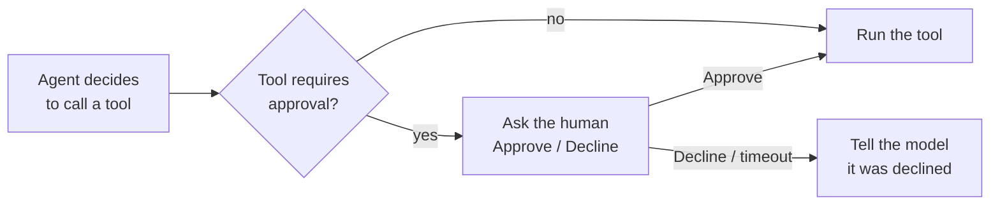
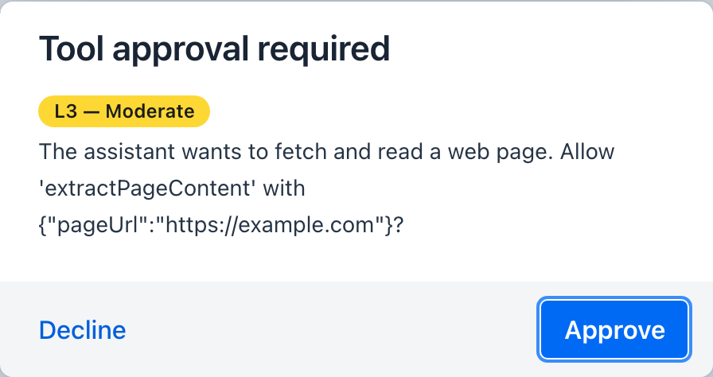
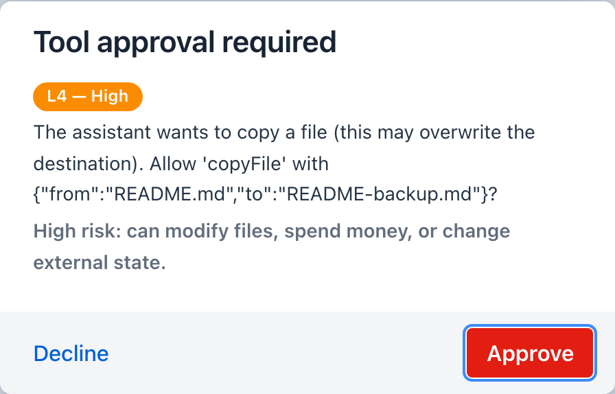
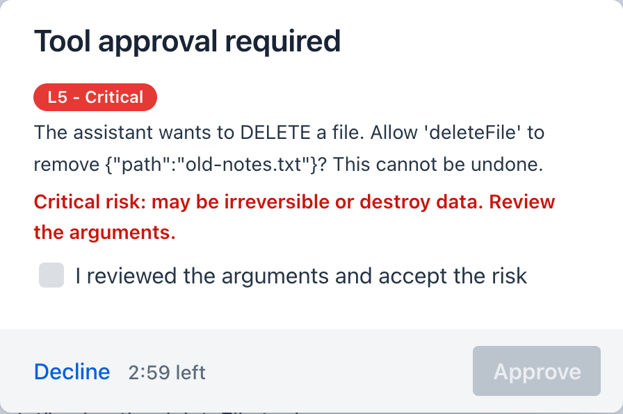

videos: ep6 ep9
description: Human-in-the-Loop approval in Spring AI Playground - require explicit approval before a tool runs, set it per tool, and approve or decline calls inside Agentic Chat.

# Human-in-the-Loop Approval

**Where:** set it per tool in **Tool Studio → Sandbox & Capabilities → Human-in-the-loop**, or per re-exposed tool in the **Composed Tools** drawer's **HITL** column. It then takes effect in **Agentic Chat** and for any external MCP client.

**Human-in-the-loop (HITL)** pauses a tool call and waits for you to **approve or decline** before the tool runs. The risk level warns you how dangerous a tool is; the sandbox limits what it can touch; HITL is the gate that asks *"run this exact call?"* at the moment it would fire.

It is the final safety layer, on top of the [tool sandbox](../safety-architecture.md) and the [MCP risk model](../mcp-server-safety.md). The design and internals are on the [Human-in-the-Loop Approval architecture page](../hitl-architecture.md); this page is the how-to.

## The two modes { #modes }

Every tool has an approval mode:

| Mode | What it does |
| --- | --- |
| **Required - ask every run** | The call is gated **every time**, for both Agentic Chat and external MCP clients. |
| **Disabled - no prompt** | The tool runs without asking. |

When you author a tool, the mode **defaults to Required above `L0`** and to Disabled at `L0` - the more capable a tool, the more it asks out of the box. The bundled default tools set their own mode; most of them run without asking (see below for the ones that ship with Required).

## Set approval on a tool you author { #author }

1. Open **Tool Studio** and select or create a tool.
2. Expand **Sandbox & Capabilities**.
3. Under **Human-in-the-loop**, pick **Required** or **Disabled**.
4. *(Optional)* In **Approval prompt (optional)**, write the question shown at approval time. `{toolName}` and `{args}` are substituted at call time - e.g. `Run tool '{toolName}' with arguments {args}?`
5. **Test & Publish** (or **Test & Update**).

!!! warning "Reducing oversight asks for confirmation"
    Moving a tool from Required to Disabled opens a **Reduce human oversight?** confirmation, so you never lower the gate by accident. Disabled lets any client run the tool immediately, with no approval step beyond the sandbox.

## Require approval on a re-exposed external tool { #expose }

When you [proxy an external tool](mcp-server/proxy.md) through the built-in server, each row in the **Composed Tools** drawer has a **HITL** toggle:

- Ticking **HITL** pauses every call to that tool for approval at runtime - the chat approval dialog in Agentic Chat, an MCP elicitation for an external client - and does not let the tool exceed the risk cap.
- It also **lowers the tool's displayed risk by one band** (a `HITL -1` annotation; never below `L1`, so a tool already at `L0` or `L1` keeps its level), because a human now gates every call - see [Composed risk and HITL mitigation](../mcp-server-safety.md#composed-risk). Built-in tools that ship with approval required (the filesystem write and destructive tools, plus `extractPageContent`, `openaiResponseGenerator` and `sendSlackMessage`) carry the same credit, rendered as a dual chip such as `L5 → L4`.

You can toggle approval per tool, or for all selected tools at once. The same setting is available in YAML via the `hitl: true` key on a composed tool - see the [Configuration reference](../getting-started/configuration.md#mcp).

## Approve a call in Agentic Chat { #chat }

When the agent calls a gated tool, a dialog appears titled **Tool approval required** with the tool's [risk-level chip](../mcp-server-safety.md) (hover it for the rationale), the rendered prompt, and two buttons:

- **Approve** → the tool runs, and the conversation continues with its result.
- **Decline** → the tool does **not** run. The model is told you declined so it won't silently retry; it either finds another way or tells you the action couldn't be completed.

The dialog escalates with the level, so the ask is proportional to what the tool can do:

| Level | What you see |
|-------|--------------|
| L0-L3 | Chip + prompt; standard **Approve** |
| L4 (High) | Warning line ("can modify files, spend money, or change external state"); **Approve** turns red |
| L5 (Critical) | Critical warning line; **Approve** is red and stays disabled until you tick *"I reviewed the arguments and accept the risk"* |

{ width="360" }

{ width="360" }

{ width="360" }

The level shown is the tool's **inherent** level (before the `HITL -1` display credit) - the dialog itself is the mitigation, so it never discounts the risk it is asking you to accept.

If you don't answer within the [approval wait](#wait) (three minutes by default; a countdown next to **Decline** shows what is left), or close the dialog, the call is **not run** - approval fails safe. If the agent requested several gated tools in the same step, they appear together in **one dialog** with a chip-labeled row per call, so you answer them all at once; ungated calls run without interruption.

Walk through it end to end in [Tutorial 11 - Approve a Tool in Chat](../tutorials/11-human-approval.md).

## The approval wait { #wait }

Every place that waits for a person shares **one** wait: `spring.ai.playground.hitl.approval-wait-seconds`, **180 seconds** by default and capped at 240 (see the [configuration reference](../getting-started/configuration.md#hitl)). The chat approval dialog, the chat file-upload and image dialogs, an Inspector call of a HITL tool, the pending cards on the Inspector's Sampling and Elicitation tabs, and the built-in server's approval gate all count down from the same number, and the transport timeouts underneath them are derived from it plus a margin, so raising or lowering it is a single setting change.

While the wait runs you can see the time left:

- **Chat approval dialog** - a muted `m:ss left` label sits beside **Decline**; when it reaches zero the dialog closes on its own.
- **Inspector Tools tab** - the running tool card shows `Running... answer any Sampling or Elicitation request from its tab while this call waits` with the time left to approve, and the moment the built-in server asks for approval the request appears **on that same card** with **Accept** / **Decline** / **Review** and its own countdown, so you do not have to find the Elicitation tab yourself.
- **Inspector Sampling and Elicitation tabs** - each pending card shows `m:ss left to answer before this request expires`.
- **External MCP clients** - the approval question itself ends with `Answer within 180 s, or the call is refused.`, and a client that sent a `progressToken` with the call receives a progress notification every 10 seconds (`Waiting for approval: 170 s left`) until it answers. MCP elicitation has no deadline field, so these two standard channels are how the limit reaches a client the playground does not control.

A call to an external MCP server from the Inspector does not wait on an approval, so its card counts down the ordinary MCP client request timeout (20 s by default) instead, with `left before the call times out`.

When the wait expires the outcome is explicit, never a transport error:

- In **chat** the tool is not run and the model is told `Tool 'x' was not run: no approval within 180 s`, so it replies that the action is waiting on you and that you can send the request again. The Safety dashboard counts it as **chat / timeout**, separate from a decline.
- In the **Inspector** the call returns an error result with the same `no approval within 180 s` text, the pending Elicitation card disappears, and the Safety dashboard counts it as **server / timeout**. An external MCP client that never answers the elicitation gets the same result.
- A tool only runs on an explicit **Approve** in chat, or on **Accept** with **Run this call** ticked in an external client; expiry, decline, cancel, an unticked box, **Deny** and a closed dialog all leave it unexecuted.

## What an external client sees { #external }

For an external MCP client (e.g. Claude Desktop) calling a `Required` tool on the built-in `/mcp` server, the built-in server issues an MCP **elicitation** request - a confirmation card the client renders before the call proceeds. The card carries one checkbox, **Run this call**, already ticked: **Accept** runs the tool, and unticking it or **Deny** refuses. The elicitation message is prefixed with the tool's risk level (for example `[risk L5 Critical]`), because the elicitation protocol has no severity field of its own. If the client does not support elicitation, the call is **denied** (it cannot be approved). The playground's own [MCP Inspector → Elicitation](mcp-server/inspector.md#elicitation) shows elicitation requests the playground receives while acting as an MCP client; external clients render the built-in server's approval prompt in their own UI.

The [management tools](mcp-server/management-tools.md#approval) ask the same way. When an external AI publishes a tool, changes what the built-in server exposes, registers a server or runs a shipped one, the question arrives in that AI's client as an elicitation that names the client and what will change (`[DESTRUCTIVE] codex-mcp-client ... wants to run saip_tools_publish: Publish the tool 'cafe_happy_hour_price' ...`), with the same wait and the same fail-safe outcomes. The model never sees the card; it only receives the result after you answered ([AI Operations Architecture](../ai-operations-architecture.md#gate)). [Tutorial 19](../tutorials/19-knowledge-server-to-chatgpt.md) shows the cards as ChatGPT renders them, and [Tutorial 21](../tutorials/21-ai-builds-a-knowledge-server.md) the single approval a whole knowledge server needs, for the docker command.

## Good defaults { #defaults }

- **Keep Required for anything that writes, deletes, sends, or spends** - irreversible or outward-facing actions are exactly what a person should confirm.
- **Leave read-only, local tools Disabled** so routine calls don't nag you.
- **Review-then-send action cards are a separate pattern.** The built-in `sendEmail` and `addToCalendar` tools ship at L0 and need no approval because they only *draft* - they never send mail or write a calendar. The outward action happens only when you click the button on the [action card](agentic-chat/index.md#action-cards) they render in chat, so that click is itself the human gate. A `send`-named tool shipping without an approval prompt is therefore not an exception to the rule above.

## Related

- [Human-in-the-Loop Approval (architecture)](../hitl-architecture.md) - the two gates, loopback de-duplication, and fail-safe internals
- [Agent Loop](../agent-loop-architecture.md) - the round governance this gate runs inside (round bounds, decline memory, the shared approval wait)
- [MCP Server Proxy](mcp-server/proxy.md) - re-expose external tools with per-tool approval
- [Tool Studio](tool-studio/index.md) - author tools and their sandbox + approval policy
- [Agentic Chat](agentic-chat/index.md) - where approvals are answered
- [Tutorial 11 - Approve a Tool in Chat](../tutorials/11-human-approval.md)
