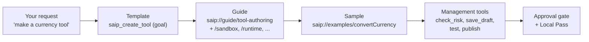
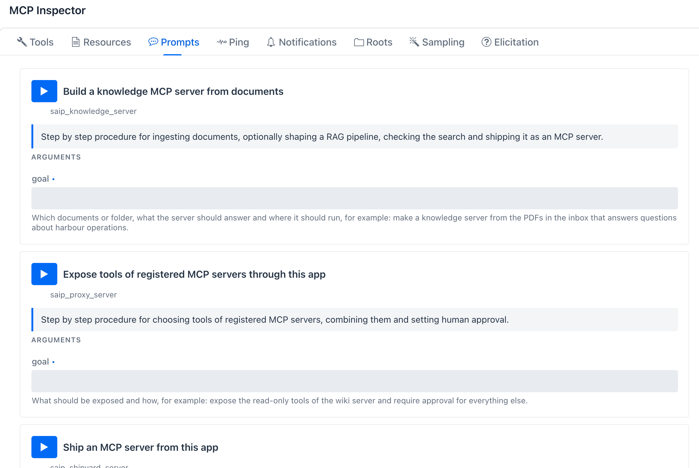

# AI Guides, Templates and Samples

**Where:** the built-in MCP server (`/mcp`), next to the [management tools](management-tools.md). Read them yourself in **MCP Server -> spring-ai-playground-built-in-mcp -> MCP Inspector -> Resources / Prompts**.

An AI that connects to this app does not read this site. It learns the app from what the built-in server hands it over MCP, and this page shows exactly that material:

- **Guides** are MCP resources under `saip://guide/`. Each one is the procedure for one job, the rules the app enforces and the mistakes to avoid. They ship inside the app, so an AI connected to an older build gets the rules of that build.
- **Templates** are MCP prompts, one per job. A prompt takes one `goal` and returns the first message of the job: which guide to read and which tools to call in which order.
- **Samples** are the bundled tools, served as `saip://examples/{name}`: tested code, parameters and sandbox settings to copy instead of writing a tool from scratch.

They appear only where the management tools appear, when the built-in server requires a bearer token ([Turning it on](management-tools.md#turning-it-on)), and they come and go with the categories you enable.


*Resources tab of the built-in server: 13 entries, the guides as `text/markdown`, the three status views as `application/json`, and the `saip://examples/{name}` template at the end of the list.*

## How an AI uses them { #flow }



A model reads a resource when it is told to, not on its own, so every template and every tutorial prompt names its guide. The guides only inform: the sandbox, the risk level, the Local Pass and the [approval gate](../../ai-operations-architecture.md#gate) decide what actually runs, whatever the AI read or skipped.

## The resources { #resources }

| URI | Kind | What the AI gets |
|---|---|---|
| `saip://guide/tool-authoring` | guide | Start here: from idea to published tool, the fields of a tool spec |
| `saip://guide/tool-authoring/runtime` | guide | How the JavaScript gets its inputs, returns results, which helpers exist |
| `saip://guide/tool-authoring/sandbox` | guide, filled in | This app's sandbox baseline, the fields that widen it, what raises the risk level |
| `saip://guide/tool-authoring/testing` | guide | The Local Pass, reading a test result, who must approve, exposure |
| `saip://guide/tool-authoring/mistakes` | guide | Symptoms of common failures and their fixes |
| `saip://guide/tool-authoring/examples` | sample index | The bundled tools by category, with level and purpose |
| `saip://examples/{name}` | sample (template) | One bundled tool: parameters, static variables, sandbox, code |
| `saip://guide/proxy` | guide | Choosing and combining tools of registered servers, approval, refusal rules |
| `saip://guide/risk-levels` | guide | What L0 to L5 mean and how they are computed |
| `saip://guide/knowledge` | guide | Ingesting documents, when a RAG pipeline is needed, checking the search |
| `saip://guide/shipyard` | guide | Validate, ship, run, check status, hand over the connection |
| `saip://status/servers`, `saip://status/exposure`, `saip://status/shipyard` | status (JSON) | The same views as `saip_mcp_list_servers`, `saip_expose_get` and `saip_shipyard_list_servers`, read fresh on every read |

## The guides, word for word { #guides }

The text below is included from the files the app serves (`src/main/resources/management/guide/`), so it cannot drift from the build this site describes. Open a fold to read a guide as the AI reads it.

### Making a tool { #tool-authoring }

The entry guide. It lays out the six steps (find a similar tool, choose the smallest sandbox, write the code, save a draft, test until it passes, publish) and links the narrower guides, so the AI reads only what the current step needs.

??? abstract "`saip://guide/tool-authoring`"

    ````markdown
    --8<-- "src/main/resources/management/guide/tool-authoring.md"
    ````

??? abstract "`saip://guide/tool-authoring/runtime` - inputs, results, helpers"

    ````markdown
    --8<-- "src/main/resources/management/guide/tool-authoring-runtime.md"
    ````

??? abstract "`saip://guide/tool-authoring/testing` - Local Pass, approval, exposure"

    ````markdown
    --8<-- "src/main/resources/management/guide/tool-authoring-testing.md"
    ````

??? abstract "`saip://guide/tool-authoring/mistakes` - symptoms and fixes"

    ````markdown
    --8<-- "src/main/resources/management/guide/tool-authoring-mistakes.md"
    ````

### Your app's limits are filled in { #sandbox }

The sandbox guide is the one guide that is not static. The file holds two placeholders, `{{baseline}}` and `{{risk-table}}`, and the app replaces them on every read with its own settings: what the sandbox allows without asking, which Java classes are always denied, and which request raises a tool to which level. Change the [sandbox configuration](../../getting-started/configuration.md#tool-studio) and the next read tells the AI the new limits.

??? abstract "`saip://guide/tool-authoring/sandbox` - the file, with its placeholders"

    ````markdown
    --8<-- "src/main/resources/management/guide/tool-authoring-sandbox.md"
    ````

What an AI reads from an app with default settings:

```markdown
## This app's baseline

- Network: blocked, files: none.
- Time limit: 30 seconds per run, statement budget: 500000.
- Java classes allowed: `java.lang.*`, `java.math.*`, `java.text.*`, `java.time.*`, `java.util.*`.
- Java classes always denied: `java.lang.Class`, `java.lang.ClassLoader`, `java.lang.Process`, `java.lang.ProcessBuilder`, `java.lang.Runtime`, `java.lang.System`, `java.lang.Thread`, `java.lang.ThreadGroup`, `java.lang.invoke.*`, `java.lang.reflect.*`, `java.util.ServiceLoader`, `java.util.spi.*`.

## What sets the level

| Requested | Level | Above the baseline |
|---|---|---|
| Locked default, nothing requested | L0 | no |
| networkMode ALLOWLIST with exact hosts | L3 | no |
| networkMode STRICT (host known only at run time) | L3 | no |
| fileRead | L3 | no |
| networkMode OPEN | L4 | yes |
| hostsAllow contains * | L4 | yes |
| fileWrite | L4 | yes |
| destructive | L5 | yes |
| addAllowClasses with an ordinary class | L3 | yes |
| addAllowClasses with a network class | L4 | yes |
| addAllowClasses with java.lang.Runtime | L5 | yes |
```


*The same resource read in the Inspector: the placeholders are already replaced with this app's values.*

### Exposing registered MCP servers { #proxy }

The proxy guide is what an AI follows when it picks tools of the MCP servers you registered, combines them into one list and decides which calls need your approval. It also lists the rules that refuse a change, so the AI can explain a refusal instead of retrying. [MCP Server Proxy](proxy.md) is the same feature for a person, and [Tutorial 20](../../tutorials/20-ai-registers-an-mcp-server.md) runs it end to end.

??? abstract "`saip://guide/proxy`"

    ````markdown
    --8<-- "src/main/resources/management/guide/proxy.md"
    ````

??? abstract "`saip://guide/risk-levels` - what L0 to L5 mean"

    ````markdown
    --8<-- "src/main/resources/management/guide/risk-levels.md"
    ````

### Building knowledge for a search tool { #knowledge }

The knowledge guide covers ingesting documents by path, URL or text, when plain retrieval is enough and when a [RAG pipeline](../rag/pipeline-studio.md) is worth shaping, and checking the answers before shipping. [Tutorial 21](../../tutorials/21-ai-builds-a-knowledge-server.md) follows it.

??? abstract "`saip://guide/knowledge`"

    ````markdown
    --8<-- "src/main/resources/management/guide/knowledge.md"
    ````

### Shipping an MCP server { #shipyard }

The Shipyard guide strings the `saip_shipyard_*` tools into one procedure: list what can be shipped, validate, ship, run, check the status and hand the person the connection snippet. [Shipyard](index.md#shipyard) is the same flow on the screen.

??? abstract "`saip://guide/shipyard`"

    ````markdown
    --8<-- "src/main/resources/management/guide/shipyard.md"
    ````

## The templates { #prompts }

Each job has a prompt with one argument, `goal`, in your words. `prompts/get` returns the first message for the AI. `saip_create_tool` also attaches the whole tool-authoring guide as an embedded resource, so the AI has the rules in the same message; the other three name their guide and the AI reads it with `resources/read`.



| Prompt | Starts | Reads |
|---|---|---|
| `saip_create_tool` | Design, test and publish a new tool | `saip://guide/tool-authoring`, attached |
| `saip_proxy_server` | Expose tools of registered MCP servers with approval | `saip://guide/proxy` |
| `saip_knowledge_server` | Ingest documents, check the search, ship a knowledge server | `saip://guide/knowledge`, then `saip://guide/shipyard` |
| `saip_shipyard_server` | Ship, run and connect an MCP server | `saip://guide/shipyard` |

The text each prompt returns, with `GOAL` standing for your argument:

=== "saip_create_tool"

    ```text
    Goal: GOAL

    Make this tool with the saip_tools_* tools. First look for a similar tool in saip://guide/tool-authoring/examples and copy it. Ask for the least sandbox capability that works and check it with saip_tools_check_risk. Save a draft, run saip_tools_test until it passes, then saip_tools_publish. The guide is attached.
    ```

    A second message carries `saip://guide/tool-authoring` as an embedded resource.

=== "saip_proxy_server"

    ```text
    Goal: GOAL

    Read the resource saip://guide/proxy first, then follow its procedure with the saip_mcp_* and saip_expose_* tools. Use saip_expose_preview before every change and show the person what will be exposed and which tools have no human approval.
    ```

=== "saip_knowledge_server"

    ```text
    Goal: GOAL

    Read the resource saip://guide/knowledge first, then follow its procedure: list the documents, ingest what is missing with saip_knowledge_ingest_document, shape a pipeline with saip_knowledge_apply_pipeline only when plain retrieval is not enough, check answers with saip_knowledge_search, then ship with the saip_shipyard_* tools (saip://guide/shipyard) and hand over the connection snippet.
    ```

=== "saip_shipyard_server"

    ```text
    Goal: GOAL

    Read the resource saip://guide/shipyard first, then follow its procedure with the saip_shipyard_* tools: list what is shippable, validate the request, ship it, run it, check saip_shipyard_status and give the person the connection snippet.
    ```


*`saip_create_tool` run in the Inspector: the procedure, then the tool-authoring guide embedded in the second message.*

A client that supports MCP prompts lists the four by name, and Claude Code offers them as slash commands that take your goal.

## The samples { #samples }

`saip://guide/tool-authoring/examples` lists every bundled tool by category with its level and purpose, and opens with seven good starting points, one per pattern a new tool usually needs:

| Sample | Pattern |
|---|---|
| `stats` | Pure computation, locked sandbox (L0) |
| `convertCurrency` | Public API with an allowed host (L3) |
| `parseCsv` | `safety.parser` helper, no network |
| `extractPageContent` | Fetch plus HTML parsing, human approval |
| `searchNaver` | API key as `${ENV}` static variables |
| `sendSlackMessage` | Secret webhook URL and human approval |
| `writeTextFile` | File write (L4) with human approval |

`saip://examples/{name}` returns one of them complete, the same tool you see on the [default tool pages](../default-tools/index.md): description, parameters with their test values, static variables, sandbox and code. The AI copies it into `saip_tools_save_draft` under a new name and changes what it needs.


??? example "`saip://examples/convertCurrency`, up to its code"

    ```markdown
    # Example: convertCurrency

    Category WEB, risk L3, human approval not required.

    ## Description

    Converts between fiat currencies using open.er-api.com daily reference rates (no key).

    Returns: { from, to, amount, rate, result, date }.

    ## Parameters

    | Name | Type | Required | testValue | Description |
    |---|---|---|---|---|
    | from | STRING | true | USD | Source currency code (ISO 4217, e.g. USD) |
    | to | STRING | true | KRW | Target currency code (ISO 4217, e.g. KRW) |
    | amount | NUMBER | false | 100 | Amount in the source currency (default 1) |

    ## Static variables

    None.

    ## Sandbox

    networkMode=ALLOWLIST, hostsAllow=[open.er-api.com]

    ## Code
    ```

    The code that follows is the `convertCurrency` card on [Global tools](../default-tools/global.md).

## Read them yourself { #read-yourself }

Everything above is what your own app serves, and it is quickest to check there, because the sandbox guide and the example list follow your configuration and your build.

### In the MCP Inspector { #inspector }

1. Turn on the bearer token ([MCP Server -> gear -> Authentication](../../getting-started/external-connections.md#bearer-token)) so the management tools and their guides are registered.
2. Open **MCP Server**, select **spring-ai-playground-built-in-mcp** and scroll to the **MCP Inspector**.
3. **Resources**: press the play button on a card to read it. For **Bundled example tool**, type a name such as `convertCurrency` under **VARIABLES** first.
4. **Prompts**: type a `goal` and press the play button to see the messages the AI would receive.

The [MCP Inspector](inspector.md#resources) page explains the cards themselves.

### With curl { #curl }

The built-in server speaks MCP Streamable HTTP: open a session, send `notifications/initialized`, then call `resources/list`, `resources/read` and `prompts/get` with the session id. Each answer arrives as one Server-Sent Events line, so strip the `data:` prefix before `jq`. Replace the port and the token with yours.

```bash
BASE=http://localhost:8282/mcp
TOKEN='<your bearer token>'
HDR=(-H "Authorization: Bearer $TOKEN" -H "Content-Type: application/json" -H "Accept: application/json, text/event-stream")

# 1. open a session and keep its id
SID=$(curl -si "${HDR[@]}" -X POST $BASE -d '{"jsonrpc":"2.0","id":1,"method":"initialize","params":{"protocolVersion":"2025-06-18","capabilities":{},"clientInfo":{"name":"curl","version":"1"}}}' | awk -F': ' 'tolower($1)=="mcp-session-id"{print $2}' | tr -d '\r')
HDR+=(-H "Mcp-Session-Id: $SID")
curl -s -o /dev/null "${HDR[@]}" -X POST $BASE -d '{"jsonrpc":"2.0","method":"notifications/initialized"}'

# helper: one JSON-RPC call, the answer arrives as one SSE line
rpc() { curl -s "${HDR[@]}" -X POST $BASE -d "$1" | sed -n 's/^data://p'; }

# 2. list the guides
rpc '{"jsonrpc":"2.0","id":2,"method":"resources/list"}' | jq -r '.result.resources[].uri'

# 3. read one
rpc '{"jsonrpc":"2.0","id":3,"method":"resources/read","params":{"uri":"saip://guide/tool-authoring/sandbox"}}' | jq -r '.result.contents[0].text'

# 4. a template and a sample
rpc '{"jsonrpc":"2.0","id":4,"method":"prompts/get","params":{"name":"saip_proxy_server","arguments":{"goal":"expose DeepWiki"}}}' | jq -r '.result.messages[].content.text'
rpc '{"jsonrpc":"2.0","id":5,"method":"resources/read","params":{"uri":"saip://examples/convertCurrency"}}' | jq -r '.result.contents[0].text'

# 5. close the session
curl -s -o /dev/null "${HDR[@]}" -X DELETE $BASE
```

The script runs in bash or zsh and needs `jq`. `resources/templates/list` returns the `saip://examples/{name}` template, and `prompts/list` the four templates.

### From your AI client { #client }

Ask the connected client directly, for example: *Read the resource saip://guide/tool-authoring/sandbox and tell me what this app allows a new tool to do without approval.* A client that shows MCP resources also lets you pick a guide by name and attach it to your message.

## What the guides do not do { #limits }

- **They do not grant anything.** A guide describes the rules; the sandbox, the risk level, the Local Pass and the approval gate enforce them on every call, whether the AI read the guide or not.
- **They are not read automatically.** A model reads a resource when a prompt or a person tells it to. Start with the template, or name the guide in your first message, as the tutorials do.
- **They are this app's guides, not general MCP documentation.** They describe the build that serves them, which is why they ship inside the app instead of linking to this site.

## Related

- [Management Tools](management-tools.md) - the `saip_*` tools the guides string together.
- [AI Operations Architecture](../../ai-operations-architecture.md#guides) - which component serves which guide.
- [Tutorial 18](../../tutorials/18-ai-authors-a-tool.md), [19](../../tutorials/19-knowledge-server-to-chatgpt.md), [20](../../tutorials/20-ai-registers-an-mcp-server.md), [21](../../tutorials/21-ai-builds-a-knowledge-server.md) - the guides in use.
