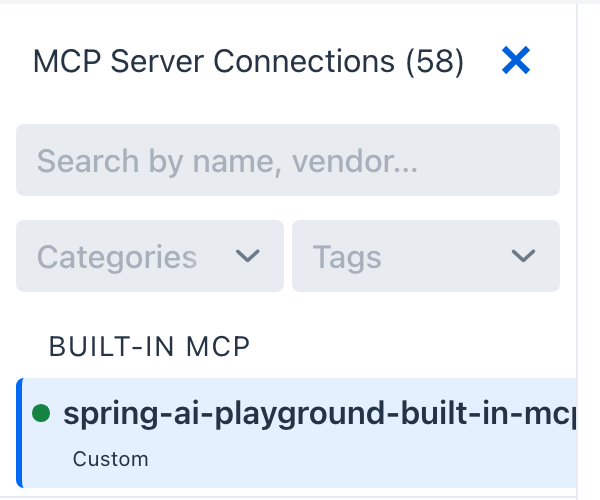
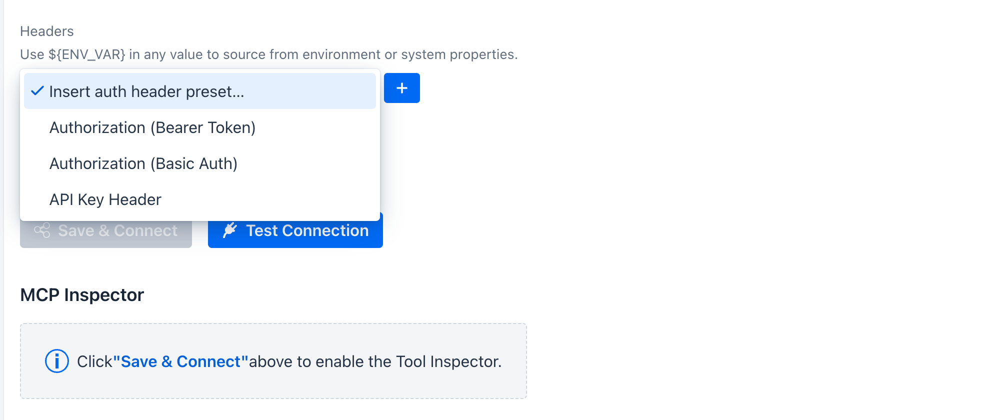
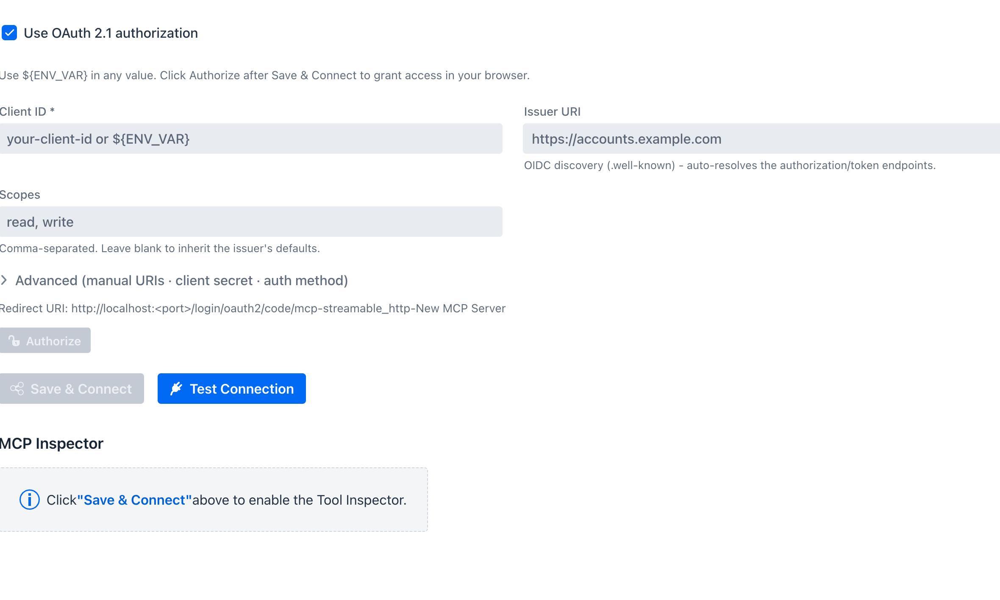
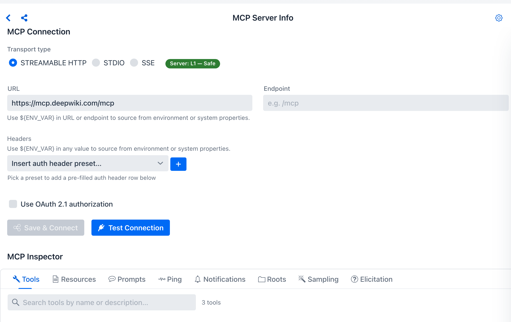
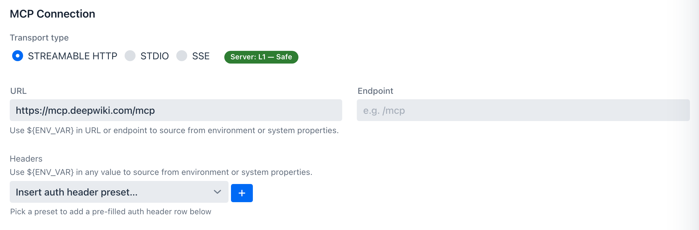
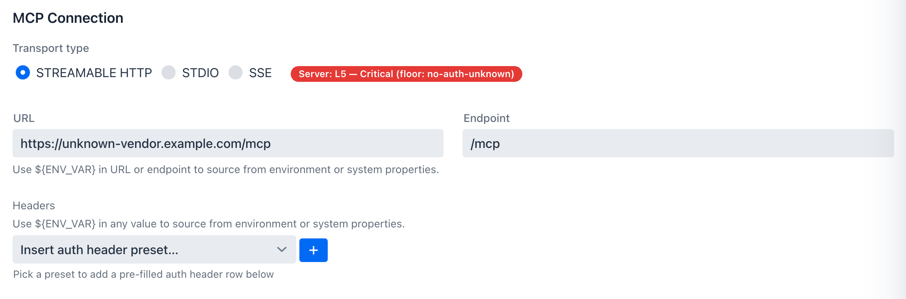

videos: start ep9
description: MCP Server - catalog and manual connections, multi-transport runtime, OAuth 2.1, live connection risk scoring, tool composition, and an Inspector for primitives.

# MCP Server

**Where:** top navigation → **MCP Server**.

The MCP Server screen is where you pick, configure, and inspect a single MCP connection. The **left rail** is a 3-layer sidebar (Built-in / Active / Inactive) under a sticky `MCP Server Connections (N)` header and a shared filter bar. The **right pane** is `MCP Server Info` - a connection form whose content swaps in to match whichever row is selected on the left, without ever leaving the page. The screen serves two audiences at once:

- It validates tools that **Spring AI Playground itself** publishes through the built-in MCP server (always pinned to the top of the sidebar).
- It is the client-side inspection surface for **external MCP servers** - anything you activate from the catalog, or any custom STDIO / HTTP / SSE / OAuth 2.1 server you wire up by hand.
- With a **bearer token** on, the built-in server also offers the `saip_*` [management tools](management-tools.md), through which an external AI does what these screens do (author and publish tools, register and proxy servers, index knowledge, ship servers) with your approval at each destructive step; and the **Shipyard** tab ([below](#shipyard)) ships what passed as a standalone MCP server. [AI Guides, Templates and Samples](ai-guides.md) shows what the built-in server teaches that AI.

## Catalog & Sidebar Filtering { #catalog-sidebar-filtering }

The sidebar splits into three layers from top to bottom under a sticky filter bar:

- **Built-in MCP** - the always-on local server that publishes the tools authored in Tool Studio. Pinned flat at the top, no category group. A colored status dot beside the name reflects the last health check: **green** for OK, **red** for a transport-init or ping error, **gray** for not yet connected. Its connection form is read-only: **Save & Connect** stays disabled and the form reads *"The built-in server connection is managed by the app and cannot be edited here. Use the gear icon for its access settings."*
- **Active MCP (N)** - user-activated remote and stdio servers, grouped per category. Each row shows the matching **category pill**, any **tag pills** (e.g. `COMMUNITY`), and a stability pill (`preview` / `beta`) where applicable. An entry joins this layer as soon as it is saved, even when the connection did not come up (gray dot). Empty by default with the inline hint *"No active MCP yet - activate one from the Inactive MCP list below."*
- **Inactive MCP (N)** - the **58-entry preset catalog** (50 remote + 8 stdio per OS), grouped per category. Rows render as **ghost-style** to stay visually distinct from active connections: italic name, neutral dot, dashed top border, 5 % shade background. Hint text under the section: *"Catalog entries - click an item to activate."*

The sidebar header counter swaps between `(N)` and `(N filtered of M)` depending on whether a filter is active. When no entry matches and the search box has text, an empty-state panel offers a **Clear filters** button.

### Filter bar

Just below the sidebar title sits a three-control filter bar (shared `webui/common/sidebar/SidebarFilterBar` widget) - a **search** input, a **Categories** multi-select (14 catalog categories plus `Custom`), and a **Tags** multi-select (12 cohort labels). The three controls compose AND across groups, OR within a group.

{ width="300" loading=lazy }

For the per-control behavior, full categories/tags vocabulary, AND/OR composition examples, and how the right-pane connection form prefills when you click a row, see [Default MCP Servers → Sidebar filtering and form prefill](../default-mcp-catalog/index.md#sidebar-filtering-and-form-prefill).

### Live status in the sidebar

Each connection in the **Built-in MCP** and **Active MCP** layers carries a colored dot that reflects its last health check: green for OK, gray for offline (not connected), red for a transport-init or ping error. The dot updates as the playground reconnects or re-pings, so a connection that drops mid-session is visible without opening the Inspector; select the row and click **Reconnect** to bring it back once the upstream is reachable again. Catalog entries in the **Inactive** layer render in italics with a neutral dot - they're ghost rows that haven't been connected yet.

### Activate from the catalog

Clicking any **Inactive MCP** entry copies the catalog template into the configuration form on the right pane:

- **transport** - `STREAMABLE_HTTP` (or `SSE` for Asana, PayPal, Square and Webflow) for remote entries, `STDIO` for the per-OS entries
- **URL or command + args** - with `${ENV_VAR}` placeholders for anything secret. STDIO arguments render as one row per argv element so individual values stay editable.
- **OAuth issuer URI + scopes** - pre-filled for OAuth-protected entries
- **category + tag chips** - matching the catalog row
- **inline description** - carrying any prerequisites and a `Docs:` link

For example, clicking **MCP-Everything** under `Example` lands an STDIO row pre-filled with Command `npx`, Arguments `-y` + `@modelcontextprotocol/server-everything`, Category `EXAMPLE`, Tags `community` + `global`, and a description carrying the macOS prereq (Node.js 18+) and the Docker fallback.

The row stays in the Inactive layer until you click **Save & Connect**; on save the row moves into the Active layer under the same category group and the playground spawns the child process. For OAuth entries this records the registration without yet connecting - see [OAuth 2.1 Authorization Code](#oauth-21-authorization-code) below for the **Authorize** click.

For the full per-category browse of the 58 catalog entries, see the [Default MCP Servers directory](../default-mcp-catalog/index.md).

### Add Custom Server

When a server isn't in the catalog, the **Add Custom Server** header CTA opens an empty configuration form. Defaults: `Streamable HTTP` transport, `Custom` category, placeholder URL `http://127.0.0.1:<server-port>`, `/mcp` endpoint, default description `"Please edit the description of the MCP Server."`, and an empty headers preset dropdown.

Three field constraints worth knowing before saving:

- **Server name** - pre-filled to `New MCP Server`. The constraint is `[A-Za-z0-9._-]+` (no spaces) so the persisted JSON file name stays inside the save directory; typing a space surfaces an inline red validation note.
- **Category** - defaults to `CUSTOM`. The combo accepts a typed value to create a new label, or picks from the 15 built-in catalog categories.
- **Tags** - free-form; the chip picker suggests cohort tags already in use across the active list and catalog.

The **Headers** section's **Insert auth header preset...** dropdown drops a templated row (Bearer / Basic / API Key) with `${VAR}` substitution wired in; the **+** button next to it adds a blank row. OAuth 2.1 has its own checkbox-toggled sub-form further down.

### Browse the Default MCP Servers

The 58 catalog entries are documented in their own directory under Features. Use the [Default MCP Servers index](../default-mcp-catalog/index.md) for a full searchable card grid (Category / Tag / Transport chips), or jump directly to a category-cohort sub-page:

| Sub-page | Categories merged | Entries | What lives there |
|---|---|---|---|
| [Productivity & Communication](../default-mcp-catalog/productivity.md) | Productivity + Communication | 8 | Mail, calendar, notes, chat, team messaging - Gmail, Outlook Mail / Calendar, Notion, Slack, Microsoft Teams, Kakao PlayMCP |
| [Dev & Project Management](../default-mcp-catalog/dev.md) | Dev + Project Management | 12 | GitHub, Linear, Atlassian Rovo, Sentry, Asana, Azure DevOps, Microsoft Learn, Context7, Korean Law + stdio: Git, Puppeteer, Playwright |
| [Data & Cloud](../default-mcp-catalog/data-cloud.md) | Storage + Database + Cloud + Public Data | 18 | BigQuery, Neon, Supabase, PlanetScale, Google Cloud (SQL / Spanner / Firestore / Run / Storage), Drive, OneDrive, Cloudflare, Vercel, Netlify, Render, Heroku, KOSIS + stdio SQLite |
| [Business](../default-mcp-catalog/business.md) | Finance + CRM + Design + Utility | 12 | Stripe, PayPal, Square, HubSpot, Intercom, Mixpanel, Figma, Canva, Webflow, Google Maps Grounding + stdio: Memory (Knowledge Graph), Sequential Thinking |
| [Search](../default-mcp-catalog/search.md) | Search | 6 | Tavily, Exa, Firecrawl, Jina AI, SerpAPI + stdio Brave Search |
| [Examples](../default-mcp-catalog/examples.md) | Reference test servers | 2 | MCP Everything (protocol-coverage reference), DeepWiki (free library docs) |

Each sub-page carries the per-entry card grid plus **Workflow combinations**, **Auth & secrets**, and a **Picking guide** decision matrix tuned to that category cohort.

## Connection Management

A connection is created in one of two ways:

1. **From the catalog** - click any **Inactive MCP** entry; the form pre-fills with the catalog template and **Save & Connect** finishes the activation. This is the path for the 58 catalogued vendor surfaces.
2. **From scratch** - click **Add Custom Server**; the form opens with the defaults above. Use this for anything not in the catalog.

The MCP runtime supports multiple transport styles:

- **Streamable HTTP** - the modern single-endpoint transport formalized in the MCP v2025-03-26 specification. Clients POST JSON-RPC requests to `/mcp`, responses stream when supported, session-oriented behavior layers on top. This is the form used by the built-in MCP server and by **46 of the 58** catalog entries (4 remote entries use SSE).
- **STDIO** - JSON-RPC over the spawned process's stdin/stdout. The form exposes **Command** + **Args** + **Env** fields; the catalog ships **8 stdio entries** in OS-specific variants (macOS / Linux use `npx` or `uvx`; Windows uses `npx.cmd`) and the sidebar picks the variant matching the host OS so the pre-filled command saves without editing.
- **Legacy HTTP plus SSE** - kept for compatibility with older external MCP integrations; the form exposes a separate **SSE Endpoint** field.

### Test Connection without disturbing live clients

The config form has a **Test Connection** button next to **Save & Connect**. It spins up a transient sync MCP client, runs `initialize` and a one-shot `listTools`, then disposes the client - without touching the running connection map. Use it to validate a config change against a remote server before saving, which would otherwise replace the live client and might briefly drop tool availability in chat.

### Reconnect a saved server

A saved server also shows a **Reconnect** button in the same row (never the built-in server, never an unsaved form). It starts the saved connection again without editing it and re-syncs the tools that server contributes to the built-in server, the same step an AI takes with `saip_mcp_reconnect`. Use it when the sidebar dot turned red or gray because the upstream was down when the playground started, or after you set a missing environment variable and restarted. The notification tells the outcome: the tool count on success, the connection error, the missing variables, or that OAuth authorization is still pending. The sidebar dot and the Inspector below refresh with it.

### Custom HTTP headers and `${ENV_VAR}` substitution { #custom-http-headers-and-env_var-substitution }

HTTP and SSE connections both expose a single **Headers** section in the config form, edited as key/value rows. The same row layout drives the auth-preset dropdown - picking **Authorization (Bearer Token)**, **Authorization (Basic Auth)**, or **API Key Header** inserts a templated row whose value you fill in. Picking a preset fills the first empty row if one exists, otherwise appends a new row. OAuth 2.1 servers use a dedicated checkbox-toggled sub-form covered in the next section.

{ loading=lazy }

STDIO connections' **Env** section uses the same add/delete row UI - the **+** button next to the section header adds a blank row, and each row's trash button removes it.

Header values, STDIO `env` values, and any name listed in `requiredEnv` accept `${VAR}` placeholders that resolve from the OS environment at connect time (with a JVM system-property fallback). The persisted JSON stores the placeholder string literally; the actual value only enters memory when the connection is brought up. A missing reference throws at connect time instead of silently sending an empty header.

Connection-error notifications and per-call invocation logs are swept by the `SecretMasking` filter - any string that matches a resolved `${VAR}` value is replaced with `***` before the UI renders it. See [Safety Architecture → Secret masking](../../safety-architecture.md#secret-masking) for the full pipeline.

## OAuth 2.1 Authorization Code

For servers that expect an OAuth dance instead of a static token (Notion, Linear, Atlassian Rovo, the Workspace catalog entries, ...) the form exposes a dedicated **OAuth 2.1 Authorization Code** sub-form. Open it by ticking the **Use OAuth 2.1 authorization** checkbox on the form. Unticking it drops the OAuth block from the persisted config entirely.

??? note "OAuth details"

    { loading=lazy }

    The sub-form has five fields plus an Advanced group:

    - **Client ID** *(required)* - accepts a `${ENV_VAR}` placeholder so client IDs don't end up in the persisted JSON.
    - **Issuer URI** - alone enough for OIDC discovery via `.well-known` to auto-resolve the authorization and token endpoints. Most providers need nothing more than this.
    - **Scopes** - comma-separated (e.g. `read, write`). Leave blank to inherit the issuer's defaults.
    - **Advanced** *(collapsible)* - discloses manual `authorization_uri` / `token_uri` / `client_secret` / client auth method overrides for non-OIDC providers.
    - **Redirect URI** - the callback the playground will listen on, displayed read-only so you can register the exact value on the issuer side.
    - **Authorize** - stays disabled until you click **Save & Connect** to record the registration; clicking it then opens your system browser to the consent screen.

    The flow has three observable states:

    - **Configured** - Save & Connect persists the OAuth registration but does not connect yet (no token).
    - **AWAITING_AUTHORIZATION** - clicking **Authorize** opens the system browser to the issuer's consent screen and the connection sits in this state until the redirect lands. The Home dashboard surfaces a counter so half-finished authorizations don't get lost.
    - **Connected** - once the redirect completes, the playground exchanges the code for tokens and the connection comes up like any other.

    Tokens are kept in an encrypted file store under `${user.home}/spring-ai-playground/mcp/oauth-tokens/`. The encryption key is derived from a per-install salt plus the host's `user.home`, so copying the directory to another machine doesn't disclose tokens to that host. Refresh is transparent - once you authorize, the playground keeps the connection live across restarts as long as the issuer accepts the refresh.

    !!! tip "Use `${ENV_VAR}` for client secrets"
        The OAuth sub-form's **Client secret** field accepts placeholders the same way header values do. Storing `${SOME_OAUTH_CLIENT_SECRET}` in the form keeps the secret out of the persisted JSON; the actual value is read from the OS environment at connect time.

## Connection risk preview { #connection-risk-preview }

Every server config form carries a live **risk chip** beside the transport selector. It recomputes as you edit - pick a catalog entry or type a URL, and the chip updates before you ever click **Save & Connect**. The chip reflects the [MCP server risk rubric](../../mcp-server-safety.md): four axes (transport, auth, trust, documentation) bucketed into `L0`-`L5`, with three floor rules that jump straight to **L5 - Critical**.

{ loading=lazy }

The chip sits beside the transport selector. A vendor-official catalog entry over HTTPS computes low:

{ loading=lazy }

Typing an unknown public URL with no auth trips the `no-auth-unknown` floor and the chip turns red - a prompt to add auth or re-check the host before connecting:

{ loading=lazy }

The built-in `spring-ai-playground` server is the one exception - it shows **L0 - Verified**, since the risk model is bypassed for the self-loopback server. For the axis-by-axis scoring, floor conditions, the description poisoning scan, and the fingerprint ledger, see [MCP Server Safety](../../mcp-server-safety.md).

## MCP Inspector

Once a connection is up, the **MCP Inspector** is where you exercise every primitive the server (or your client) exposes, isolated from chat. The eight tabs split into **server primitives** (Tools, Resources, Prompts, Ping, Notifications) and **client primitives** (Roots, Sampling, Elicitation - inverted: the *server* asks the playground to act as the client).

See the [MCP Inspector sub-page](inspector.md) for the full per-tab walkthrough, including the `InlineResultPanel` request/response/raw-toggle behavior, JSON-Schema-typed input controls, and how to verify push notifications and OAuth-protected reads end-to-end.

## Expose external tools - the MCP Server Proxy { #expose-external-tools }

The **gear icon** on the MCP Server Info header opens the **Built-in MCP Server** drawer. Its **Authentication** section switches the built-in server between **None** and **Bearer token** (reveal, Generate, Copy; applied without a restart - see [Require a bearer token](../../getting-started/external-connections.md#bearer-token)). Its **Composed Tools** section **re-publishes selected tools from your external connections through the built-in server** (`spring-ai-playground-built-in-mcp`) - so they're callable from Agentic Chat *and* external `/mcp` clients, each wrapped with a risk level, optional HITL approval, logging, and secret masking.

This is the **MCP Server Proxy**. Its [dedicated page](proxy.md) covers the full walkthrough - the per-composition risk cap, per-tool HITL and alias/description overrides, the safe-wrapping contract, the poisoning/shadowing guards, and how external clients reach the proxied tools.

## Ship tools as a standalone server - Shipyard { #shipyard }

!!! info "The architecture behind this section"
    [Shipyard Architecture](../../shipyard-architecture.md) describes the bundle contract, the three contributions that write it, what the container checks before it serves, and how **Out of date** is computed. This section is the operator's view of the same thing.

??? note "How shipping works"

    The **Shipyard** tab composes Local Pass tools from Tool Studio into a **self-contained MCP server bundle**: a `saip-bundle.json` manifest, the tool subset it needs, plus a `Dockerfile` with its `.dockerignore`, `compose.yaml`, `README.md` and a starter `server.json` for the official MCP Registry. The bundle is written under `<home>/mcp/bundles/<name>/` and is yours to build, run and publish anywhere.

    Open it from the Shipyard tab, or use **Ship MCP Server** in the header of **Tool Studio** (preselects the tool that is open), **MCP Server** (preselects the tools the built-in server exposes right now) or the **Ship** button in the Pipeline Studio summary bar (preselects that pipeline as a knowledge source and carries your last test question into the Try panel).

    Knowledge tools search a frozen snapshot of the documents and vectors a RAG pipeline or document had when the server was shipped. In the ship flow, expand a knowledge row to rename it, set its default `top_k` and **Try** a search; the excerpts are exactly what the shipped `search_` tool returns. On a running server the **Tools** tab has a **Try** button per tool that calls it through the container. When documents are re-embedded, deleted or added after shipping, the **Out of date** banner sums it up per tool ("1 re-embedded, 1 deleted, 1 added") and **Review changes** opens the Knowledge tab, where each document carries its status and the vector dump size is shown.

    Every server can also be declared in configuration or environment variables instead of the UI; the app writes those bundles at startup and marks them **Managed by configuration**. A declared server that could not be exported, for example because a named tool does not exist yet, stays in the sidebar with the reason, and `auto-run` starts a declared server right after its bundle is written. The Docker binary and the base image are configurable too. See [Configuration -> Shipyard](../../getting-started/configuration.md#shipyard).

    **Docker is required only to run a bundle from inside the app.** Everything else works without it:

    | Step | Needs Docker |
    |------|--------------|
    | Compose tools, name the server, **Ship** the bundle | no |
    | Inspect the Tools / Publish / Files tabs, copy the registry commands | no |
    | Publish the image and the `server.json` to the MCP Registry | no, you run those commands yourself |
    | **Run**, and the Test connection / Add to this app / Logs / Stop actions that follow it | yes |

    When the Docker CLI is missing, the server page says so in its status chip and disables the primary action, pointing at the bundle's `README.md` for the equivalent manual commands. When the Docker engine of the server's target is down, the chip says so and the run dialog lets you pick another target. The app looks for the `docker` binary on `PATH` first and falls back to the standard Docker Desktop install locations, so a packaged desktop app still finds it when it is launched without a login shell.

    **What goes in.** The ship flow shows one table of every tool the server will expose, exactly as MCP clients will see it: its kind (**Tool**, **Built-in**, **Proxied** or **Knowledge**), name, description and risk. Add to it with **+ Your tools** (Local Pass tools from Tool Studio), **+ Built-in** and **+ Proxied**, and remove a row with its close button. Two tools with the same name block shipping, whatever their kinds. The preview on the right lists what the server **needs at run time**: models, upstream servers and environment variables.

    **Proxied tools.** A server can also carry external tools composed in the [MCP Server Proxy](proxy.md) drawer. **+ Proxied** lists the current composition; each added tool keeps its alias, description override and HITL flag, and the bundle copies the connection file of every upstream those tools need into `home/mcp/save/`. The container connects to those upstreams on start and re-publishes their tools under the same risk cap. A shipped server speaks Streamable HTTP and stdio, but its upstreams must be Streamable HTTP, so shipping is blocked for stdio and SSE upstreams, OAuth upstreams (their tokens stay on this machine), and literal secrets in an upstream's headers or URL; `${ENV_VAR}` references become required environment variables like a tool's.

    **Where it runs - targets.** A server runs on a **target**: a Docker engine. `local` is built in and is the Docker this machine's CLI uses. **Targets** in the Shipyard header lists the others and adds remote ones: give a name and a Docker host (`ssh://user@host` or `tcp://host:2376`, the same value as `DOCKER_HOST`), and optionally the public host clients should connect to. Docker contexts with a remote endpoint appear on their own, and targets can be declared in configuration. The app stores no keys; `ssh://` goes through your ssh-agent and `~/.ssh/config`, and TLS stays in the docker context.

    The run dialog picks the target, checks that its Docker answers, and shows what changes there: the bundle folder is sent as build context and the image is built on that engine, which must be able to pull the base image; `host.docker.internal` means that machine, so an Ollama model is looked up there, and a proxied upstream at `localhost` or `127.0.0.1` is written into the bundle as `host.docker.internal`, because inside the container `localhost` would be the container itself. The dialog names each such upstream. A server on a remote target must require a bearer token, because its port is published on that host; the dialog generates one. The token and the container's Ollama endpoint can also come from this app's configuration (`SAIP_MCP_AUTH_TOKEN`, `SAIP_OLLAMA_BASE_URL`); the dialog then shows them read-only. Each server remembers the target it last ran on, and its status, Stop, Logs, connection snippets, deep links, Test connection and Add to this app all use that target's address. Kubernetes is planned as another kind of target.

    **Knowledge.** A server can also search a snapshot of your RAG sources. **+ Knowledge** lists the same sources Agentic Chat can pick, pipelines and documents alike, and **Suggest** picks a set for you: one tool per pipeline that scopes documents, plus the all-documents pipeline (or the documents themselves) for what no pipeline covers, with unique names you can still edit; each one ships as a retrieval-only tool named `search_<source>` (editable, with its description and default `top_k`) that takes `query` and an optional `top_k` (1-20) and returns the most relevant excerpts with their source document and similarity score, as text and as structured content. The bundle carries the pipeline frozen as configured, the documents' chunks and their vectors, so the server needs no re-indexing; it does need the embedding model that indexed them, which Shipyard derives from this app and shows under **Needs at run time** (an Ollama model is reached through `host.docker.internal` like a chat model). A pipeline with LLM stages before retrieval (rewrite, translate, multi-query) also needs the chat model chosen under Advanced. The snapshot is honest: editing a pipeline or re-indexing a document marks the server **Out of date**, and the server page's **Knowledge** tab lists what each tool searches.

    **How a shipped server runs.** There is one image per server, `saip-mcp/<name>:<version>`, built from the bundle on top of the base image. **Run**, the stdio snippet and the image you publish are all that same image, so what you tested is what you ship. The image carries the app's screens too, and a shipped server keeps them on: open `http://<host>:<port>/` to look at a running server's Inspector, tools and logs in a browser. Set `SPRING_AI_PLAYGROUND_UI_ENABLED=false` in the container's environment for a headless server that answers only MCP and the actuator endpoints. Over stdio the server answers the client's first request only after every tool is registered, and it exits when the client closes its stdin. Over HTTP, `/mcp` answers `503` with a `Retry-After` header until then, so a client never sees a tool that is not in the bundle. The bundle is copied into the image under `/opt/saip-bundle` and every start serves a fresh copy of it: a run never writes into the bundle, and the manifest's file hashes are checked on every start.

    A problem inside the bundle or its configuration stops the server from starting: a changed file, a missing required environment variable, or a model provider or model name other than the one the bundle was built with. A problem outside it does not. When an upstream server or a model endpoint is unreachable, the server starts, the tools that need it stay unavailable, and the connection is retried every 30 seconds. Proxied tools of an unreachable upstream are withdrawn from `tools/list` until it answers again, so clients never see a tool they cannot call. The server page shows it in the status chip (**Running on :18282 · 1 unavailable**) and lists which tools are affected. An Ollama model is reached through `host.docker.internal`, and the run dialog checks that Ollama answers and that the model is pulled before you start (on a remote target it tries the target's address and otherwise leaves the check to the running server). The container never pulls a model itself; a missing model is reported as unavailable until you pull it.

    **Out of date.** A bundle is a snapshot. When a tool it ships is edited or deleted in Tool Studio, or an upstream connection it copied changes, the server page shows **Out of date** with the sources that changed and a **Rebuild** button. A server declared in configuration is rebuilt on the next start instead. Stop the container first: while it runs the banner says so and Rebuild stays disabled, **Delete** refuses, and Delete asks for confirmation.

## Getting Started With MCP

1. **Pick a server** - open the sidebar's **Inactive MCP** section and click a catalog entry, or click **Add Custom Server** for anything not in the catalog. See the [Default MCP Servers directory](../default-mcp-catalog/index.md) for the full per-category browse.
2. **Fill the connection form** - for catalog rows the form is pre-filled; supply only the local bits (API key via `${VAR}` placeholders, tenant ID, OAuth Authorize click). For custom rows, type the URL or command + auth. Watch the **[risk chip](#connection-risk-preview)** beside the transport selector - it scores the connection live before you save.
3. **Validate before saving** - click **Test Connection** to spin up a transient client and confirm `initialize` + one-shot `listTools` work without touching the running connection map.
4. **Save & Connect** - the row moves into the **Active MCP** sidebar layer; the status dot turns green when the playground gets a successful ping.
5. **For OAuth-protected servers** - complete the **Authorize** browser handoff once; the AWAITING_AUTHORIZATION counter on Home tracks half-finished flows.
6. **Inspect the live connection** - exercise tools, resources, prompts, ping, notifications, roots, sampling, elicitation in the [MCP Inspector](inspector.md).
7. **(Optional) Expose its tools on the built-in server** - open the **[Composed Tools](#expose-external-tools)** gear drawer to merge selected upstream tools into `spring-ai-playground-built-in-mcp`, with a per-composition risk cap and per-tool HITL.
8. **Use it from chat** - the validated connection is now available to Agentic Chat as a tool / resource source.

## Relationship to Tool Studio

Tool Studio and MCP Server are designed to work together:

- Tool Studio creates or updates a tool
- The built-in MCP server exposes it (visible as the **Built-in MCP** row at the top of the sidebar)
- MCP Inspector verifies the contract and runtime behavior
- Agentic Chat consumes the validated connection

This is one of the cleanest parts of the overall product flow.

The two surfaces also **share a sidebar widget**. The MCP Server view and Tool Studio's tool list both render through `webui/common/sidebar/SidebarFilterBar` (search + Categories MultiSelect + Tags MultiSelect) + `CategoryGroupDetails` (collapsible per-category groups) + `SidebarItemLayout` (status dot · name · category pill · tag pills). Filters compose identically on both screens - see [Tool Studio](../tool-studio/index.md) for the same widget in its tool-authoring context.
