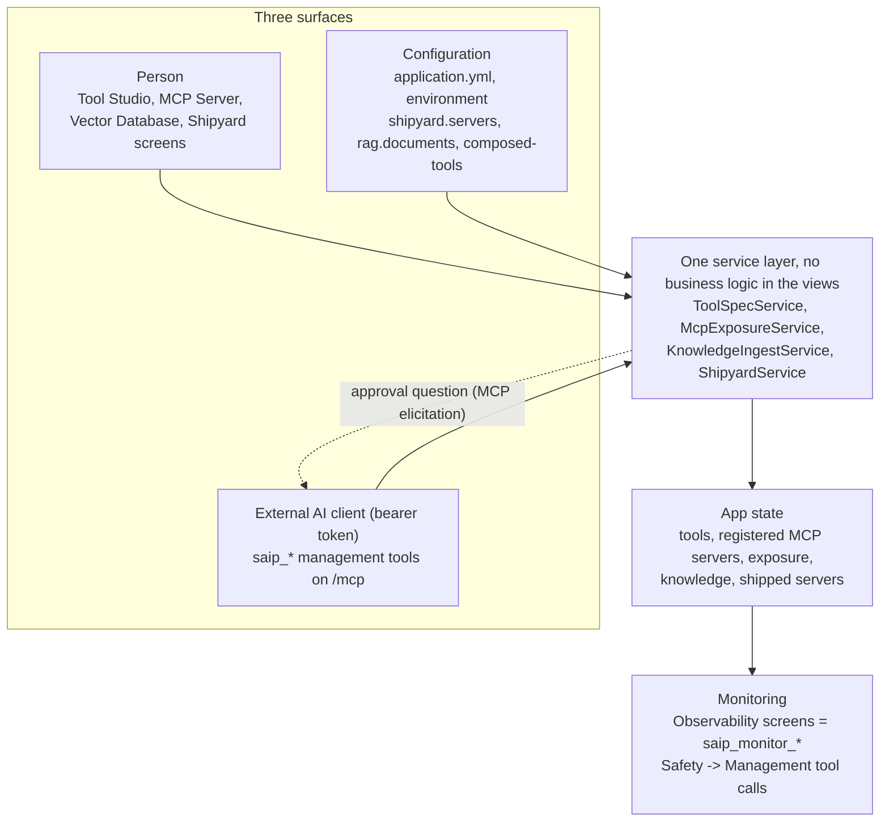

# Management MCP Tools

**Where:** the built-in MCP server (`/mcp`), for clients that present its bearer token. Status: **MCP Server -> gear icon -> AI management**. Audit trail: **Observability -> Safety -> Management tool calls**.

The app can be operated by an AI, not only by a person. Next to your own tools, the built-in MCP server offers **management tools**, named `saip_<area>_<verb>`. An external AI client (Claude Desktop, Cursor, your own agent) uses them to do what you do on the screens: write and publish a tool in [Tool Studio](../tool-studio/index.md), pick tools of the MCP servers you registered in the [Composed Tools drawer](proxy.md) and decide which need a human to approve each call, index documents and build RAG pipelines, and ship all of it as a standalone MCP server from [Shipyard](index.md#shipyard). There is no REST API; the tools call the same services the screens call, so what the AI sets up is what you see when you open the screens.



One rule holds the three surfaces together: a button on a screen, a service method, a management tool and a configuration key are the same operation. A tool an AI publishes appears in Tool Studio as if you had written it, a knowledge server declared in `application.yml` shows up on the Shipyard page and in `saip_shipyard_list_servers`, and every one of them lands in the same Observability screens.

## Turning it on

Management tools are offered only when the built-in server **requires a bearer token** ([MCP Server -> gear -> Authentication](../../getting-started/external-connections.md#bearer-token) or `spring.ai.playground.mcp-server.auth-token`). Without a token anyone who reaches the port could manage the app, so the tools are not registered at all. They are also not offered inside a shipped server bundle or in stdio mode. The drawer shows the current state and, when off, the reason.

They are never visible to this app's own Agentic Chat: chat only sees your own tools. The MCP Inspector can call them, so you can try them by hand: a call that needs approval shows the question on the running card with **Accept** / **Decline** and the [approval wait](../human-in-the-loop.md#wait) countdown, exactly as an external client would receive it. [Tutorial 18](../../tutorials/18-ai-authors-a-tool.md) walks through the `tools` area that way.

## What the AI reads first { #guides }

The AI does not need this site. The app serves its own guides as MCP resources, compressed from the pages a person reads and versioned with the app, so a client connected to an older build gets the rules of that build. A client reads them with `resources/read` before it calls a tool. The tutorials name the guide in their first prompt, which is the reliable path: a model reads a resource when it is told to, not on its own.

| Area | Guide | Prompt that starts it |
|---|---|---|
| `tools` | `saip://guide/tool-authoring` with `/runtime`, `/sandbox`, `/testing`, `/mistakes`, `/examples` and `saip://examples/{name}` | `saip_create_tool` |
| `mcp`, `expose` | `saip://guide/proxy`, `saip://guide/risk-levels` | `saip_proxy_server` |
| `knowledge` | `saip://guide/knowledge` | `saip_knowledge_server` |
| `shipyard` | `saip://guide/shipyard` | `saip_shipyard_server` |

A guide sits one layer above the tools: each management tool does one step, and the guide is the procedure that strings several of them together, the same role an [Agent Skill](https://www.anthropic.com/engineering/equipping-agents-for-the-real-world-with-agent-skills) plays above the tools a host can call. It also follows the same progressive disclosure: a short overview points to narrower resources, so the AI reads only the part it needs. `saip_create_tool` returns its guide as an embedded resource; the other three prompts tell the AI to read their guide first. What the app builds, tests and ships are tools; the guides only teach an AI to operate the app. [AI Operations Architecture](../../ai-operations-architecture.md#guides) lists which component serves which guide, and [AI Guides, Templates and Samples](ai-guides.md) shows the full text of every guide, the four prompts and the example tools, with how to read them yourself in the Inspector or with curl.

## Tool areas

| Category | Tools | Default |
|---|---|---|
| `tools` | `saip_tools_list`, `saip_tools_get`, `saip_tools_check_risk`, `saip_tools_save_draft`, `saip_tools_test`, `saip_tools_publish`, `saip_tools_delete`, `saip_tools_get_exposure`, `saip_tools_set_exposure` | on |
| `mcp` | `saip_mcp_list_servers`, `saip_mcp_catalog_search`, `saip_mcp_preview_risk`, `saip_mcp_server_tools` | on |
| `expose` | `saip_expose_get`, `saip_expose_preview`, `saip_expose_add_tools`, `saip_expose_remove_tools`, `saip_expose_set_hitl`, `saip_expose_apply` | on |
| `monitor` | `saip_monitor_overview`, `saip_monitor_mcp_status`, `saip_monitor_tool_calls`, `saip_monitor_proxied_calls`, `saip_monitor_risk_events`, `saip_monitor_hitl`, `saip_monitor_management_log`, `saip_monitor_traces`, `saip_monitor_trace_get`, `saip_monitor_system`, `saip_monitor_logs_tail` | on |
| `mcp-register` | `saip_mcp_test_connection`, `saip_mcp_add_from_catalog`, `saip_mcp_add_custom`, `saip_mcp_remove_server`, `saip_mcp_reconnect` | **off** |
| `shipyard` | `saip_shipyard_list_servers`, `saip_shipyard_list_shippable`, `saip_shipyard_validate`, `saip_shipyard_ship`, `saip_shipyard_run`, `saip_shipyard_stop`, `saip_shipyard_status`, `saip_shipyard_logs`, `saip_shipyard_delete`, `saip_shipyard_targets` | on |
| `knowledge` | `saip_knowledge_list_documents`, `saip_knowledge_ingest_document`, `saip_knowledge_delete_document`, `saip_knowledge_list_pipelines`, `saip_knowledge_apply_pipeline`, `saip_knowledge_delete_pipeline`, `saip_knowledge_search`, `saip_knowledge_suggest_tools`, `saip_knowledge_status` | on |
| `chat` | `saip_chat_ask`, `saip_chat_list_conversations` | on |

??? note "All areas and tools"

    Servers are registered by people in the app. The `mcp-register` group lets an AI register and remove servers too; switch it on with `spring.ai.playground.management.tools` only when you want that.

    The tools return structured results with `ok`, `message`, `persisted`, `restartRequired`, `warnings` and a `data` object, and every tool carries the MCP hints `readOnlyHint` and `destructiveHint` so a client can show the right warning.

## What an AI does

### Writing a tool

The `tools` tools let an AI do what a person does in [Tool Studio](../tool-studio/index.md), under the same rules: a tool is a draft until it earns its Local Pass, and only a published tool can be offered to MCP clients.

1. `saip_tools_list` shows the existing tools (custom ones by default, `scope` `BUILTIN` or `ALL` for the bundled catalog) with state, risk level and exposure, so a name is not taken twice; `saip_tools_get` returns one tool completely, including the code of a bundled tool to copy from.
2. `saip_tools_check_risk` previews the risk level of a `sandbox` setting before anything is saved: the level, each setting that raises it, a cheaper alternative, and whether a test or publish would need a person. It can also scan a piece of code for capabilities the sandbox does not grant.
3. `saip_tools_save_draft` saves the tool: `name`, `description`, `params` (each with a `testValue`), `staticVariables` (secrets only as `${ENV_NAME}` references), `code`, `category`, `tags`, `sandbox` and `humanApproval`. Drafts are private: they are not offered to MCP clients and cannot be called.
4. `saip_tools_test` runs a draft, or an unsaved definition passed as a nested object, once in the sandbox with the test values and returns the result, the error, the console output and hints for the failure. This is the Local Pass that publishing requires.
5. `saip_tools_publish` tests the draft again and, only when that passes, makes it a live tool after approval. Publishing never changes the exposure settings; the result says whether the tool became visible.
6. `saip_tools_get_exposure` and `saip_tools_set_exposure` show and change which tools the built-in server offers to clients and whether newly published tools are exposed automatically. Only the tools named in `expose` or `stopExposing` change; drafts cannot be exposed.
7. `saip_tools_delete` removes a custom tool or draft. Bundled catalog tools cannot be deleted.

The [guide](#guides) for this area is `saip://guide/tool-authoring`, the procedure, with `saip://guide/tool-authoring/runtime` (the helpers the code can use, `fetch`, `safety.fs` and the rest), `/sandbox` (this app's baseline and the risk levels), `/testing` (the Local Pass, publishing and exposure) and `/mistakes` (frequent failures and their fix). `saip://guide/tool-authoring/examples` lists bundled tools that passed their Local Pass, and `saip://examples/{name}` returns one of them completely. The prompt `saip_create_tool` starts the procedure. The guides are a compressed form of the [Safe Tool Specification](../../safe-tool-specification.md) and the Tool Studio page, which remain the reference.

### Exposing the tools of registered servers

1. `saip_mcp_list_servers` and `saip_mcp_server_tools` show the registered servers and, per tool, its risk level, the description scan result and whether it is exposed.
2. `saip_expose_preview` is a dry run: what would be added, updated or removed and every reason a change would be refused.
3. `saip_expose_add_tools` applies it. One call can combine several servers:

```json
{ "selections": [
    { "server": "DeepWiki",
      "tools": ["read_wiki_structure", {"name": "read_wiki_contents", "alias": "wiki_read", "hitl": true}],
      "hitl": {"default": "ALL", "except": ["read_wiki_structure"]} },
    { "server": "GitHub", "tools": "all",
      "hitl": {"default": "RISK", "atLeast": "L3"} } ] }
```

- `tools` is `"all"`, a list of names, or objects with `name`, `alias`, `description` and `hitl` for per-tool settings.
- `hitl.default` is `ALL` (every tool needs approval, also the default when `hitl` is left out), `NONE`, or `RISK` (only tools at or above `atLeast`). `except` lists the tools that get the opposite.
- The whole call is applied or refused together.

`saip_expose_remove_tools`, `saip_expose_set_hitl` and `saip_expose_apply` (replace the whole set) take the same `selections`.

The [guides](#guides) for this area are `saip://guide/proxy` and `saip://guide/risk-levels`, started by the prompt `saip_proxy_server`.

### Shipping an MCP server

The `shipyard` tools let an AI do what the [Shipyard](index.md#shipyard) page does: `saip_shipyard_list_shippable` shows the tested Tool Studio tools, the exposed proxied tools, the knowledge sources and the models; `saip_shipyard_validate` is the dry run of a ship request (the same fields as `spring.ai.playground.shipyard.servers`: `name`, `tools`, `composedTools`, `knowledge`, `chatModel`, `transport`, `hostPort`); `saip_shipyard_ship` writes the bundle without a question under the default approval mode, because a bundle on disk serves nothing yet; `saip_shipyard_run` builds and starts the container on a target after you approve the docker command its question quotes; `saip_shipyard_status` returns the state, unavailable dependencies and the connection snippets. Bearer tokens never pass through these tools; the person reads them in the app. The [guide](#guides) is `saip://guide/shipyard`, started by the prompt `saip_shipyard_server`.

### Building the knowledge behind a search tool

The `knowledge` tools cover the steps before shipping a knowledge server: `saip_knowledge_ingest_document` takes the same record as `spring.ai.playground.rag.documents` (`source` with `path`, `url` or `text`, `title`, `extract`, `split`, `enrich`) and embeds the document, reporting MCP progress notifications per stage and per enriched chunk when the call carries a `progressToken`; `saip_knowledge_apply_pipeline` takes the `rag.pipelines` record and creates or updates a RAG pipeline by name; `saip_knowledge_search` runs a search exactly as a shipped `search_` tool would, so what the AI checked is what ships; `saip_knowledge_suggest_tools` proposes the knowledge list of a server from what is indexed (one `search_` tool per scoped pipeline, the all-documents pipeline or single documents for what no pipeline covers), the same proposal as the Suggest button of the Shipyard knowledge picker; `saip_knowledge_status` says which shipped knowledge servers went out of date. Documents and pipelines declared in configuration are read-only here. The [guide](#guides) `saip://guide/knowledge` carries the procedure, reader and chunking guidance and the threshold ranges; its prompt `saip_knowledge_server` ends in the `saip_shipyard_*` tools.

### Asking the app's chat

`saip_chat_ask` runs one turn of [Agentic Chat](../agentic-chat/index.md) without the screen and returns the answer, so an external agent can use this app as a sub-agent that has the local model, the tools and the knowledge configured here. The turn is a real conversation: it appears in the chat history with the same process details (tools, RAG, thinking) as a turn typed in the app, and it is traced like one. `prompt` is required; `conversationId` continues an existing conversation (`saip_chat_list_conversations` lists them, newest first), otherwise a new one starts from the app's default preset. For a new conversation `model` picks a downloaded chat model. `tools` names the published or exposed tools the turn may call and `ragSourceId` is a pipeline id or `doc:<documentId>`; a new conversation gets no tools unless they are named, and an existing one keeps its own unless `tools` or `ragSourceId` is given. `timeoutSeconds` bounds the wait (300 by default, 1800 at most).

A tool the turn calls that needs human approval asks **the person at the AI client** through MCP elicitation, with the same wording and [approval wait](../human-in-the-loop.md#wait) as the other management approvals; a client that cannot ask gets the tool declined, never run. The management tools themselves are never available to the turn, so a chat turn cannot call `saip_chat_ask` again.

### Watching the app

The `monitor` tools read what the [Observability](../observability/index.md) screen shows. `saip_monitor_overview` is a one-page summary of a time window; `saip_monitor_tool_calls`, `saip_monitor_proxied_calls`, `saip_monitor_hitl` and `saip_monitor_risk_events` are its panels; `saip_monitor_traces` and `saip_monitor_trace_get` list the recent request traces of Agentic Chat and the Inspector and the spans of one of them; `saip_monitor_system` reports memory, CPU, threads, disk and HTTP; `saip_monitor_logs_tail` returns the end of the app log, filtered by level or text; `saip_monitor_management_log` is the audit trail of these tools themselves. Every list takes a `limit` and says when it was truncated, and secrets in log lines and spans are masked.

For a shipped server, `saip_shipyard_status` adds what Docker reports about the container (status, start and exit time, exit code, restart count, health check) and `saip_shipyard_logs` takes the same `level` and `text` filters as `saip_monitor_logs_tail`, applied to the requested tail.

Three resources mirror the read-only views as JSON and are read fresh on every read, so an agent can poll them instead of calling a tool: `saip://status/servers` (the registered MCP servers and their connection state), `saip://status/exposure` (the exposed tools, their HITL and fingerprint status) and `saip://status/shipyard` (the shipped servers and their containers).

## Connecting an AI client

Any MCP client that supports **elicitation**, the request a server uses to ask the person a question, can operate the app. Register the built-in server with the bearer token in the `Authorization` header; the management tools appear in the client's tool list next to your own tools.

| Client | Where the server goes | Approval question | Notes |
|---|---|---|---|
| ChatGPT desktop app (Codex) | `~/.codex/config.toml`: `[mcp_servers.playground]` with `url`, `http_headers = { Authorization = "Bearer ..." }` | A card at the bottom of the chat: the question, a **Run this call** checkbox that is already ticked, then **Deny** and **Accept**. **Accept** runs it; unticking the box or **Deny** refuses | Set `tool_timeout_sec = 200`: Codex cancels a tool call after 60 s by default, shorter than the 180 s approval wait. Read on start; new tools show up in a new chat |
| Claude Code | `claude mcp add --transport http playground <url> --header "Authorization: Bearer ..."`, or `.mcp.json` | In the terminal, in an interactive session: **Approval** already set to **Run this call**, above **Accept** and **Decline**. Return moves to **Accept** and Return again runs it; **Decline** refuses, and Backspace unsets the choice so Accept is held back | Headless `claude -p` has nobody to ask and cancels the question; the server records a decline |
| Claude Desktop, Cursor | Their connector or `mcp.json` settings with the same URL and header | Their own approval dialog | Both support elicitation |
| The app's MCP Inspector | Nothing to configure | The **Elicitation** tab and the running card, with a countdown | Sends a `progressToken`, so the wait is visible as progress too |

A client without elicitation support is refused, never silently granted: the call ends with `it needs human approval and this client cannot ask for it (no elicitation support)`.

## Approval

Each tool has an approval level, and the AI client asks its user before a tool runs, using MCP elicitation.

??? note "Approval levels and rules"

    | Level | Tools | `approval=destructive` (default) | `all` | `none` |
    |---|---|---|---|---|
    | Read | every `list`, `get`, `preview`, `check_risk`, `get_exposure`, `server_tools`, `catalog_search`, `saip_monitor_*`, `saip_knowledge_search`, `saip_knowledge_suggest_tools`, `saip_knowledge_status`, and `saip_shipyard_validate`, `status`, `logs`, `targets` | never asks | never asks | never asks |
    | Write | `saip_tools_save_draft`, `saip_tools_test`, `saip_mcp_test_connection`, `saip_mcp_reconnect`, `saip_knowledge_ingest_document`, `saip_knowledge_apply_pipeline`, `saip_shipyard_ship`, `saip_shipyard_stop`, `saip_chat_ask` | never asks | asks | never asks |
    | Destructive | `saip_tools_publish`, `saip_tools_delete`, `saip_tools_set_exposure`, `saip_expose_add_tools`, `remove_tools`, `set_hitl`, `apply`, `saip_mcp_add_*`, `saip_mcp_remove_server`, `saip_knowledge_delete_document`, `saip_knowledge_delete_pipeline`, `saip_shipyard_run`, `saip_shipyard_delete` | asks | asks | never asks |

    The question names the client and lists what will change: which tools are added, updated or removed, their risk, and separately **the tools that will have no human approval**. The question ends with `Answer within 180 s, or the call is refused.` (the [approval wait](../human-in-the-loop.md#wait)), and a client that sent a `progressToken` with the call gets `Waiting for approval: N s left` progress notifications every 10 seconds while the question is open. A client that cannot ask is refused, and so is a request the person declines. Actions rated L4 or higher (a high-risk server, a high-risk tool) always ask, and are refused when `approval` is `none`. Testing or publishing a tool whose sandbox is above this app's baseline (risk L4 or L5, or extra Java classes) is such an action: the question says which setting raised the level.

## Rules that can refuse a change

- **Local Pass.** A tool is published only after it ran successfully once in the sandbox with its test values; a failing test leaves the draft as it is.
- **Tool names.** A tool name takes letters, digits and `_`, starts with a letter, must not start with `saip_` and must not reuse the name of another tool or of a bundled default tool.
- **Published tools are replaced, not edited.** `saip_tools_save_draft` with the name of a published tool is refused (`'x' is already published and is not changed here. Save the new version as a draft under another name, publish it, then delete the old tool with saip_tools_delete.`), so a new version always goes through its own test, publish approval and delete approval.
- **Risk cap.** A tool whose inherent risk is above the cap is refused. HITL does not lift the cap.
- **Changed definitions.** A tool whose description or schema changed since you last approved it is refused until the AI lists it in `acknowledgeChanged`. The Composed Tools drawer asks the same of a person: the row shows **Definition changed** and the tool stays withheld until **Accept new definition** is ticked. Nothing re-approves a changed tool implicitly.
- **Names.** Aliases must be 1 to 64 letters, digits, `_` or `-`, unique, and must not clash with your own tools or start with `saip_`.
- **Configuration.** While `spring.ai.playground.mcp-server.composed-tools` manages the set, the tools report it and change nothing.
- **Secrets never pass through.** With `mcp-register` on, a header or value that looks like a secret must be a `${ENV_NAME}` reference to an environment variable on the machine that runs the app. stdio servers can be registered only from the catalog, and the approval shows the exact command that will run. This app's own `/mcp` URL cannot be registered as an upstream server.
- **Exposure mode.** If `built-in-mcp-server.exposure-mode` is `builtin-only`, proxied tools stay hidden and the result says so. The management tools do not change the mode.

## Seeing what the AI did

The tools work on the same stored state as the screens, so open **Tool Studio** to see the drafts and published tools the AI wrote, and the **Composed Tools** drawer (or reload it if it was already open) to see the selected tools, aliases, descriptions and HITL checkboxes. Every management call, including refused and declined ones, is recorded: **Observability -> Safety -> Management tool calls**, the MCP tool `saip_monitor_management_log`, and the app log (`mgmt.call`). Arguments are masked.

## How it works { #how-it-works }

Every management tool is a thin handler over a service the screens already call; the gate in front of it is the only new runtime piece. The chat tool and the status resources add two more small pieces, both on the service side. This section is the short version; the [AI Operations Architecture](../../ai-operations-architecture.md) page has the registration conditions, the gate's decision sequence step by step, every contribution with its service, the guides and the audit trail.

??? note "How it works"

    ```mermaid
    flowchart LR
        CLIENT["External AI client<br/>(bearer token, elicitation)"]
        subgraph SERVER["Built-in MCP server /mcp"]
            GATE["ManagementApprovalGate<br/>approval question, audit,<br/>progress, elicitation channel"]
            RES["Status resources<br/>saip://status/servers, exposure, shipyard"]
        end
        subgraph SERVICES["Service layer (shared with the screens)"]
            MGMT["Contributions<br/>tools, mcp, expose, knowledge,<br/>shipyard, monitor, chat"]
            HEAD["HeadlessChatService<br/>one chat turn, no screen"]
            TURN["ChatTurnService<br/>same loop as Agentic Chat"]
            EQH["ElicitationQuestionHandler<br/>HITL question -> client"]
            VIEWS["View records<br/>McpExposureService.view,<br/>McpServerOverviewService.servers,<br/>ShipyardService.servers"]
        end
        CLIENT -->|"tools/call saip_*"| GATE --> MGMT
        MGMT -->|"saip_chat_ask"| HEAD --> TURN
        TURN -.->|"gated tool call"| EQH -.->|"elicitation"| CLIENT
        CLIENT -->|"resources/read"| RES --> VIEWS
        MGMT --> VIEWS
    ```

    - **Dispatch.** `ManagementApprovalGate` wraps each tool: it names the caller (client name and version, elicitation support, loopback or not), asks the approval question when the tool's level and the `approval` mode require it, records the call in the audit log, forwards progress notifications, and hands the caller an elicitation channel the handler may use for questions of its own.
    - **Chat turn.** `saip_chat_ask` calls `HeadlessChatService`, which starts or continues a conversation through the same `ChatTurnService` and `AgentLoopManager` as the screen. It passes an `ElicitationQuestionHandler` as the turn's human question handler, so a tool that needs approval asks the client that started the turn; without an elicitation channel the handler declines. The recorder that writes the process details (tools, RAG, thinking, tokens) is the same one the chat view uses, which is why the turn renders in the history as if typed. The architecture page describes this as the [third approval path](../../hitl-architecture.md#management-chat-gate).
    - **Status resources.** `saip://status/*` are read handlers over the same view records the read-only tools return (`saip_mcp_list_servers`, `saip_expose_get`, `saip_shipyard_list_servers`), serialized with one shared JSON mapper. They have no cache: every read recomputes the view, so a client can poll them without side effects. They are registered and removed with the tools, so they exist only while the bearer token does.
    - **Shipped servers.** `saip_shipyard_status` adds a `docker inspect` of the container next to the health probe the app already runs, and `saip_shipyard_logs` filters the `docker logs` tail with the same level and text rules as `saip_monitor_logs_tail`. Nothing runs inside the bundle for this; the host app asks Docker.

## Configuration

| Property | Default | Notes |
|---|---|---|
| `spring.ai.playground.management.enabled` | `true` | Master switch. |
| `spring.ai.playground.management.tools` | *(all but `mcp-register`)* | Categories to offer: `tools`, `mcp`, `mcp-register`, `expose`, `monitor`, `shipyard`, `knowledge`, `chat`. |
| `spring.ai.playground.management.exclude` | `[]` | Individual tool names to leave out. |
| `spring.ai.playground.management.approval` | `destructive` | `destructive`, `all` or `none`. `none` is for trusted automation without a person. |
| `spring.ai.playground.management.audit-capacity` | `500` | Calls kept in memory for the audit view. |

These are configuration only: nothing an AI can call changes them, and the drawer shows them read-only. See the [Configuration reference](../../getting-started/configuration.md#management).

## Related

- [AI Guides, Templates and Samples](ai-guides.md) - the guides, prompts and example tools these tools come with, word for word
- [Tool Studio](../tool-studio/index.md) and the [Safe Tool Specification](../../safe-tool-specification.md) - what the `tools` tools write
- [MCP Server Proxy](proxy.md) - the drawer the `expose` tools drive
- [MCP Server Safety](../../mcp-server-safety.md) - risk levels, the poisoning scan and the fingerprint ledger
- [Human-in-the-Loop Approval](../../hitl-architecture.md) - how approval prompts work
- [Tutorial 18 - Let an AI Author a Tool](../../tutorials/18-ai-authors-a-tool.md) - the `tools` area end to end, with the approval questions a person sees
- [Tutorial 19 - Ship a Knowledge Server and Hand It to ChatGPT](../../tutorials/19-knowledge-server-to-chatgpt.md) - the `tools`, `shipyard` and `monitor` areas from ChatGPT, on a knowledge server shipped from the UI
- [Tutorial 20 - Let an AI Proxy External MCP Servers Through a Safety Net](../../tutorials/20-ai-registers-an-mcp-server.md) - the `mcp-register` and `expose` areas, with both approval questions
- [Tutorial 21 - Let an AI Build and Ship a Knowledge Server](../../tutorials/21-ai-builds-a-knowledge-server.md) - the `knowledge` and `shipyard` areas: documents in, a dedicated MCP server out
- [Tutorial 22 - Let an AI Use the Chat as a Sub-agent](../../tutorials/22-ai-chat-as-a-subagent.md) - the `chat` area, with the approval of a gated tool in your own client
