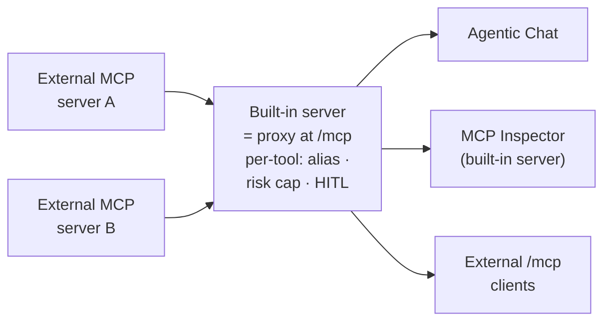
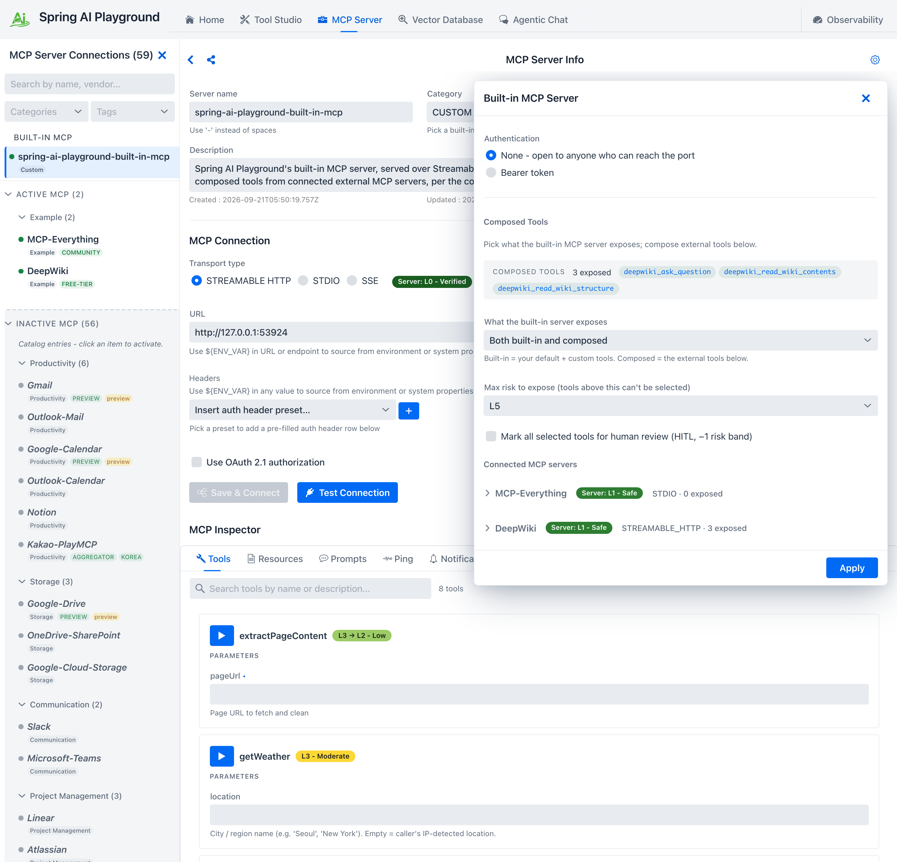
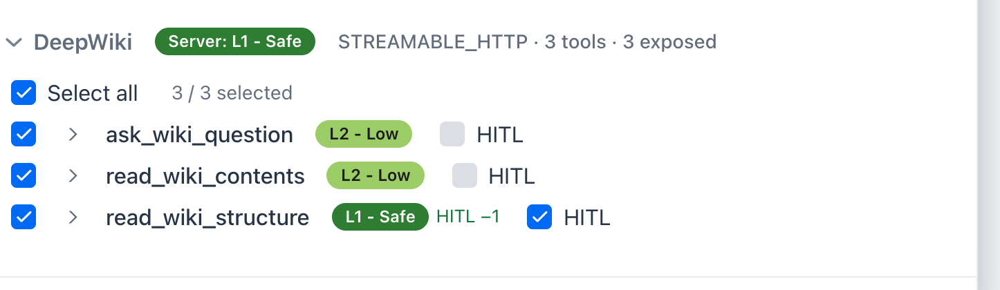

videos: proxy ep10
description: MCP Server Proxy - a safety net for every external MCP server your AI uses - compose their tools into one list, gate calls with HITL approval, and log and monitor every call through the built-in server.

# MCP Server Proxy - a Safety Net for External MCP Servers

**Where:** top navigation → **MCP Server** → select a connected server → the **gear icon** at the top-right of the *MCP Server Info* pane → **Composed Tools**.

Connect your AI client to the playground once and use external MCP servers through it: you compose the tools it sees, the calls you mark wait for your approval, and every call is logged and monitored. [Tutorial 20](../../tutorials/20-ai-registers-an-mcp-server.md#why) shows an AI setting this up for you; this page covers the controls.

The **MCP Server Proxy** re-publishes tools from the external MCP servers you've connected **through the playground's own built-in MCP server** (`spring-ai-playground-built-in-mcp`, Streamable HTTP at `/mcp`). The built-in server fronts those upstream servers as a **governed proxy** - Agentic Chat, the MCP Inspector, and any external MCP client reach the proxied tools on one endpoint, alongside the tools you authored in Tool Studio. You control it **per tool**: which tools, under what alias, with what risk cap and human-approval setting.



You pick the tools through the **Composed Tools** drawer; internally the selection is a *composition* (`McpComposition`) that wraps each chosen tool in a `WrappedExternalToolCallback`. "Proxy" is the user-facing idea - *re-publish someone else's tool through mine, per tool* - and "composition" is the mechanism.

!!! info "Combine across connections"
    You re-publish the tools you select - individually or with **Select all**, across one or several active connections - combined onto the one built-in `/mcp` endpoint. See [Default MCP Servers → trust and risk](../default-mcp-catalog/index.md#trust-and-risk).

## Why proxy a tool instead of calling it directly

An external MCP server can be written in any language and run anywhere - you didn't author it and can't see inside it. Proxying it through the built-in server buys three things that a direct connection doesn't:

- **One endpoint, governed.** Chat and external `/mcp` clients reach the upstream tool alongside your own tools, without each client negotiating that vendor's transport or auth.
- **A safety envelope.** Every proxied tool is wrapped with a computed risk level, optional human approval (HITL), full logging and tracing, and secret masking - see the [safe-wrapping contract](../../mcp-server-safety.md#wrapping-contract).
- **A review gate.** Before a tool is published it passes a [description poisoning scan](../../mcp-server-safety.md#poisoning-scan), a [fingerprint ledger](../../mcp-server-safety.md#fingerprint-ledger) (so a silently-redefined upstream tool is flagged for re-review), and [composition shadowing rules](../../mcp-server-safety.md#shadowing-rules).

## The Composed Tools drawer

The **gear icon** on the MCP Server Info header opens the **Built-in MCP Server** drawer. Its top section, **Authentication**, decides who may call the built-in server ([Require a bearer token](../../getting-started/external-connections.md#bearer-token)); **Composed Tools** below it decides what external tools it re-publishes.

{ loading=lazy }

- **What the built-in server exposes** - `Both built-in and composed` (default), `Built-in tools only`, or `Composed tools only`; the YAML equivalent is `exposure-mode`.
- **Max risk to expose (tools above this can't be selected)** caps which tools can be selected - any tool whose effective risk exceeds the cap is disabled in the list. The drawer opens at `L5`, so lower it deliberately.
- **HITL** can be ticked per tool, or for all selected tools at once via the header's **Mark all selected tools for human review (HITL, -1 risk band)** checkbox. That checkbox is a mode, not a one-off: while it stays ticked, every tool you select afterwards gets HITL too, and unticking HITL on one tool turns the mode off again. It opens ticked when every tool of the saved set has HITL. Marking a tool HITL lowers its effective risk by one band (never below `L1`; a tool already at `L1` keeps `L1`) and **gates the call at runtime** - external clients are asked via MCP elicitation, and chat on this device shows an approval dialog (see [Human-in-the-Loop](../human-in-the-loop.md)).
- Each server row expands to its tools; the row's tool count (`STREAMABLE_HTTP · 3 tools · 0 exposed`) appears once the row has been expanded. Every tool shows its own **risk chip** plus an alias / description editor; **Select all** ticks every tool and opens each one's editor. The exposed alias defaults to `<server>_<tool>` and the input schema passes through unchanged.
- **Definition changed** marks an exposed tool whose description or input schema changed upstream since you approved it. The [fingerprint ledger](../../mcp-server-safety.md#fingerprint-ledger) withholds such a tool from the built-in server, the composed-tools summary counts it as withheld, and its chip reads `alias · changed`. Expand the server, read the description shown in the row, tick **Accept new definition**, then **Apply**; until then Apply keeps the tool withheld and says so. Nothing re-approves a changed tool implicitly, on this screen or through the [management tools](management-tools.md#rules-that-can-refuse-a-change).

{ loading=lazy }

## What the proxy adds to each tool

Re-exposing a tool **wraps** it - it doesn't copy it. The upstream call is unchanged, but the wrapped tool now carries a composed risk level, emits `start` / `done` / `crash` spans tagged with its upstream origin and risk, masks upstream connection secrets in errors, and honors its HITL flag.

Try a HITL-ticked proxied tool from the [MCP Inspector](inspector.md#tools) to see the gate work: the call waits on the Tools tab with a countdown, the approval request shows up on the running card and on the Elicitation tab, and **Accept** lets the upstream call through. Leave it unanswered for the [approval wait](../human-in-the-loop.md#wait) (180 s by default) and the call ends with `Tool 'x' was not run: no approval within 180 s` instead of running.

That wrapper - plus the risk scoring, poisoning scan, fingerprint ledger, and shadowing rules behind it - is the **safety model**, documented field-by-field on its own page so this one stays about *using* the feature: see **[MCP Server Safety → The safe-wrapping contract](../../mcp-server-safety.md#wrapping-contract)**.

## Who can reach the proxied tools

Once you click **Apply**, the selected tools join the built-in server and are reachable by:

- **Agentic Chat** - alongside your Tool Studio tools and any directly-selected MCP connections.
- **The MCP Inspector** - select the built-in server (`spring-ai-playground-built-in-mcp`) in the MCP Server screen and the proxied tools show up in its [Tools tab](inspector.md#tools), where you can run them directly. (Each card carries the same composed level the drawer shows, server plus tool with the `HITL -1` credit applied, so a gated tool reads as a dual chip such as `L2 → L1`; the upstream's own level still shows on its connection's Inspector.)
- **External MCP clients** - anything that connects to the playground's `/mcp` endpoint sees the proxied tools in `tools/list` (under their exposed aliases).

This is how external tools reach external clients in practice; the [trust-and-risk overview](../default-mcp-catalog/index.md#trust-and-risk) frames the same exposure at the catalog level.

## Steps

1. **Connect the upstream server** - activate a [catalog entry](../default-mcp-catalog/index.md) or add a custom server, and confirm its tools work in the [Inspector](inspector.md#tools).
2. **Open the Composed Tools drawer** - the gear icon on the MCP Server Info header.
3. **Set the ceiling** - pick a **Max risk to expose** cap; optionally tick **Mark all selected tools for human review (HITL, -1 risk band)**.
4. **Select tools** - expand a server, tick the tools you want. Each shows its effective risk chip; over-cap tools are disabled.
5. **(Optional) Rename / gate** - edit the exposed alias or description, and toggle HITL per tool.
6. **Apply** - the tools join the built-in server, visible at the top of the sidebar and callable from chat and `/mcp`.

Apply takes effect immediately and is saved to `mcp/risk/compositions.json` under the playground home, so the exposed set survives a restart. The upstream server still has to connect on the next start before its wrapped tools reappear. When `composed-tools` is set in configuration (below), configuration wins and this section is read-only.

## Configure exposure via YAML { #yaml-exposure }

The drawer's selection is a composition you can also declare in `application.yaml` or environment variables - handy for reproducible or scripted setups. A non-empty `composed-tools` list is authoritative: it replaces the saved selection on every start, and the drawer shows it read-only with a note pointing back to the configuration. Leave the list empty to manage composed tools from the drawer instead. Under `spring.ai.playground`:

```yaml
spring:
  ai:
    playground:
      built-in-mcp-server:
        name: spring-ai-playground-built-in-mcp   # identity external /mcp clients see
        description: Curated tools for my team     # shown in clients' server list
        exposure-mode: both          # builtin-only | composed-only | both
      mcp-server:
        composed-tools-max-risk: L3  # cap (omit this key -> L5); tools whose risk exceeds this are skipped
        composed-tools:
          - server: DeepWiki         # connected server name
            tool: ask_wiki_question  # upstream tool name
            alias: deepwiki_ask      # exposed name (optional; defaults to <server>_<tool>)
            description: "..."        # optional description override
            hitl: true               # require human approval (optional, default false)
```

The built-in server's **name** and **description** are sourced from this config (not the connection form) so the published identity stays stable and keeps matching the `L0 - Verified` self-bypass.

Each list entry wraps one upstream tool, exactly like a drawer row - same risk cap, alias, and HITL semantics. The upstream server must be **connected** for its tools to wrap. These keys are also in the [Configuration reference → MCP built-in server & exposure](../../getting-started/configuration.md#mcp).

## Ship the proxy as its own server { #ship }

Tools composed here can also leave the app: [Shipyard](index.md#shipyard) lists them under **Proxied tools** in its ship flow, and **Ship MCP Server** in the MCP Server header preselects the whole current composition. The bundle keeps each tool's alias, description override, HITL flag and the risk cap, and copies only the connection files of the upstream servers those tools need. Streamable HTTP upstreams without OAuth can ship; stdio upstreams cannot (the bundle image has no local command runner), SSE upstreams cannot (only Streamable HTTP upstreams ship), OAuth upstreams cannot yet (their tokens stay on this machine), and a literal secret in an upstream's headers or URL blocks shipping until it is a `${ENV_VAR}` reference.

## Related

- [MCP Server Safety](../../mcp-server-safety.md) - how composed risk, the poisoning scan, the fingerprint ledger, and shadowing rules are computed
- [MCP Server](index.md) - connections, transports, OAuth, the sidebar catalog
- [MCP Inspector](inspector.md) - exercise a connection's tools (with per-tool risk chips) before proxying them
- [Management Tools](management-tools.md) - let an external AI client choose and expose these tools over MCP, with the same risk cap and HITL rules
- [AI Guides, Templates and Samples](ai-guides.md#proxy) - the proxy guide an AI follows for the same job
- [Default MCP Servers](../default-mcp-catalog/index.md) - the 58 preset connections you can proxy from
