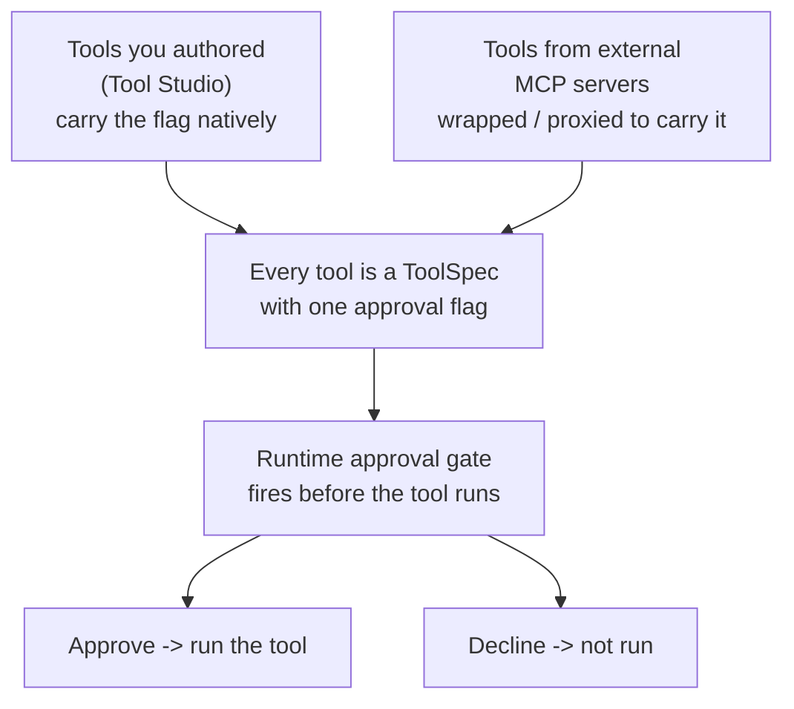
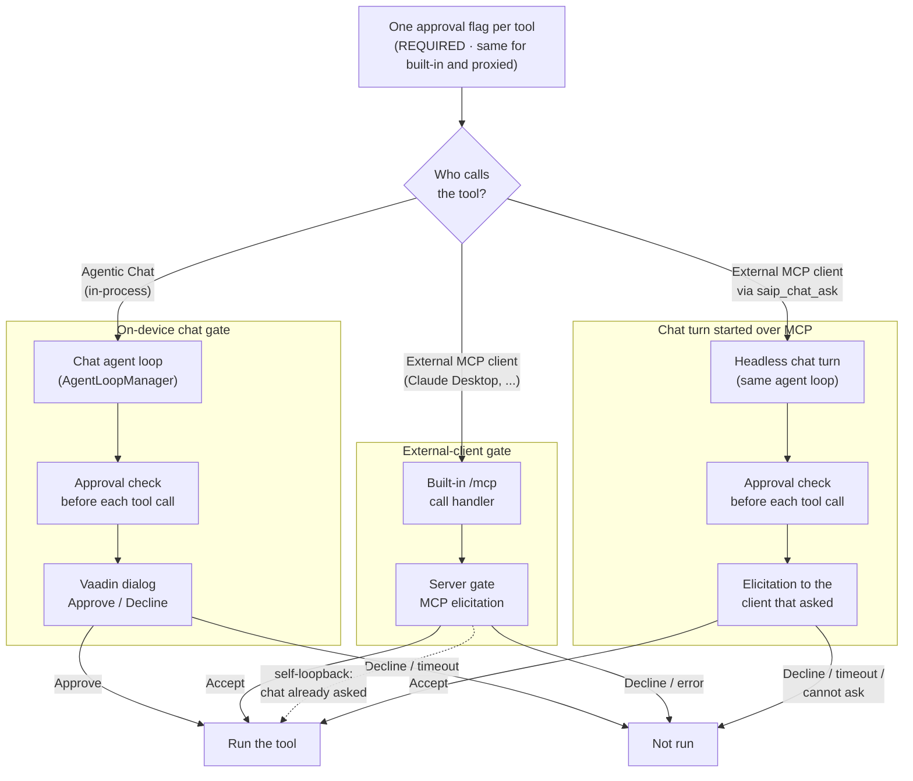
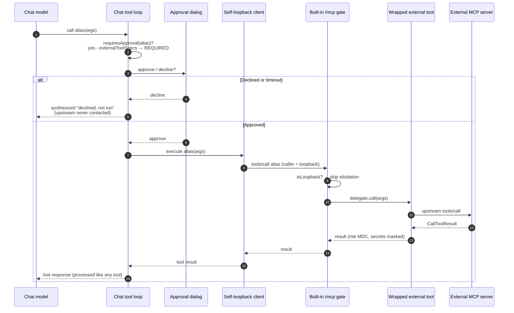

videos: ep6 ep9
title: Human-in-the-Loop Approval
description: How Spring AI Playground gates tool calls behind human approval - one per-tool flag enforced at the caller's entry point: chat dialog or MCP elicitation, fail-safe.

# Human-in-the-Loop Approval

A risk level tells you *how dangerous* a tool is. A sandbox limits *what* it can touch. **Human-in-the-loop (HITL) approval** decides *whether a specific call runs at all* - it pauses an individual tool call and waits for a person to approve or decline before the tool executes.

This is the runtime checkpoint that the [AI Agent Tool Safety](safety-architecture.md) and [MCP Server Safety](mcp-server-safety.md) pages refer to. It is the last gate before a call fires, and it sits *between* the sandbox (which judges what a tool **can** do) and the agent (which judges **when** to call it).

Pages this gate connects to:

- [Agent Loop](agent-loop-architecture.md) - the round governance in which this gate runs as one interceptor
- [MCP Server Safety](mcp-server-safety.md) - how a tool from an external server is wrapped so it can carry the flag
- [AI Agent Tool Safety](safety-architecture.md) - the sandbox that bounds what an approved call may touch
- [Safe Tool Specification](safe-tool-specification.md) - the `humanInTheLoop` block that declares the flag
- [AI Agent Observability](observability-architecture.md) - where approvals, declines, and timeouts are recorded
- [Application](architecture.md) - where the gate sits in the runtime

## Overview { #overview }

The whole model is **one flag, enforced once, wherever the call enters**:

1. **One per-tool flag.** Every tool carries a `HumanInTheLoop` policy on its `ToolSpec` (`REQUIRED` / `DISABLED`). There is no second place to configure approval - both gates below read this one flag.
2. **A tool you authored carries the flag itself.** Set it in Tool Studio; publishing applies it automatically.
3. **A tool from an external MCP server is *wrapped* so it carries the flag too.** You cannot rely on a third-party server to implement approval, so the playground **proxies** the upstream tool through its own built-in server, wrapping it as one of its own `ToolSpec`s with the flag attached. From that point it is gated exactly like a tool you wrote.
4. **The gate fires at the caller's entry point** - an approval dialog for on-device Agentic Chat, an MCP `elicitation/create` round-trip for an external MCP client. Both consult the same flag, and a call is never asked twice.



The rest of this page details each piece: [what it guarantees](#guarantees), [the policy itself](#model), [where the flag comes from](#flag-source), [the two enforcement points](#gates), and - the part that ties it together - [the full path a proxied external tool takes](#proxied).

## What it guarantees { #guarantees }

When a tool is configured to require approval, **no caller can execute it without an explicit human ACCEPT**, and every decision fails safe:

- **No silent execution.** A `REQUIRED` tool always asks first.
- **Fail-safe default.** A timeout, a closed dialog, a client with no elicitation support, a transport error - every non-`ACCEPT` outcome is treated as a **decline**, and the tool does *not* run.
- **The model is told.** A decline returns a message back into the conversation so the agent does not silently retry.
- **Asked once, not twice.** A call that is already gated on this device is not gated again downstream (see [loopback de-duplication](#loopback)).

## The per-tool policy { #model }

Every tool carries an optional approval policy, defined by [`ToolManifest.HumanInTheLoop`](https://github.com/spring-ai-community/spring-ai-playground/blob/main/src/main/java/org/springaicommunity/playground/service/tool/ToolManifest.java) and stored on the tool's `ToolSpec`:

```java
record HumanInTheLoop(Mode mode, String promptTemplate) {
    enum Mode { DISABLED, REQUIRED }
}
```

| Mode | On-device Agentic Chat | External MCP client |
| --- | --- | --- |
| `REQUIRED` | Ask on **every** call | Ask on **every** call (MCP elicitation) |
| `DISABLED` | Never ask | Never ask |

The chat-side decision logic is centralized in [`ToolSpecService.requiresApproval`](https://github.com/spring-ai-community/spring-ai-playground/blob/main/src/main/java/org/springaicommunity/playground/service/tool/ToolSpecService.java), which gates a call only when its mode is `REQUIRED`. The server-side MCP gate likewise decorates only `REQUIRED` tools.

The optional **`promptTemplate`** customizes the question text. `{toolName}` and `{args}` are substituted at call time; the default is *"Run '{toolName}' with arguments {args}?"* in the chat dialog and *"Approve running tool '{toolName}' with arguments {args}?"* in the MCP elicitation.

## Where the approval flag comes from { #flag-source }

The single policy above is attached to a tool by one of two routes, depending on who authored the tool:

- **Authored (Tool Studio) tools** carry `humanInTheLoop` on their own `ToolSpec`. The author chooses the mode; publishing registers the tool on the built-in server *already wearing* the flag (`ToolSpecService.addMcpTool` decorates the registration through `McpServerHitlToolGate`).
- **External MCP server tools** are the interesting case. The playground has **no way to know whether a third-party server implements any approval step** - it only speaks the upstream tool's `tools/call` contract. So when you re-expose such a tool through the [Composed Tools drawer](features/mcp-server/proxy.md), the playground does not hand it to the agent raw. It **proxies** the tool: it wraps the upstream callback in a [`WrappedExternalToolCallback`](https://github.com/spring-ai-community/spring-ai-playground/blob/main/src/main/java/org/springaicommunity/playground/service/mcp/risk/WrappedExternalToolCallback.java) and registers it on the built-in server via [`ToolSpecService.addExternalMcpTool(callback, hitl)`](https://github.com/spring-ai-community/spring-ai-playground/blob/main/src/main/java/org/springaicommunity/playground/service/tool/ToolSpecService.java). When you tick **HITL** on that tool, the playground attaches a `REQUIRED` policy to a runtime `ToolSpec` entry in its `externalToolSpecs` registry. That entry is separate from authored tools and is not persisted or shown in Tool Studio's authored-tool list.

This is *why* proxying exists for the safety story: re-exposing an external tool through your own server is what lets **you** own the approval gate, instead of trusting a server you did not write. Once wrapped, the upstream tool is gated by exactly the same flag and the same two enforcement points as a tool you authored. (The [MCP Server Safety](mcp-server-safety.md) page covers the *other* things the wrapper adds at the same moment - risk scoring, secret masking, logging.)

## The two enforcement points { #gates }

There is **one per-tool policy**, enforced wherever a call enters - and the split is by **caller (entry point), not by tool type**. Built-in tools and re-exposed external tools carry the same flag and are gated the same way; what differs is *who* is calling:

- **Agentic Chat (in-process agent loop)** - every tool call the chat makes, built-in or re-exposed external, runs through a **single** [`AgentLoopManager`](https://github.com/spring-ai-community/spring-ai-playground/blob/main/src/main/java/org/springaicommunity/playground/service/agent/AgentLoopManager.java) round. The `ChatClient` installs Spring AI's `ToolCallingAdvisor` (or `ToolSearchToolCallingAdvisor` for dynamic discovery) with this manager as its `ToolCallingManager`; the manager runs a chain of round interceptors, the first business one being [`HitlApprovalInterceptor`](https://github.com/spring-ai-community/spring-ai-playground/blob/main/src/main/java/org/springaicommunity/playground/service/agent/HitlApprovalInterceptor.java), which asks for approval **before** any gated tool runs. The check is `requiresApproval(toolName)`, which finds the flag on the authored `ToolSpec` *or* on the wrapped external one. The wider loop this sits in is covered in [Agent Loop](agent-loop-architecture.md).
- **External MCP client over `/mcp`** (Claude Desktop, another app) - this caller never touches the `ChatClient`, its advisor chain, or the `ToolCallingManager`. The MCP server SDK invokes the tool's `callHandler` directly, so the only place to gate it is by **wrapping that handler at registration** ([`McpServerHitlToolGate`](https://github.com/spring-ai-community/spring-ai-playground/blob/main/src/main/java/org/springaicommunity/playground/service/mcp/McpServerHitlToolGate.java)), which asks via MCP elicitation.

The two never fire for the same call: when Chat reaches a built-in or proxied tool through the self-loopback MCP client, the server-side gate sees the loopback caller and **skips** - the chat loop already asked (see [loopback de-duplication](#loopback)).

A third caller reuses the first gate with a different asker: a chat turn that an **external MCP client starts with `saip_chat_ask`** runs the same in-process loop, but its approval questions travel back to that client as elicitation instead of a dialog (see [chat turn started over MCP](#management-chat-gate)).



### On-device chat - approval dialog { #chat-gate }

When the on-device agent loop is about to execute tool calls, the [`HitlApprovalInterceptor`](https://github.com/spring-ai-community/spring-ai-playground/blob/main/src/main/java/org/springaicommunity/playground/service/agent/HitlApprovalInterceptor.java) inspects the round. For every call whose tool `requiresApproval`, it raises a `HumanQuestion` **keyed by the tool call id** and asks the [`HumanQuestionHandler`](https://github.com/spring-ai-community/spring-ai-playground/blob/main/src/main/java/org/springaicommunity/playground/service/tool/HumanQuestionHandler.java) carried in the tool context. In Agentic Chat that handler is [`ChatHumanQuestionHandler`](https://github.com/spring-ai-community/spring-ai-playground/blob/main/src/main/java/org/springaicommunity/playground/webui/chat/ChatHumanQuestionHandler.java), which renders **all of the round's approval questions in a single Vaadin dialog** - a `ConfirmDialog` (*Approve* / *Decline*) when there is one, or one row per call when there are several - on the chat UI. This path uses a dialog, **not** MCP elicitation; chat is in-process, so there is no protocol round-trip to make.

Each `HumanQuestion` also carries the tool's **inherent risk level** (`ToolSpecService.gatingRiskLevel`: sandbox posture for authored tools, composed level for proxied external tools - never the `HITL -1` display credit, since this dialog *is* that mitigation). The dialog renders it as the standard risk chip and escalates with it: L4 adds a warning line and a red *Approve*; L5 disables *Approve* until an explicit acknowledgment checkbox is ticked, so a destructive call can never be approved by a reflex Enter press.

- **Approve** → the call executes normally.
- **Decline** → the call is removed from the batch and a `ToolResponse` is synthesized telling the model the user declined, it was **not** executed, and not to call it again for this request. The tool is also remembered as declined for the rest of the turn, so a re-request is auto-declined without a second dialog. The model continues with the remaining (approved) calls, if any.
- **Timeout** (the shared [approval wait](#wait), default 3 minutes; the dialog counts it down beside *Decline*), dialog closed, or UI error → the call is **not run** (fail-safe). A timeout synthesizes `Tool 'x' was not run: no approval within N s` and is counted as `timeout`, separate from a decline.

Keying by tool call id matters: if the model emits the *same* gated tool with the *same* arguments twice in one round, each call gets its own verdict, so declining both cannot let the first slip through. All the round's questions share one dialog, so the wait never stacks past the stream's inter-signal timeout. Approved and declined calls in the same round are handled together, and the original ordering is preserved so the conversation history stays consistent.

### External MCP client - elicitation { #server-gate }

When a tool is published on the built-in MCP server, [`ToolSpecService`](https://github.com/spring-ai-community/spring-ai-playground/blob/main/src/main/java/org/springaicommunity/playground/service/tool/ToolSpecService.java) wraps its specification with [`McpServerHitlToolGate`](https://github.com/spring-ai-community/spring-ai-playground/blob/main/src/main/java/org/springaicommunity/playground/service/mcp/McpServerHitlToolGate.java) when the tool's mode is `REQUIRED`. At call time the gate, before delegating to the real handler:

1. **Loopback?** If the caller is this device's own chat (the [self-loopback](#loopback) client), pass straight through - the chat dialog already asked. A loopback call that carries `_meta.playgroundInteractiveHitl=true` - what the MCP Inspector sends when it runs a tool on the built-in server - is not passed through; it is gated by elicitation like an external client.
2. **Elicitation capable?** If the calling client did not advertise the `elicitation` capability, **deny** - there is no way to ask, so the call cannot be approved.
3. **Ask.** Issue `exchange.createElicitation(prompt, schema)`. Run the tool only on `ACCEPT` with `approve: ["run"]` in the answer; on `DECLINE` / `CANCEL`, or an `ACCEPT` where the choice is unticked or missing, return a denied `CallToolResult` (`isError = true`).
4. **Expired.** When the playground's own client lets the [approval wait](#wait) run out, it answers `CANCEL` with a `playgroundApprovalExpired` marker in `_meta`; the gate reports `Tool 'x' was not run: no approval within N s`, logs `hitl.server.timeout`, and counts `timeout`. The gate also stops waiting on its own when the approval wait elapses, whatever the client does, so an external client that answers late lands on the same result and its late answer is ignored.
5. **Any other error** (transport drop, exception) → **deny** (fail-safe).

The prompt schema asks for one required field, `approve`, and nothing else (`ApprovalConfirmation.SCHEMA`): a one-item choice, **Run this call**, ticked by default. A client renders it as a single checkbox that is already ticked above its **Accept** and **Deny** buttons, so the person's answer is one click on **Accept**, and unticking it or denying refuses. An empty schema would look the same without the checkbox, but a client that fills in empty forms by itself, as Codex does when its approvals are switched off, would pass the gate without a person; with the field present such a client declines instead, and an `ACCEPT` that does not carry the ticked choice is treated as a decline. Because MCP elicitation has no severity field, the gate prefixes the message text with the tool's risk level (e.g. `[risk L5 Critical] Approve running tool 'deleteFile' ...`), so external clients see the same signal the chat dialog shows as a chip. (In the playground's own [MCP Inspector](features/mcp-server/inspector.md#elicitation), that arrives as an `ElicitationRequestPrimitive` card.) Elicitation has no deadline field either, so the message ends with the wait notice, `Answer within 180 s, or the call is refused.`, and while the call waits the gate sends `notifications/progress` every 10 seconds (`Waiting for approval: 170 s left`, progress = seconds elapsed, total = the wait) to a client that put a `progressToken` on the call; a client without a token gets the notice only.

### Chat turn started over MCP - elicitation through the caller { #management-chat-gate }

The management tools' own approval questions (publish, exposure change, register, run) are the server-side elicitation of the previous section issued by `ManagementApprovalGate` before a management call runs; the [AI Operations Architecture](ai-operations-architecture.md#gate) page walks through that gate. This section covers the case where a management call starts a whole chat turn.

The management tool `saip_chat_ask` ([Management Tools](features/mcp-server/management-tools.md#asking-the-apps-chat)) runs one turn of Agentic Chat without the screen. [`HeadlessChatService`](https://github.com/spring-ai-community/spring-ai-playground/blob/main/src/main/java/org/springaicommunity/playground/service/chat/HeadlessChatService.java) drives the same `ChatTurnService` the chat view uses, so the turn goes through the same `AgentLoopManager` round and the same `HitlApprovalInterceptor`. What changes is the `HumanQuestionHandler` in the tool context: instead of the Vaadin dialog it is an [`ElicitationQuestionHandler`](https://github.com/spring-ai-community/spring-ai-playground/blob/main/src/main/java/org/springaicommunity/playground/service/management/ElicitationQuestionHandler.java) bound to the management caller. For each gated call it sends one elicitation to the client that started the turn, with the risk prefix and the question text the dialog would have shown (`[risk L2] Chat turn started by this client wants to run a tool. Run 'deepwiki_read_wiki_structure' with arguments {...}? Answer within 180 s, or the call is refused.`), wrapped in the same [approval wait](#wait) with progress ticks when the outer call carries a `progressToken`.

The decision maps onto the chat gate's verdicts, so the model receives exactly what it would after a dialog: `ACCEPT` with **Run this call** ticked runs the tool; `DECLINE`, `CANCEL` or an accept with the choice unticked or missing is a decline; an expired wait is a timeout; a client that did not advertise elicitation, or whose elicitation fails, is declined without a prompt. The handler never returns an approval it did not get (fail-safe), which matters because the interceptor would otherwise run every gated tool when no handler is present. The loopback de-duplication still applies: the built-in server's own gate sees the loopback caller of the headless turn and skips, so the person is asked once, by their own client.

The caller is identified by the elicitation channel that [`ManagementApprovalGate`](https://github.com/spring-ai-community/spring-ai-playground/blob/main/src/main/java/org/springaicommunity/playground/service/management/ManagementApprovalGate.java) puts on the `ManagementCaller` when it dispatches the management call; a caller without that channel (a script without an elicitation callback) can still run a turn, but every gated tool in it is declined and the answer says so.

### One wait, derived timeouts { #wait }

`spring.ai.playground.hitl.approval-wait-seconds` (180 s by default, capped at 240 under the chat stream's 300-second inter-signal timeout) is the only number a person sets. Everything that waits on a human derives from it:

| Wait | Value |
|------|-------|
| Chat approval, upload, and image dialogs (`ChatHumanQuestionHandler`, `ChatFileUploadHandler`, `ChatImageReferenceHandler`) | the wait |
| Client-side elicitation and sampling window (`McpClientService`, the pending card's countdown) | the wait |
| Loopback client used for an Inspector HITL call (`McpClientService`, created on first use for the built-in server) | the wait + 30 s |
| Built-in server `spring.ai.mcp.server.request-timeout` (`McpServerRequestTimeoutAligner`) | raised to the wait + 30 s unless configured larger |

The ordering guarantees that the human-facing window always closes first and the transports never cut a pending decision short: the Inspector call outlives the elicitation it is waiting on, and the server's own request timeout only ever fires for a client that never answers at all.

## Proxied external tools - the full runtime path { #proxied }

This is the path that ties the whole model together, and it is the reason proxying exists. When Agentic Chat (with the built-in MCP server enabled) calls a **re-exposed external tool**, the call is approved *once* on this device and only then reaches the upstream server. The flag was attached when the tool was wrapped ([above](#flag-source)); here is what happens at call time:



The key properties this path guarantees:

- **HITL happens first, the network call second.** The upstream external server is **not** contacted until after approval - a declined call never leaves the machine.
- **Approved once, not twice.** The chat dialog (step 3) is the only prompt; the server-side gate is on the path (steps 8-9) but skips because the caller is the self-loopback client.
- **The result is processed identically.** After the upstream `CallToolResult` returns, it flows back through the same `AgentLoopManager` round as any built-in tool - same tool-result event, same conversation history, same observability spans.

The same proxied tool called by an **external** MCP client instead of on-device chat takes the other gate: step 3's dialog is replaced by the server-side **elicitation** in `McpServerHitlToolGate` (step 9 is no longer loopback, so it does **not** skip), and steps 10-14 are identical. Either way the upstream call is reached only after an explicit approval.

## Loopback de-duplication { #loopback }

Agentic Chat reaches the built-in server's tools through a **self-loopback MCP client**. Without care, such a call would be gated twice - once by the chat dialog and again by the server elicitation. `McpServerHitlToolGate` compares the caller's client info against `McpClientService.selfLoopbackServerName()` and, on a match, **skips the elicitation** and delegates immediately, unless the call is marked interactive (`_meta.playgroundInteractiveHitl=true`, sent by the MCP Inspector, whose call has no chat dialog in front of it). The user is asked exactly once, by the chat dialog. External clients do not match the loopback name, so they are always gated by the server elicitation.

## Why fail-safe matters { #fail-safe }

Approval is a **deny-by-default** gate: the call runs only on an explicit, affirmative human ACCEPT. Every other path - no answer, a declined dialog, an incapable client, a dropped connection - resolves to *not run*. This is deliberate: a HITL tool is one a human decided is consequential enough to confirm, so the safe failure is to withhold execution, never to assume consent.

## How it relates to risk { #risk }

HITL and the L0-L5 risk model reinforce each other:

- **Defaults track risk.** When you author a tool, the approval mode defaults to `DISABLED` at `L0` and `REQUIRED` above `L0` - the more capable the tool, the more it asks by default. Lowering that protection prompts a confirmation.
- **Approval lowers *displayed* risk.** Marking a re-exposed external tool HITL also lowers its composed risk by one band (`McpToolRiskComposer.applyHitlMitigation`; no credit at or below `L1`) - a human gating every call genuinely reduces exposure. Built-in tools whose spec requires approval get the same one-band credit, shown as a dual chip (`L5 → L4`): the inherent level keeps driving sandbox permissions and the audit log, the effective level reflects the mandatory gate. The credit is conditional - a tool whose description trips the poisoning scanner keeps its inherent level, since a deceptive description undermines the very approval dialog the credit relies on. See [MCP Server Safety → Composed risk and HITL mitigation](mcp-server-safety.md#composed-risk).

The risk level is the *advice*; HITL is the *enforcement* that makes a high-risk tool safe to keep within reach.

## Where it surfaces { #surfaces }

| Surface | What you set / see | Reference |
| --- | --- | --- |
| Tool Studio → **Sandbox & Capabilities** | The **Human-in-the-loop** mode (Required / Disabled) and an optional approval prompt for a tool you author | [Human-in-the-Loop feature](features/human-in-the-loop.md#author) |
| Composed Tools drawer → **HITL** column | Per-tool approval for a re-exposed external tool (attaches the `REQUIRED` flag to its wrapper) | [MCP Server Proxy](features/mcp-server/proxy.md) |
| Agentic Chat | The **Approve / Decline** dialog when a gated tool is called | [Tutorial 11 - Approve a Tool in Chat](tutorials/11-human-approval.md) |
| MCP Inspector → **Elicitation** | The approval card an external client would see | [MCP Inspector](features/mcp-server/inspector.md#elicitation) |
| Management tools (`saip_*`) ([AI Operations](ai-operations-architecture.md#gate)) | The approval question an external AI gets before it publishes, deletes or changes exposure, and the per-call question for a tool it published with `humanApproval` | [Tutorial 18 - Let an AI Author a Tool](tutorials/18-ai-authors-a-tool.md) |

## Further reading

- [Human-in-the-Loop Approval (feature)](features/human-in-the-loop.md) - the user-facing how-to
- [Tutorial 11 - Approve a Tool in Chat](tutorials/11-human-approval.md) - end-to-end walkthrough
- [MCP Server Safety](mcp-server-safety.md) - risk scoring for external tools that this gate protects
- [Application](architecture.md) - where the approval gate sits in the runtime layers and chat advisor chain
- [AI Agent Observability](observability-architecture.md) - how approve/decline decisions surface (`mcp.hitl.decision` counter, `hitl.*` logs)
