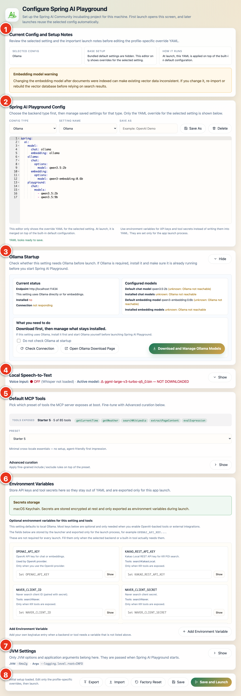
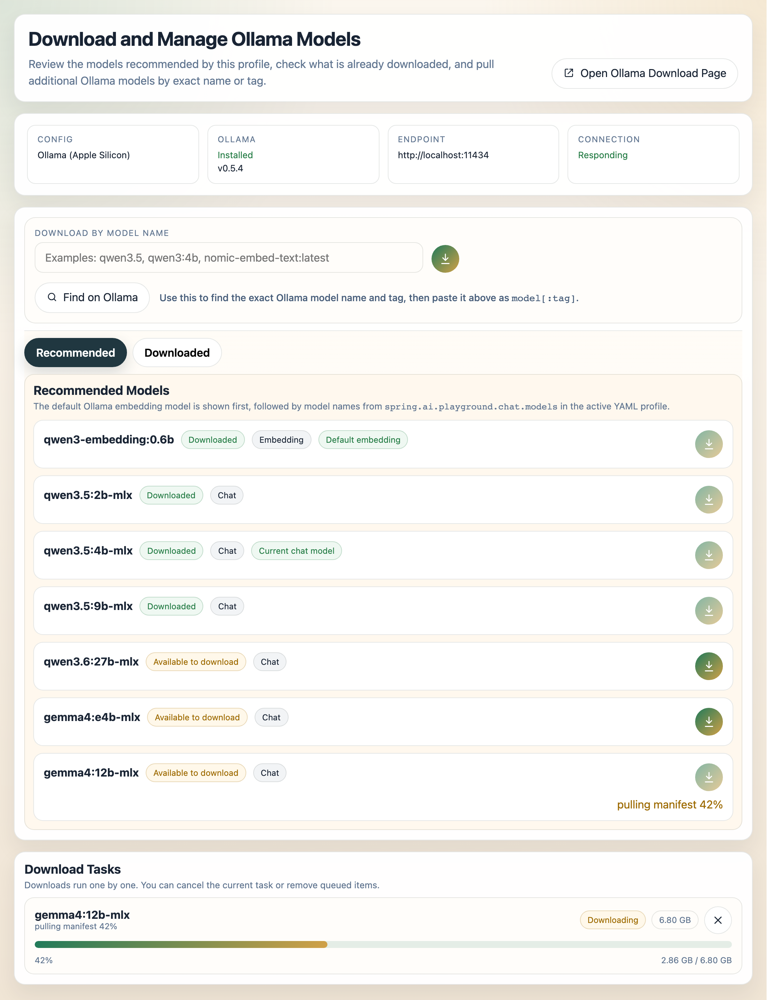

title: Safe Local Execution Layer for AI Agent Tools
description: Desktop app to build, test, publish and ship MCP tools, and one safety net for everything your AI uses through it - HITL approval, monitoring and audit for your tools, proxied MCP servers and AI-made changes. Tool Studio, a defense-in-depth sandbox, Risk Levels (L0-L5), Agentic Chat, RAG, Shipyard, management tools for an AI operator, and observability dashboards.

# Spring AI Playground

## Safe Local Execution Layer for AI Agent Tools

Spring AI Playground is a cross-platform desktop app for building, testing, validating, and executing MCP tools in a controlled local environment.

> **No pass, no run.**

Every tool you build earns a **Local Pass** - a local test-run with sample arguments. Only tools that pass are added live to the built-in MCP server and become callable from Agentic Chat. Nothing you author reaches an agent until you have seen it work on your own machine.

Safe execution does not end at publication: every chat, tool call, vector lookup and MCP invocation lands in fourteen built-in **Observability dashboards**, from token cost down to the trace timeline of a single call, so the tools you let an agent call are also the tools you can audit afterwards.

> **Security scope.** The in-process sandbox is defense-in-depth for the local build-and-vet loop. It is not adversarial-grade isolation and not a gateway. To run tool code you do not trust, nest it in container or microVM isolation. See [Isolation tiers](safety-architecture.md#isolation-tiers).

<div style="text-align: center;">
  <b>An AI Ships and Runs an MCP Server - Every Risky Step Asks a Person</b><br/>
  ChatGPT works through the management tools and you approve each step; the rest of the series plays next
</div>

<div style="text-align: center;">
  <iframe width="820" height="461" style="width: 100%; max-width: 820px; height: auto; aspect-ratio: 16 / 9; border: 0;"
          src="https://www.youtube-nocookie.com/embed/uz2kNthufyQ?list=PLfizCrbCZK9k"
          title="An AI Ships and Runs an MCP Server - Every Risky Step Asks a Person"
          allow="accelerometer; clipboard-write; encrypted-media; gyroscope; picture-in-picture; web-share"
          referrerpolicy="strict-origin-when-cross-origin" allowfullscreen></iframe>
  <p><a href="https://youtu.be/dR6XRs2-nEY" target="_blank" rel="noopener">30-second trailer</a> · <a href="https://www.youtube.com/playlist?list=PLfizCrbCZK9k" target="_blank" rel="noopener">Watch the full demo series on YouTube</a></p>
</div>

## :material-rocket-launch: Quick Start

The recommended default is the desktop app distributed from GitHub Releases.

Spring AI Playground is a standalone desktop app, so you can install it and start building MCP tools without setting up a Java project, Docker environment, or source build first.

### 1. Download the Desktop App

Pick the installer for your platform. Each link resolves to the latest published release automatically.

<div class="dl-social">
  <details id="dl-stats" class="dl-stats" hidden>
    <summary class="dl-stats__summary"><span id="dl-stats-total"></span></summary>
    <ul id="dl-stats-list" class="dl-stats__list"></ul>
  </details>
  <span class="dl-social__note">"a very interesting project indeed" - <a href="https://spring.io/blog/2026/06/02/this-week-in-spring-june-2-2026/">Josh Long, This Week in Spring</a></span>
</div>

<div class="dl-picker" id="dl-picker">
  <span class="dl-picker__sep" id="dl-picker-sep">Choose your platform</span>
  <a id="win-x64" class="dl-opt" href="https://github.com/spring-ai-community/spring-ai-playground/releases/latest" data-pattern="win-x64.exe" data-label="Windows (NSIS, x64)" data-os="Windows" rel="noopener"><svg class="dl-opt__icon" viewBox="0 0 24 24" fill="none" stroke="currentColor" stroke-width="2" stroke-linecap="round" stroke-linejoin="round" aria-hidden="true"><path d="M12 3v12"/><path d="m6 11 6 6 6-6"/><path d="M5 21h14"/></svg><span class="dl-opt__label">Windows x64 (.exe)</span></a>
  <a id="mac-arm64" class="dl-opt" href="https://github.com/spring-ai-community/spring-ai-playground/releases/latest" data-pattern="mac-arm64.dmg" data-label="macOS (Apple Silicon)" data-os="macOS (Apple Silicon)" rel="noopener"><svg class="dl-opt__icon" viewBox="0 0 24 24" fill="none" stroke="currentColor" stroke-width="2" stroke-linecap="round" stroke-linejoin="round" aria-hidden="true"><path d="M12 3v12"/><path d="m6 11 6 6 6-6"/><path d="M5 21h14"/></svg><span class="dl-opt__label">macOS Apple Silicon (.dmg)</span></a>
  <a id="mac-x64" class="dl-opt" href="https://github.com/spring-ai-community/spring-ai-playground/releases/latest" data-pattern="mac-x64.dmg" data-label="macOS (Intel)" data-os="macOS (Intel)" rel="noopener"><svg class="dl-opt__icon" viewBox="0 0 24 24" fill="none" stroke="currentColor" stroke-width="2" stroke-linecap="round" stroke-linejoin="round" aria-hidden="true"><path d="M12 3v12"/><path d="m6 11 6 6 6-6"/><path d="M5 21h14"/></svg><span class="dl-opt__label">macOS Intel (.dmg)</span></a>
  <a id="linux-deb" class="dl-opt" href="https://github.com/spring-ai-community/spring-ai-playground/releases/latest" data-pattern="linux-amd64.deb" data-label="Linux (DEB, amd64)" data-os="Linux (.deb)" rel="noopener"><svg class="dl-opt__icon" viewBox="0 0 24 24" fill="none" stroke="currentColor" stroke-width="2" stroke-linecap="round" stroke-linejoin="round" aria-hidden="true"><path d="M12 3v12"/><path d="m6 11 6 6 6-6"/><path d="M5 21h14"/></svg><span class="dl-opt__label">Linux .deb (amd64)</span></a>
  <a id="linux-rpm" class="dl-opt" href="https://github.com/spring-ai-community/spring-ai-playground/releases/latest" data-pattern="linux-x86_64.rpm" data-label="Linux (RPM, x86_64)" data-os="Linux (.rpm)" rel="noopener"><svg class="dl-opt__icon" viewBox="0 0 24 24" fill="none" stroke="currentColor" stroke-width="2" stroke-linecap="round" stroke-linejoin="round" aria-hidden="true"><path d="M12 3v12"/><path d="m6 11 6 6 6-6"/><path d="M5 21h14"/></svg><span class="dl-opt__label">Linux .rpm (x86_64)</span></a>
</div>

<p id="dl-resolved" class="dl-resolved-version" hidden></p>

<div id="dl-confirm" class="dl-confirm-overlay" hidden role="dialog" aria-modal="true" aria-labelledby="dl-confirm-title">
  <div class="dl-confirm-modal" role="document">
    <button id="dl-confirm-close" class="dl-confirm__close" type="button" aria-label="Close">&times;</button>
    <div class="dl-confirm__header">
      <span class="dl-confirm__icon" aria-hidden="true">
        <svg viewBox="0 0 24 24" fill="none" stroke="currentColor" stroke-width="2" stroke-linecap="round" stroke-linejoin="round"><path d="M12 3v12"/><path d="m6 11 6 6 6-6"/><path d="M5 21h14"/></svg>
      </span>
      <div class="dl-confirm__heading">
        <h4 id="dl-confirm-title" class="dl-confirm__title">Confirm download</h4>
        <p class="dl-confirm__platform"><span id="dl-confirm-label"></span></p>
      </div>
    </div>
    <dl class="dl-confirm__body">
      <div class="dl-confirm__row">
        <dt class="dl-confirm__row-label">File</dt>
        <dd class="dl-confirm__row-value">
          <code id="dl-confirm-filename"></code>
          <span id="dl-confirm-message" class="dl-confirm__message" hidden></span>
        </dd>
      </div>
      <div class="dl-confirm__row">
        <dt class="dl-confirm__row-label">Size</dt>
        <dd class="dl-confirm__row-value" id="dl-confirm-size">&mdash;</dd>
      </div>
      <div class="dl-confirm__row">
        <dt class="dl-confirm__row-label">Save to</dt>
        <dd class="dl-confirm__row-value dl-confirm__saveto">
          <span id="dl-confirm-saveto-path" class="dl-confirm__saveto-path">Downloads folder</span>
          <span class="dl-confirm__saveto-hint">(set by your browser)</span>
        </dd>
      </div>
    </dl>
    <div class="dl-confirm__actions">
      <a id="dl-confirm-go" class="download-button download-button--primary" href="#" rel="noopener">
        <svg viewBox="0 0 24 24" fill="none" stroke="currentColor" stroke-width="2" stroke-linecap="round" stroke-linejoin="round" aria-hidden="true"><path d="M12 5v14"/><path d="m19 12-7 7-7-7"/></svg>
        <span id="dl-confirm-go-label">Download</span>
      </a>
      <button id="dl-confirm-cancel" class="download-button download-button--ghost" type="button">Cancel</button>
    </div>
  </div>
</div>

<noscript>

JavaScript is disabled in your browser, so the buttons above link to the
[latest release page](https://github.com/spring-ai-community/spring-ai-playground/releases/latest).
Pick the asset that matches your platform.

</noscript>

<script>
(function () {
  const REPO = 'spring-ai-community/spring-ai-playground';
  const FALLBACK = `https://github.com/${REPO}/releases/latest`;
  const buttons = Array.from(document.querySelectorAll('a[data-pattern]'));
  if (buttons.length === 0) return;

  // Promote the visitor's platform to a single filled button and leave the rest
  // as quiet alternates. macOS cannot report its architecture, so Apple Silicon
  // is promoted and the Intel build is ordered first among the alternates.
  (function promotePlatform() {
    const picker = document.getElementById('dl-picker');
    const separator = document.getElementById('dl-picker-sep');
    if (!picker) return;
    const ua = navigator.userAgent || '';
    let primaryId = null;
    if (/Windows/i.test(ua)) primaryId = 'win-x64';
    else if (/Mac/i.test(ua)) primaryId = 'mac-arm64';
    else if (/Linux/i.test(ua) && !/Android/i.test(ua)) primaryId = 'linux-deb';
    const primary = primaryId ? document.getElementById(primaryId) : null;
    if (!primary) return;
    primary.classList.add('dl-opt--primary');
    const label = primary.querySelector('.dl-opt__label');
    if (label) label.textContent = 'Download for ' + primary.dataset.os;
    if (primaryId === 'mac-arm64') picker.classList.add('dl-picker--mac');
    if (separator) {
      separator.textContent = primaryId === 'mac-arm64'
        ? 'Using an Intel Mac, or another platform?'
        : 'Other platforms';
    }
  })();

  const confirmEl = document.getElementById('dl-confirm');
  const confirmLabel = document.getElementById('dl-confirm-label');
  const confirmFilename = document.getElementById('dl-confirm-filename');
  const confirmMessage = document.getElementById('dl-confirm-message');
  const confirmSize = document.getElementById('dl-confirm-size');
  const confirmSavetoPath = document.getElementById('dl-confirm-saveto-path');
  const confirmGo = document.getElementById('dl-confirm-go');
  const confirmGoLabel = document.getElementById('dl-confirm-go-label');
  const confirmGoSvg = confirmGo ? confirmGo.querySelector('svg') : null;
  const confirmCancel = document.getElementById('dl-confirm-cancel');
  const confirmClose = document.getElementById('dl-confirm-close');
  let lastTrigger = null;

  // Show the typical default download path for this OS (informational only).
  if (confirmSavetoPath) {
    const ua = navigator.userAgent || '';
    if (/Mac/i.test(ua)) confirmSavetoPath.textContent = '~/Downloads';
    else if (/Win/i.test(ua)) confirmSavetoPath.textContent = '%USERPROFILE%\\Downloads';
    else if (/Linux/i.test(ua)) confirmSavetoPath.textContent = '~/Downloads';
  }

  function formatBytes(bytes) {
    if (!bytes || bytes <= 0) return null;
    const units = ['B', 'KB', 'MB', 'GB'];
    let i = 0;
    let n = bytes;
    while (n >= 1024 && i < units.length - 1) {
      n /= 1024;
      i++;
    }
    return `${n.toFixed(n >= 10 || i === 0 ? 0 : 1)} ${units[i]}`;
  }

  function showConfirm(button) {
    if (!confirmEl) return;
    const isUnresolved = button.classList.contains('download-badge--unresolved');
    confirmLabel.textContent = button.dataset.label || button.textContent.trim();
    if (isUnresolved) {
      confirmFilename.hidden = true;
      confirmFilename.textContent = '';
      confirmMessage.hidden = false;
      confirmMessage.textContent = 'No matching asset in the latest release.';
    } else {
      confirmMessage.hidden = true;
      confirmFilename.hidden = false;
      confirmFilename.textContent = button.dataset.resolved || '';
    }
    confirmSize.textContent = (!isUnresolved && button.dataset.size) ? button.dataset.size : '-';
    confirmGo.href = button.href;
    if (confirmGoLabel) {
      confirmGoLabel.textContent = isUnresolved ? 'Open Releases page' : 'Download';
    }
    if (confirmGoSvg) {
      confirmGoSvg.style.display = isUnresolved ? 'none' : '';
    }
    if (!isUnresolved && button.dataset.resolved) {
      confirmGo.setAttribute('download', button.dataset.resolved);
    } else {
      confirmGo.removeAttribute('download');
    }
    lastTrigger = button;
    confirmEl.hidden = false;
    document.body.classList.add('dl-confirm-open');
    requestAnimationFrame(() => {
      if (confirmClose && typeof confirmClose.focus === 'function') confirmClose.focus();
    });
  }

  function hideConfirm() {
    if (!confirmEl || confirmEl.hidden) return;
    confirmEl.hidden = true;
    document.body.classList.remove('dl-confirm-open');
    if (lastTrigger && typeof lastTrigger.focus === 'function') {
      try { lastTrigger.focus(); } catch (_) {}
    }
    lastTrigger = null;
  }

  function attachClickHandlers() {
    buttons.forEach((button) => {
      button.addEventListener('click', (event) => {
        // Always intercept: resolved → confirm filename + size,
        // unresolved → friendly message with "Open Releases page".
        event.preventDefault();
        showConfirm(button);
      });
    });
  }

  if (confirmCancel) {
    confirmCancel.addEventListener('click', hideConfirm);
  }
  if (confirmClose) {
    confirmClose.addEventListener('click', hideConfirm);
  }
  if (confirmGo) {
    // Let the browser proceed with the link, then dismiss the modal
    confirmGo.addEventListener('click', () => setTimeout(hideConfirm, 0));
  }
  // Click on the overlay (outside the modal box) closes the modal
  if (confirmEl) {
    confirmEl.addEventListener('click', (event) => {
      if (event.target === confirmEl) hideConfirm();
    });
  }
  // Escape key closes the modal
  document.addEventListener('keydown', (event) => {
    if (event.key === 'Escape' && confirmEl && !confirmEl.hidden) {
      hideConfirm();
    }
  });

  fetch(`https://api.github.com/repos/${REPO}/releases/latest`, {
    headers: { Accept: 'application/vnd.github+json' }
  })
    .then((response) => response.ok ? response.json() : Promise.reject(new Error(`HTTP ${response.status}`)))
    .then((release) => {
      const assets = release.assets || [];
      // Defensive filter: only consider assets whose filename also contains
      // the release tag's version. Without this, a release whose draft was
      // polluted with older-version assets (the way `0.2.0-M4-*.dmg` lived
      // inside the `v0.2.0-M5` draft) would let `find()` return the older
      // file just because it appeared first in upload order.
      const releaseVersion = (release.tag_name || '').replace(/^v/, '');
      buttons.forEach((button) => {
        const pattern = button.dataset.pattern;
        const asset = assets.find((a) =>
          a.name &&
          a.name.endsWith(pattern) &&
          (!releaseVersion || a.name.includes(releaseVersion))
        );
        if (asset) {
          button.href = asset.browser_download_url;
          button.dataset.resolved = asset.name;
          const formatted = formatBytes(asset.size);
          if (formatted) button.dataset.size = formatted;
        } else {
          button.href = FALLBACK;
          button.classList.add('download-badge--unresolved');
        }
      });
      const tag = release.tag_name || release.name;
      if (tag) {
        const note = document.getElementById('dl-resolved');
        if (note) {
          note.textContent = `Latest release: ${tag}`;
          note.hidden = false;
        }
      }
      attachClickHandlers();
      autoOpenFromHash();
    })
    .catch(() => {
      buttons.forEach((button) => {
        button.href = FALLBACK;
        button.classList.add('download-badge--unresolved');
      });
      attachClickHandlers();
      autoOpenFromHash();
    });

  function autoOpenFromHash() {
    const hash = (window.location.hash || '').replace(/^#/, '');
    if (!hash) return;
    const picker = document.getElementById('dl-picker');
    const wantsPicker = hash === 'dl-picker' || hash === 'download';
    const target = wantsPicker
      ? document.querySelector('.dl-opt--primary')
      : buttons.find((b) => b.id === hash);
    if (!target) {
      if (wantsPicker && picker) picker.scrollIntoView({ behavior: 'smooth', block: 'center' });
      return;
    }
    target.scrollIntoView({ behavior: 'smooth', block: 'center' });
    showConfirm(target);
  }
})();
</script>

Or browse all available assets on the [Releases page](https://github.com/spring-ai-community/spring-ai-playground/releases). Need [verification info](getting-started/index.md#verify-your-download)?

### 2. Install and Launch

Install the package the same way you would for a normal desktop application, then launch **Spring AI Playground** from your applications menu. The desktop app bundles the backend runtime with a launcher for provider templates, YAML overrides, secrets and one-click launch, so there is no Docker or server to set up.

??? warning "macOS, Windows or Linux blocks the installer?"

    **macOS**

    Gatekeeper may block the install flow in two places:

    - When you open the downloaded DMG, macOS may show a warning such as "cannot be opened because the developer cannot be verified." If you trust the release source, go to **System Settings > Privacy & Security** and click **Open Anyway**.
    - After copying the app into **Applications**, macOS may block the first app launch again. If that happens, open the app once, then return to **System Settings > Privacy & Security** and click **Open Anyway**.

    If the app still doesn't open because it remains quarantined, and you trust the app, one practical workaround is:

    ```bash
    xattr -dr com.apple.quarantine "/Applications/Spring AI Playground.app"
    ```

    **Windows**

    The most common warning appears when you run the downloaded installer (`.exe`).

    If Microsoft Defender SmartScreen shows a warning such as "Windows protected your PC" or says the app is unrecognized:

    - Click **More info**
    - Then click **Run anyway**

    **Linux**

    Separate Gatekeeper- or SmartScreen-style reputation warnings are uncommon. When installing the `.deb` or `.rpm` package, you usually only need to complete the normal package-install confirmation steps.

    For more detailed platform guidance and first-launch configuration screens, see [Getting Started](getting-started/index.md).

??? info "The first-launch configuration screen"

    <div style="text-align: center;">
      <b>First-Launch Configuration Screen</b><br/>
      The configuration editor stacks every card on one scrollable screen - numbered top to bottom below
    </div>

    <div style="text-align: center;">
      <a href="assets/images/launcher-first-launch.png">
        
      </a>
    </div>

    The markers run top to bottom, and each card has a detailed step in the [Desktop App configuration walkthrough](getting-started/desktop.md#desktop-configuration-walkthrough):

    1. **Current Config and Setup Notes** - explains the selected setting before you edit it ([details](getting-started/desktop.md#1-read-the-setup-notes-first))
    2. **Spring AI Playground Config** - pick the provider type, choose a saved setting, and edit the override YAML ([details](getting-started/desktop.md#2-choose-a-config-type))
    3. **Ollama Startup** - Ollama endpoint, install / connection status, and the configured models ([details](getting-started/desktop.md#6-understand-the-ollama-startup-card))
    4. **Local Speech-to-Text** - opt in to on-device voice input and download a Whisper model ([details](getting-started/desktop.md#local-speech-to-text-whisper))
    5. **Default MCP Tools** - choose which preset of built-in tools the MCP server exposes at boot ([details](getting-started/desktop.md#8-pick-your-default-mcp-tools))
    6. **Environment Variables** - API keys and tool secrets, encrypted by your OS keychain ([details](getting-started/desktop.md#9-use-environment-variables-for-keys-and-secrets))
    7. **JVM Settings** - optional launch-time JVM options and application args ([details](getting-started/desktop.md#10-set-jvm-and-app-args-only-when-needed))
    8. **Save and Launch action bar** - Export, Import, Factory Reset, Save, and Save and Launch ([details](getting-started/desktop.md#4-save-clone-delete-or-reset-settings))

??? info "The Ollama model manager"

    <div style="text-align: center;">
      <b>Ollama Model Manager</b><br/>
      Review recommended models, search exact Ollama names on ollama.com, and manage downloaded models
    </div>

    <div style="text-align: center;">
      <a href="assets/images/launcher-ollama-config.png">
        
      </a>
    </div>

    The model manager opens from the Ollama Startup card; see [Download and Manage Ollama Models](getting-started/desktop.md#7-download-and-manage-ollama-models) for the full walkthrough, including how to copy an exact model name from ollama.com.

??? note "Prefer Docker? Run the same app in a container"

    By default the container behaves like the desktop / source app - Vaadin web UI on `http://localhost:8282` and a `streamable-http` MCP server in the same process. To use it as a stdio MCP server for Claude Desktop and other MCP clients instead, add `-e SPRING_PROFILES_INCLUDE=mcp-stdio` (see the [Docker section in Alternative Runtimes](getting-started/alternative-runtimes.md#docker)).

    ```bash
    docker run -d -p 8282:8282 --name spring-ai-playground \
      -e SPRING_AI_OLLAMA_BASE_URL=http://host.docker.internal:11434 \
      -v spring-ai-playground:/root \
      --restart unless-stopped \
      ghcr.io/spring-ai-community/spring-ai-playground:latest
    ```

    Then open `http://localhost:8282`.

## :material-star-outline: Key Features { #key-features }

Unlike many playgrounds that stop at prompt testing, this project connects AI conversations to real actions while making the tools it manages inside the app safer and easier to inspect before reuse:

- **connect your AI over MCP and let it do the work, inside one safety net** - Claude, ChatGPT, Cursor or any MCP client connects to the playground's `/mcp` once, reads the [guides, start prompts and example tools the app serves](features/mcp-server/ai-guides.md), with this app's own sandbox limits filled in, and through the `saip_*` [management tools](features/mcp-server/management-tools.md) does the work itself:
    - writes, tests and publishes JavaScript tools that earn their Local Pass ([Tutorial 18](tutorials/18-ai-authors-a-tool.md))
    - registers external MCP servers and proxies their tools as one list ([Tutorial 20](tutorials/20-ai-registers-an-mcp-server.md#why))
    - builds RAG knowledge from your documents and turns it into search tools ([Tutorial 21](tutorials/21-ai-builds-a-knowledge-server.md))
    - monitors the app itself - tool calls, approvals, traces, logs and running servers - with the same numbers you see in Observability ([Tutorial 19](tutorials/19-knowledge-server-to-chatgpt.md#audit), [Tutorial 21](tutorials/21-ai-builds-a-knowledge-server.md#watch))
    - runs the app's chat as a sub-agent ([Tutorial 22](tutorials/22-ai-chat-as-a-subagent.md))
    - ships tools, proxied tools and knowledge as standalone MCP servers with Shipyard and runs them on Docker ([Tutorial 19](tutorials/19-knowledge-server-to-chatgpt.md#reship), [Tutorial 21](tutorials/21-ai-builds-a-knowledge-server.md#use))

    Every change it makes and every call you mark asks you first in that client, and everything is logged and audited, readable from your AI with the `saip_monitor_*` tools and in the [Observability](features/observability/index.md) dashboards

- build JavaScript tools directly in the app
- earn a **Local Pass** by test-running each tool against sample arguments you define
- **add tools live to the built-in MCP server** the moment each passes - no restart, no redeploy
- start immediately with **116 pre-loaded default tools** - web, files, GitHub, Wikipedia, weather, finance, geo and Korean services ([browse below](#what-used-to-take-an-afternoon-already-wired-in))
- connect external services in one click with **58 preset MCP server connections** - Gmail, Notion, Slack, GitHub, BigQuery, Tavily and more ([browse below](#what-used-to-take-an-afternoon-already-wired-in))
- validate retrieval pipelines against your own documents
- run agentic chat that combines tool use and grounded context (e.g. *"Get today's weather and send it to Slack"*)
- **ship what passed as its own MCP server** with [Shipyard](features/mcp-server/index.md#shipyard) - tools, proxied tools and RAG knowledge in a Docker bundle that runs without the playground
- run every tool in a **defense-in-depth GraalVM sandbox** with a visible **Risk Level** (L0-L5), and risk-score every external MCP server you connect ([AI Agent Tool Safety](safety-architecture.md))
- **see every chat, tool call, vector query and MCP invocation** in the fourteen built-in [Observability dashboards](features/observability/index.md), down to the span timeline and back to the conversation

??? abstract "Feature pages at a glance"

    - [:material-robot-outline: AI Models](getting-started/external-connections.md#connect-model-providers): switch between Ollama, OpenAI, and OpenAI-compatible runtime paths.
    - [:material-tools: Tool Studio](features/tool-studio/index.md): build low-code tools in JavaScript and expose them instantly through MCP.
    - [:material-connection: MCP Server](features/mcp-server/index.md): inspect external MCP servers, read a live **risk score** (L0-L5) before connecting, and **proxy** their tools onto the built-in server - compose multiple servers into one surface - each gated by per-tool human-in-the-loop, with an optional bearer token on the built-in `/mcp` endpoint. Behind that token the same server offers the `saip_*` [management tools](features/mcp-server/management-tools.md), so an external AI can operate the app with your approval.
    - [:material-ferry: Shipyard](features/mcp-server/index.md#shipyard): ship Local Pass tools, proxied tools and RAG knowledge as a standalone MCP server in Docker that runs without the playground, on local or remote Docker, behind a bearer token of its own.
    - [:material-server-network: Default MCP Servers](features/default-mcp-catalog/index.md): 58 preset external MCP server connections (Gmail, Notion, Slack, GitHub, Tavily, ...) gated on `${ENV_VAR}` placeholders.
    - [:material-database-search: RAG](features/vector-database.md): upload content, chunk it, enrich it, embed it, then compose a **Modular RAG pipeline** over it - query rewriting, multi-query expansion, re-ranking, prompt augmentation - and test it against the same executor chat uses.
    - [:material-chat-processing: Agentic Chat](features/agentic-chat/index.md): combine grounded context, built-in tools, and explicitly trusted MCP connections in one interaction flow - with a Prompt Library of ready-to-use [presets](features/agentic-chat/prompt-presets.md) and [`{{variable}}` templates](features/agentic-chat/prompt-templates.md), [dynamic tool discovery](features/agentic-chat/dynamic-tool-discovery.md), per-turn reasoning effort, [document attachments with size-tiered ingest](features/rag/chat-attachments.md), [image attachments as multimodal vision input](features/agentic-chat/image-attachments.md), review-then-act [action cards](features/agentic-chat/index.md#action-cards) (email, calendar, map) and clickable file paths, on-device voice input, and rich code/math/diagram rendering.
    - [:material-chart-line: Observability](features/observability/index.md): fourteen in-app dashboards covering token economics, tool and MCP behavior, RAG quality, host runtime, and a live trace tail.

## :material-sitemap-outline: How it all connects { #how-it-all-connects }

Spring AI Playground is **one local app with three roles**: an MCP **server** that publishes tools to your agents at `/mcp`, an MCP **client** that reaches external services, and a **workbench** where you build and vet tools. Your AI clients call its tools over `/mcp` (Claude Desktop through the `mcp-stdio` profile) or operate it through the `saip_*` [management tools](features/mcp-server/management-tools.md), and every change that matters comes back to you as an approval question. Tools from the built-in library, [Tool Studio](features/tool-studio/index.md) and [proxied external servers](features/mcp-server/proxy.md) are vetted before an agent can call them ([AI Agent Tool Safety](safety-architecture.md)), [Shipyard](features/mcp-server/index.md#shipyard) ships what passed as a standalone MCP server, and everything that runs lands in [Observability](features/observability/index.md). Models run local-first: Ollama by default, OpenAI and OpenAI-compatible runtimes optional.

![Spring AI Playground integration architecture - used by you and your AI clients, which call the built-in MCP server's tools over /mcp or operate the app through the saip_* management tools after reading the saip://guide/* resources, with approval questions coming back to you; the server publishes built-in plus authored plus proxied and composed MCP tools under safety and observability; Shipyard ships tools, proxied tools and RAG knowledge as standalone MCP servers in Docker; local-first models and your documents below](assets/images/integration-architecture.svg){ loading=lazy }

## :material-format-quote-close: Mentions and Coverage

**[Introducing the Spring AI Community GitHub Organization](https://spring.io/blog/2025/10/07/spring-ai-community-announcement/)** - spring.io, October 7, 2025. Listed under Incubating Projects:

> Spring AI Playground - Self-hosted web UI for AI experimentation and testing, enabling developers to explore Spring AI capabilities interactively. Led by Jemin Huh.

**[This Week in Spring - June 2nd, 2026](https://spring.io/blog/2026/06/02/this-week-in-spring-june-2-2026/)** - spring.io, June 2, 2026. Josh Long in the weekly Spring ecosystem roundup:

> the Spring AI Playground seems like a *very* interesting project indeed

**[Client-Side Tool Risk Gating for MCP Hosts](https://owasp.org/www-project-mcp-top-10/2025/recommended-controls/Client-Side-Tool-Risk-Gating)** - OWASP MCP Top 10, merged July 29, 2026. Contributed from this project and accepted as a recommended control, written vendor-neutrally as a host-side pattern, with Spring AI Playground cited as its open-source reference implementation.

**[The Complete Guide to AI Agent Development with Spring AI 2.0](https://jm-lab.github.io/spring-ai-agent-book/)** - Wikibooks, September 17, 2026, in Korean, written by this project's lead maintainer. Its [Spring AI Playground appendix](https://jm-lab.github.io/spring-ai-agent-book/appendix/23-spring-ai-playground/) introduces the app and connects the book's MCP servers to it; the companion site is free in English and Korean, and the [book](https://wikibook.co.kr/springai-agents/) itself is in Korean.

Also carried on the [Spring AI Community project page](https://springaicommunity.mintlify.app/projects/incubating/spring-ai-playground) with the Incubating badge, and listed under UI Clients in [awesome-spring-ai](https://github.com/spring-ai-community/awesome-spring-ai). The full record of coverage and ecosystem listings lives on the [Mentions](mentions.md) page.

## :material-flash: What used to take an afternoon - already wired in

Installing an external MCP server normally means cloning a repo, installing the right runtime, registering an OAuth app, exporting tokens, and restarting your host. We did that 58 times so you don't have to. The 116 default tools ship in the same box. Every tool carries a visible **Risk Level (L0-L5)** - the sandbox, Local Pass, `${ENV_VAR}` substitution, and SecretMasking handle the rest.

### Built-in tools - call from chat the moment you launch

<div class="tcg-grid--home" markdown>

<div class="tcg-card--home" markdown>
<a class="tcg-stretched-link" href="features/default-tools/examples/#getWeather" aria-label="Open getWeather"></a>
<span class="tcg-home-icon">:material-weather-partly-cloudy:</span>
<span class="tcg-home-name">getWeather</span>
<span class="tcg-home-pill risk-l3">L3</span>
</div>

<div class="tcg-card--home" markdown>
<a class="tcg-stretched-link" href="features/default-tools/global/#searchWikipedia" aria-label="Open searchWikipedia"></a>
<span class="tcg-home-icon">:material-book-search-outline:</span>
<span class="tcg-home-name">searchWikipedia</span>
<span class="tcg-home-pill risk-l3">L3</span>
</div>

<div class="tcg-card--home" markdown>
<a class="tcg-stretched-link" href="features/default-tools/examples/#extractPageContent" aria-label="Open extractPageContent"></a>
<span class="tcg-home-icon">:material-text-box-search-outline:</span>
<span class="tcg-home-name">extractPageContent</span>
<span class="tcg-home-pill risk-l3">L3</span>
</div>

<div class="tcg-card--home" markdown>
<a class="tcg-stretched-link" href="features/default-tools/examples/#getCurrentTime" aria-label="Open getCurrentTime"></a>
<span class="tcg-home-icon">:material-clock-outline:</span>
<span class="tcg-home-name">getCurrentTime</span>
<span class="tcg-home-pill risk-l0">L0</span>
</div>

<div class="tcg-card--home" markdown>
<a class="tcg-stretched-link" href="features/default-tools/utilities/#hash" aria-label="Open hash"></a>
<span class="tcg-home-icon">:material-shield-key-outline:</span>
<span class="tcg-home-name">hash (SHA-256)</span>
<span class="tcg-home-pill risk-l0">L0</span>
</div>

<div class="tcg-card--home" markdown>
<a class="tcg-stretched-link" href="features/default-tools/filesystem/#writeTextFile" aria-label="Open writeTextFile"></a>
<span class="tcg-home-icon">:material-file-edit-outline:</span>
<span class="tcg-home-name">writeTextFile</span>
<span class="tcg-home-pill risk-l4">L4</span>
</div>

</div>

<p class="home-spotlight-cta">→ <a href="features/default-tools/">Browse all 116 default tools</a> across Examples (29) · Utilities (26) · Filesystem (18) · Global (21) · Korea (22).</p>

### External MCP - one click in the sidebar, fill `${ENV_VAR}`, done

<div class="tcg-grid--home" markdown>

<div class="tcg-card--home t-google" markdown>
<a class="tcg-stretched-link" href="features/default-mcp-catalog/productivity/#Gmail" aria-label="Open Gmail"></a>
<span class="tcg-home-icon">{ width="20" }</span>
<span class="tcg-home-name">Gmail</span>
<span class="tcg-home-oauth" title="OAuth 2.1">🔐</span>
</div>

<div class="tcg-card--home t-slack" markdown>
<a class="tcg-stretched-link" href="features/default-mcp-catalog/productivity/#Slack" aria-label="Open Slack"></a>
<span class="tcg-home-icon">:material-slack:</span>
<span class="tcg-home-name">Slack</span>
<span class="tcg-home-oauth" title="OAuth 2.1">🔐</span>
</div>

<div class="tcg-card--home t-github" markdown>
<a class="tcg-stretched-link" href="features/default-mcp-catalog/dev/#GitHub" aria-label="Open GitHub"></a>
<span class="tcg-home-icon">{ width="20" }</span>
<span class="tcg-home-name">GitHub</span>
<span class="tcg-home-oauth" title="OAuth 2.1 / PAT">🔐</span>
</div>

<div class="tcg-card--home" markdown>
<a class="tcg-stretched-link" href="features/default-mcp-catalog/productivity/#Notion" aria-label="Open Notion"></a>
<span class="tcg-home-icon">{ width="20" }</span>
<span class="tcg-home-name">Notion</span>
<span class="tcg-home-oauth" title="OAuth 2.1">🔐</span>
</div>

<div class="tcg-card--home t-google" markdown>
<a class="tcg-stretched-link" href="features/default-mcp-catalog/data-cloud/#BigQuery" aria-label="Open BigQuery"></a>
<span class="tcg-home-icon">{ width="20" }</span>
<span class="tcg-home-name">BigQuery</span>
<span class="tcg-home-oauth" title="OAuth 2.1">🔐</span>
</div>

<div class="tcg-card--home" markdown>
<a class="tcg-stretched-link" href="features/default-mcp-catalog/business/#Stripe" aria-label="Open Stripe"></a>
<span class="tcg-home-icon">{ width="20" }</span>
<span class="tcg-home-name">Stripe</span>
<span class="tcg-home-pill risk-l2">L2</span>
<span class="tcg-home-oauth" title="OAuth 2.1">🔐</span>
</div>

</div>

<p class="home-spotlight-cta">→ <a href="features/default-mcp-catalog/">Browse all 58 preset MCP connections</a> across Productivity & Communication (8) · Dev & Project Management (12) · Data & Cloud (18) · Business (12) · Search (6) · Examples (2). New to this surface? Walk through <a href="tutorials/9-mcp-everything/">Tutorial 9 - MCP Everything: All 8 Primitives in One Walkthrough</a>.</p>

## :material-lightbulb-on-outline: Why This Project Exists

As AI agents start calling real tools, what matters is no longer just the model's answer - it is which tool runs, what it can reach, whether it was tested, and whether you can see what it did afterward. Spring AI Playground started as a place to explore Spring AI's features; as agents and MCP became central to how AI apps are built, it grew into a tool-first environment for building, testing, validating, and operationalizing MCP tools - a safe local execution layer for the tools agents call.

??? quote "What the project focuses on now"

    Its current focus is:

    - providing a UI-driven environment for building, testing, and validating MCP tools in a practical workflow
    - making test-before-publish the default path for built-in local tool exposure
    - testing tool execution flows, environment-backed tool configuration, and RAG integration in one place
    - making tools easier to inspect, easier to test, and easier to operationalize before they are reused elsewhere
    - supporting practical single-agent workflows through Agentic Chat with tools and grounded context. See [Agentic Chat Architecture Overview](features/agentic-chat/index.md#agentic-chat-architecture-overview).
    - promoting validated built-in tools into reusable MCP-hosted runtimes that can be shared across multiple MCP-compatible hosts and clients, and shipping them with proxied tools and RAG knowledge as standalone MCP servers through Shipyard
    - letting an external AI operate the app over MCP through the management tools, with human approval on every change that matters

    It is intentionally opinionated and scope-limited in its current stage. The goal is a stable, reproducible platform for practical MCP tool work rather than a feature-complete agent orchestration product.

## Further Reading

- [Getting Started](getting-started/index.md): install the desktop app, configure models, and understand alternative runtimes
- [Features](features/index.md): the main product areas and what they do
- [Tutorials](tutorials/index.md): follow end-to-end workflows for tools, MCP, vector search, and agentic chat

??? info "Architecture pages"

    - [Application Architecture](architecture.md): runtime layers, data flows, and extension points
    - [AI Agent Tool Safety Architecture](safety-architecture.md): defense-in-depth sandbox model, policy resolution, threat model, and Risk Level reference
    - [OWASP MCP Top 10 Coverage](mcp-owasp-top-10.md): how the shipped controls map to MCP01-MCP10 and where coverage is partial, alongside [Client-Side Tool Risk Gating for MCP Hosts](https://owasp.org/www-project-mcp-top-10/2025/recommended-controls/Client-Side-Tool-Risk-Gating), the upstream OWASP recommended control contributed from this project
    - [Agent Loop](agent-loop-architecture.md): per-turn state, round bounds, and the interceptor chain that governs the Agentic Chat tool-calling loop
    - [Context Engineering Architecture](context-engineering-architecture.md): how each chat turn's context window is assembled from system prompt, retrieved documents, tools, memory, and per-request options
    - [AI Agent Observability Architecture](observability-architecture.md): trace pipeline, storage tiers, configuration, and external export paths behind the fourteen dashboards
    - [Shipyard Architecture](shipyard-architecture.md): one ship request from three entry points, the three bundle contributions, the fail-closed container and the freshness check
    - [AI Operations Architecture](ai-operations-architecture.md): how an external AI operates the app over MCP, the one approval gate, the guides the app serves and the audit trail

## Analytics

This site uses Google Analytics to collect anonymous usage data - page views,
interaction events, and device/browser metadata - for product analysis.

To opt out, use your browser's tracker-blocking extension or Do Not Track setting.
