# Shipyard Architecture

The workbench vets things: a tool earns its Local Pass, an external server's tool is risk-scored and composed, a document is chunked and embedded. **Shipyard** is where vetted things leave. It packs tools, proxied tools and RAG knowledge into a **bundle**, builds one Docker image from it, and runs a server that answers any MCP client without the playground.

The design rule is that the server you run is the app you tested. The bundle is a manifest plus a frozen copy of the app's home folder; the image is the app's own jar on top of that folder; the container boots the same code paths, with the management tools and the workbench off and every integrity check on.

Pages this architecture connects to:

- [Shipyard](features/mcp-server/index.md#shipyard) - the screens: ship flow, server page, run dialog, targets, connect snippets
- [AI Operations](ai-operations-architecture.md) - the `saip_shipyard_*` and `saip_knowledge_*` tools an external AI ships with
- [Human-in-the-Loop Approval](hitl-architecture.md) - the gate a shipped tool carries into the container
- [MCP Server Safety](mcp-server-safety.md) - the risk cap and fingerprints proxied tools keep when shipped
- [Vector Database and RAG](features/vector-database.md) - the pipelines and documents a knowledge tool freezes
- [Configuration](getting-started/configuration.md#shipyard) - the `spring.ai.playground.shipyard.*` keys
- [Application](architecture.md) - where Shipyard sits in the runtime layers

## Overview { #overview }

```mermaid
flowchart LR
    subgraph ENTRY["Three entry points, one request"]
        UI["Shipyard screens<br/>ShipFlowView · RunPlanDialog"]
        CONF["Configuration<br/>shipyard.servers[]"]
        AI["External AI<br/>saip_shipyard_*"]
    end
    REQ["ShipRequest"]
    subgraph EXPORT["BundleExportService"]
        VAL["validate: blockers, warnings,<br/>env requirements, tool list"]
        CONTRIB["BundleContribution x3<br/>tools · proxied · knowledge"]
        ART["BundleArtifactWriter<br/>Dockerfile · compose · README · server.json"]
    end
    DIR["<home>/mcp/bundles/&lt;name&gt;/<br/>home/saip-bundle.json + frozen home/"]
    subgraph RUN["Run"]
        PLAN["RunPlanner<br/>target · command preview · model lines"]
        DOCKER["DockerCliService<br/>compose up on local or remote engine"]
    end
    subgraph CONTAINER["Container: the same jar"]
        BOOT["BundleBootstrapper<br/>hashes · env · models · contributions verify"]
        SERVE["serve: manifest tools only<br/>HITL gate · readiness 503 · /actuator/bundle"]
        MON["BundleDependencyMonitor<br/>upstreams and models every 30 s"]
    end
    CLIENTS["MCP clients<br/>Claude Code · Codex · Cursor · this app as upstream"]
    FRESH["BundleFreshnessService<br/>fingerprints then vs now"]
    UI --> REQ
    CONF --> REQ
    AI --> REQ
    REQ --> VAL --> CONTRIB --> ART --> DIR
    DIR --> PLAN --> DOCKER --> BOOT --> SERVE --> CLIENTS
    SERVE --> MON
    DIR -. "sources changed?" .-> FRESH
```



Three things make the picture work:

1. **One request.** The ship flow's form, a `spring.ai.playground.shipyard.servers` entry and the arguments of `saip_shipyard_ship` are the same `ShipRequest` record, validated by the same `BundleExportService`. Whichever way a server is described, the bundle is identical.
2. **Contributions, not a monolith.** Each kind of content implements `BundleContribution` and owns its validation, its files in the bundle, its fingerprints and its part of the container start. Adding a kind of content means adding a contribution.
3. **Fail-closed container.** The container re-hashes every bundle file, checks the environment and the models, and asks each contribution to verify its part before it registers a single tool. A bundle that disagrees with itself does not start; a dependency that is merely unreachable starts and reports.

## One request, three entry points { #request }

`ShipRequest` carries everything a bundle needs:

| Field | Meaning |
|---|---|
| `serverName`, `description`, `version` | The server identity. The version becomes the image tag (`0.1.0` by default for configured servers) |
| `toolIds` | Tool Studio tools, native or built-in, by id |
| `composedTools`, `composedToolsMaxRisk` | Proxied tools as `McpComposition.Member`s (server, tool, alias, description, HITL) and the risk cap (`L5` by default) |
| `knowledge[]` | `Knowledge(sourceId, toolName, description, topK)`: a pipeline or a document that ships as a `search_` tool |
| `transport`, `httpPort` | `HTTP`, `STDIO` or `BOTH`; the host port, `18282` by default |
| `models` | The chat and embedding `ModelRef(provider, model)` the bundle pins |

Each entry point produces that record and hands it to the same two calls:

- **Screens.** `ShipFlowView` builds the request from the form, shows `BundleExportService.validate` live, and calls `exportBundle` on **Ship**. `RunPlanDialog` calls `RunPlanner.plan` and `run`.
- **Configuration.** `ConfiguredBundleExporter` maps each `shipyard.servers` entry to a request at startup (tool names to ids, knowledge sources by pipeline or document name), exports it with `exportConfigured`, and starts it when `auto-run` is set. Such a server is **managed by configuration**: `ShipyardService.requireMutable` and `validate` refuse to change or delete it from the screens or the tools.
- **AI.** `ShipyardManagementContribution` builds the request from the tool arguments of `saip_shipyard_validate` and `saip_shipyard_ship`, and runs through `RunPlanner` for `saip_shipyard_run`. The [AI Operations](ai-operations-architecture.md) page describes the approval gate in front of those tools.

`validate` returns a `ValidationReport(blockers, warnings, envRequirements, tools)`. A report with no blockers is exportable; the warnings travel with it (an existing name is replaced, a tool that could not run locally, an app version that pins `latest`). The `tools` list is what every MCP client will see, with kind (**Tool**, **Built-in**, **Proxied**, **Knowledge**), risk and HITL flag per tool, and it is the same list the ship flow shows on screen and `saip_shipyard_validate` returns.

## The three contributions { #contributions }

`BundleContribution` has six methods, and every kind of content answers all of them:

| Method | Called when | Answers |
|---|---|---|
| `normalize(request)` | before validation | Fill defaults: a knowledge tool's name, description, `topK`, the embedding model |
| `validate(request, draft)` | every validate and export | Blockers, warnings, required environment variables, the shipped tool rows |
| `write(request, writer)` | export | The files under the bundle's `home/`, through `BundleWriter`, which hashes each file as it is written and refuses a path that escapes `home/` |
| `fingerprints(request)` | export, and again later | What the bundle was built from, so the app can tell when a source changed |
| `verify(manifest, problems)` | container start | Whether the shipped files match this runtime |
| `serve(manifest)` | container start | Registering its tools on the container's MCP server |

| Contribution | Validates | Writes into `home/` | Fingerprints | Serves |
|---|---|---|---|---|
| `ToolsContribution` | The id exists, the tool is published (not a draft), its integrity is intact; static variables and code reference secrets as `${ENV_VAR}` | `tool/save/toolSpecsMcpSetting.json` with the custom specs and the exposure list. Built-in tools are not copied; the image already has them | `tool:<name>` = canonical hash of each custom spec | Sets the container's exposure to the manifest's tool ids |
| `ProxiedToolsContribution` | The upstream exists; it is Streamable HTTP (stdio cannot be spawned in the image, OAuth tokens stay on this machine); headers and URL parameters hold `${ENV_VAR}` references, not literal secrets | `mcp/save/<TRANSPORT>-<server>.json` per upstream, with loopback hosts rewritten to `host.docker.internal` | `upstream:<server>` = hash of the connection file | Starts each upstream client, then re-publishes the members under the risk cap through `McpCompositionService` |
| `KnowledgeContribution` | The store is `SimpleVectorStore`; an embedding model exists; the source exists and its documents still do; the tool name is `[a-z0-9_]{1,64}` and not `saip_*`; pipeline stages that need a chat model have one | The pipeline frozen as configured (search only), each document's chunk file, and a vector dump scoped to the shipped documents | `knowledge:<tool>/pipeline` = hash of the frozen pipeline; `knowledge:<tool>/doc:<title>` = each document's source fingerprint | Registers one `search_` tool per entry: input `query` and `top_k`, output ranked excerpts with document, chunk and score; read-only, no HITL, risk `L1` |

Two rules cross all three. A tool name may not start with `saip_`, the prefix of the management tools. And two tools with the same name block the ship whatever their kinds, because an MCP server cannot expose two tools with one name.

## What a bundle is { #bundle }

`BundleExportService.exportBundle` writes under `<home>/mcp/bundles/<name>/`:

```
<name>/
  home/                      the frozen home the container boots from
    saip-bundle.json         the manifest
    tool/save/...            custom tool specs (ToolsContribution)
    mcp/save/...             upstream connection snapshots (ProxiedToolsContribution)
    vectorstore/...          frozen pipelines, chunk files, vector dump (KnowledgeContribution)
  build-config.json          the normalized ShipRequest, for rebuilds and freshness
  Dockerfile                 FROM <base image>, COPY home /opt/saip-bundle, ENV lines
  compose.yaml               build, image name, port, extra_hosts, env pass-through
  README.md                  tools, requirements, run, connect and publish instructions
  server.json                MCP Registry entry (OCI package, stdio transport)
  .dockerignore              everything but home/
```

The **manifest** (`BundleManifest`, `bundleVersion` `1`) records the server identity, what it **requires** (environment variables, models, upstream servers, a minimum runtime version), what it **contains** (tools, composed tools, RAG pipelines), the **risk** summary per tool, the **integrity** block (a SHA-256 per file under `home/`, a canonical hash per tool) and the **provenance** (exporting app version, time, and the source fingerprints). The integrity block is what the container checks; the provenance block is what freshness compares.

The **Dockerfile** starts from the app's own image, `spring.ai.playground.shipyard.image-repository` (`ghcr.io/spring-ai-community/spring-ai-playground` by default) at the tag matching this app's version, and sets the environment that turns that image into this server: the bundle source path, the server name and version, Streamable HTTP as the protocol, `spring.ai.model.chat` and `spring.ai.model.embedding` as `none` or the pinned provider and model, and for Ollama the `host.docker.internal` base URL with model pulling off. **`compose.yaml`** builds that into `saip-mcp/<name>:<version>`, publishes the host port, maps `host.docker.internal` to the host gateway, and passes every required environment variable through from the shell that runs it, plus `SAIP_MCP_AUTH_TOKEN` as the container's bearer token.

Nothing in the bundle should be a secret. Upstream headers and URL parameters that look like secrets are refused unless they are `${ENV_VAR}` references, and a tool static variable that looks like a literal secret is reported as a warning. The `${ENV_VAR}` references become the bundle's **required environment variables**, listed in the manifest, the README, the run dialog and the validate result.

## Running { #run }

A server runs on a **target**, a Docker engine described by `DeployTarget`: the built-in `local` engine, an entry of `spring.ai.playground.shipyard.targets`, a target added in the **Targets** dialog (kept in `<home>/mcp/shipyard-targets.json`), or any `docker context` with an `ssh://` or `tcp://` endpoint. `DockerCliService` selects the engine with `--context` or `--host` on each command; the app stores no keys, so `ssh://` goes through the user's agent and TLS stays in the context.

`RunPlanner.plan` turns a server and a target into what the person or the AI approves:

- the **command preview**, `docker [--context X | --host H] compose -f <bundle>/compose.yaml up -d --build`, which is also the text of the `saip_shipyard_run` approval question;
- the **target lines**: whether the Docker CLI was found and the engine answers, and for a remote engine that the bundle folder is sent as build context, that the engine must pull the base image, and that `host.docker.internal` means that machine;
- the **model lines** from `OllamaModelProbe`: whether each pinned Ollama model is pulled, with the `ollama pull` command when it is not;
- the **token rule**: a remote target must require a bearer token, so `run` generates one when none is configured.

The token never lands in the bundle or on disk. It reaches the container through `SAIP_MCP_AUTH_TOKEN`, is kept in memory for the session, can be recovered from `docker inspect`, or comes from this app's configuration; `saip_shipyard_run` answers an AI with "The bearer token is shown to the person in the app, not here."

**Status** comes from Docker and the container's own health, in `DockerCliService.status`:

| State | Meaning |
|---|---|
| `ABSENT` | No container named `saip-mcp-<name>` on that engine |
| `STOPPED` | The container exists and is not running (a crashed container shows here too, with its exit code in the details) |
| `STARTING` | Running, but `/actuator/health` does not answer `UP` yet: the bundle is still being verified and its tools registered |
| `RUNNING` | Healthy; `unavailable` lists the dependencies the container reports as down |

`awaitSettled` polls every 2 seconds for up to 2 minutes, which is what the screens and `saip_shipyard_status` wait on after a run.

## Inside the container { #container }

The image contains the application jar and the bundle's `home/` at `/opt/saip-bundle`. On start, `BundleHome.prepareWorkingHome` copies it into a fresh temporary home, so a run never writes into the bundle and every start begins from the shipped state. Then the normal application boots with that home, and `BundleBootstrapper` (an `ApplicationReadyEvent` listener) takes over before any tool is served:

1. `bundleVersion` must be `1`.
2. **File hashes.** Every entry of `integrity.files` is re-hashed against the shipped files. A missing or changed file stops the start: `Bundle file hash mismatch for <path>; the bundle was modified after export`.
3. **Environment.** Every required environment variable must be set.
4. **Models.** With no model requirement, `spring.ai.model.chat` and `spring.ai.model.embedding` must be `none` (the model-free boot); otherwise the provider must match the pinned one, and the model name must match when set.
5. **Contributions verify.** A custom tool whose canonical hash changed, a missing pipeline or document, a vector dump whose dimensions differ from the embedding model: each is a problem, and problems stop the start. A built-in tool that differs from the image's version only logs a warning (the image's version is served), and an embedding model that is merely unreachable only logs a warning.

Only then does it serve: the exposure mode is derived from the content (`BUILTIN_ONLY`, `COMPOSED_ONLY` or `BOTH`), each contribution registers its tools, `BundleReadiness.markReady()` flips the readiness filter, and `BundleDependencyMonitor` starts watching. Until that moment, `/mcp` answers `503` with `Retry-After`, and over stdio the first request is answered only after every tool is registered, so a client never lists a tool that is not in the bundle.

What the container has and does not have:

- **The same gates.** `ToolSpecService` wraps native tools with `McpServerHitlToolGate` by their `humanInTheLoop` setting and proxied members by their HITL flag, exactly as the built-in server does. A client that cannot elicit is denied. Knowledge tools are read-only and never ask.
- **The same token filter.** `McpServerAuthTokenFilter` protects `/mcp`, `/sse` and `/actuator/bundle` with the bearer token from `SAIP_MCP_AUTH_TOKEN`.
- **No management tools.** `ManagementToolRegistrar` refuses to register inside a bundle (`not offered by a shipped server bundle`), so a shipped server cannot be operated into something else. `ConfiguredBundleExporter` is off inside a container as well.
- **The screens stay on.** The published port serves the app's screens next to `/mcp`, so a person can open any shipped server in a browser and look at its Inspector, its tools and its logs; a later hub can open each shipped server's screens from one place with the endpoints Shipyard already records. `spring.ai.playground.ui.enabled=false` in the container's environment turns them off (`UiAccessFilter` then answers `404` for every path that is not `/mcp`, `/sse`, `/actuator/**` or an OAuth callback), for a headless server.
- **No models unless pinned.** A bundle without knowledge or LLM pipeline stages boots model-free; one with knowledge needs the embedding model that indexed it, reached at `host.docker.internal`, and never pulls it.
- **Dependencies as state, not failure.** Every 30 seconds (`spring.ai.playground.shipyard.dependency-check-interval-ms`) the monitor pings each upstream and each pinned Ollama model. The proxied tools of an upstream that is down are withdrawn from `tools/list` until it answers again; a model that is not pulled is reported. `/actuator/bundle` returns this status, and the host app reads it into **Running on :18282 · 1 unavailable**.

## Freshness { #freshness }

A bundle is a snapshot, and the app says so when the snapshot is stale. `BundleFreshnessService.changes` recomputes every contribution's fingerprints from `build-config.json` and compares them with the manifest's provenance:

| Change | Detected by |
|---|---|
| A shipped custom tool was edited or deleted in Tool Studio | `tool:<name>` differs or is missing |
| An upstream connection a proxied tool needs changed | `upstream:<server>` differs (the connection file, not the upstream's tool list) |
| A document was re-embedded, deleted, or added to a shipped pipeline | `knowledge:<tool>/doc:<title>` differs, is missing, or is new |
| A shipped pipeline's configuration changed | `knowledge:<tool>/pipeline` differs |

The server page shows **Out of date** with the sources and a **Rebuild** button; `saip_knowledge_status` and `saip://status/shipyard` report the same flag. Rebuilding needs the container stopped, because a running container serves the old snapshot and the image is rebuilt from the folder. A configured server is rebuilt on the next app start instead, unless its container is running, in which case the problem is recorded next to the server until it is stopped.

`KnowledgeSuggestService` is the other side of freshness: it proposes what to ship from what is indexed. Every scoped pipeline becomes one `search_` tool and covers its documents; what no pipeline covers becomes the all-documents pipeline, or the documents one by one, with unique names (`search_<slug>`, `_2`, `_3`). The **Suggest** button and `saip_knowledge_suggest_tools` return the same list.

## Trust boundaries { #boundaries }

- **What ships is what passed.** Drafts cannot ship, tools that fail integrity verification cannot ship, and the container verifies the hashes again. The risk summary in the manifest is the same L0-L5 the workbench computed.
- **Secrets stay on the machine that runs the server.** The bundle holds `${ENV_VAR}` names for upstream headers and URL parameters, never their values, and a tool static variable that looks like a literal secret is flagged before you ship; OAuth upstreams cannot ship because their tokens cannot; the bearer token travels as an environment variable at run time only.
- **The container is a smaller app.** No management tools, no configured exporter, no chat model unless pinned, no model pulling, a read-only copy of the bundle. Its attack surface is the MCP endpoint behind the token, the actuator endpoints the Dockerfile exposes (`health`, `info`, `metrics`, `prometheus`, `bundle`), and the screens on the same port.
- **Remote targets must be locked.** A server published on another host requires a bearer token; the run dialog generates one and shows it once.

## Known limitations { #limitations }

- **The screens are reachable by design.** The bearer token protects the MCP endpoint and the bundle status, not the screens, and the Vaadin UI stays loaded (turning it off saves only a few tens of megabytes). Publish the port only where that is acceptable, or run the server headless with `spring.ai.playground.ui.enabled=false`.
- **`transport` changes the README, not the image.** The Dockerfile always configures Streamable HTTP; stdio is the `mcp-stdio` profile the stdio snippet and `server.json` set at run time.
- **Upstream freshness is the connection, not the upstream's tools.** A proxied tool whose definition changes upstream is caught by the fingerprint ledger when the container re-exposes it, not by **Out of date**.
- **Knowledge snapshots have no size guard.** The vector dump holds every shipped document's vectors; the server page shows the dump size, the ship flow does not warn about it.
- **No `FAILED` state.** A container that crashed on start shows as `STOPPED`; the reason is in **Logs** and in the details (`exitCode`), not in the chip.

## Configuration reference { #configuration }

| Property | Default | What it does |
|---|---|---|
| `spring.ai.playground.shipyard.servers` | `[]` | Servers declared in configuration; the same record as a ship request, with `auto-run` and `target` |
| `spring.ai.playground.shipyard.targets` | `[]` | Remote Docker engines next to `local`, by `docker-context` or `docker-host` |
| `spring.ai.playground.shipyard.image-repository` | `ghcr.io/spring-ai-community/spring-ai-playground` | The base image every bundle starts from |
| `spring.ai.playground.shipyard.image-tag` | `v<app version>` (`latest` for a build that is not a release or milestone) | Overrides the base image tag |
| `spring.ai.playground.shipyard.docker-executable` | `docker` on `PATH`, then the Docker Desktop locations | The Docker CLI the app runs |
| `spring.ai.playground.shipyard.dependency-check-interval-ms` | `30000` | How often a running bundle probes its upstreams and models |
| `SAIP_MCP_AUTH_TOKEN` | *(unset)* | The bearer token every server started from this app requires; becomes `spring.ai.playground.mcp-server.auth-token` inside the container |
| `SAIP_OLLAMA_BASE_URL` | `http://host.docker.internal:11434` | Where the container reaches Ollama |
| `SPRING_AI_PLAYGROUND_UI_ENABLED` | *(unset, screens on)* | `false` runs the shipped server headless, without the app's screens next to `/mcp` |

The full key list is in [Configuration -> Shipyard](getting-started/configuration.md#shipyard).

## Source map { #source-map }

| Concern | Classes (`service/mcp/bundle` unless noted) |
|---|---|
| Request and validation | `ShipRequest`, `ShipDraft`, `ShippedTool`, `BundleExportService` |
| Contributions | `BundleContribution`, `ToolsContribution`, `ProxiedToolsContribution`, `KnowledgeContribution`, `BundleWriter` |
| Bundle files | `BundleManifest`, `BundleArtifactWriter`, `BundleRegistryService`, `BundleHome` |
| Running | `RunPlanner`, `DockerCliService`, `DeployTarget`, `DeployTargetService`, `OllamaModelProbe`, `ConnectionSnippetService` |
| Container | `BundleBootstrapper`, `BundleReadiness`, `BundleHealthProbe`, `BundleStatusEndpoint`, `BundleDependencyMonitor`, `config/UiAccessFilter` |
| Freshness and suggestions | `BundleFreshnessService`, `KnowledgeSuggestService`, `ConfiguredBundleExporter` |
| Entry points | `webui/shipyard` (`ShipyardView`, `ShipFlowView`, `ServerPageView`, `RunPlanDialog`, `TargetsDialog`, `ConnectSection`), `service/management/ShipyardManagementContribution` |

## Further reading

- [Shipyard](features/mcp-server/index.md#shipyard) - the screens and the day-to-day rules (what needs Docker, targets, out of date)
- [AI Operations](ai-operations-architecture.md) - how an AI drives the same services with your approval
- [Tutorial 16](tutorials/16-public-api-to-mcp-server.md) - a person ships one tool; [Tutorial 19](tutorials/19-knowledge-server-to-chatgpt.md) - a person ships knowledge and ChatGPT re-ships it; [Tutorial 21](tutorials/21-ai-builds-a-knowledge-server.md) - ChatGPT builds and ships knowledge
- [Human-in-the-Loop Approval](hitl-architecture.md) and [MCP Server Safety](mcp-server-safety.md) - the gates and the risk model the bundle carries
