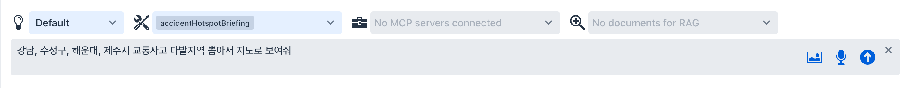
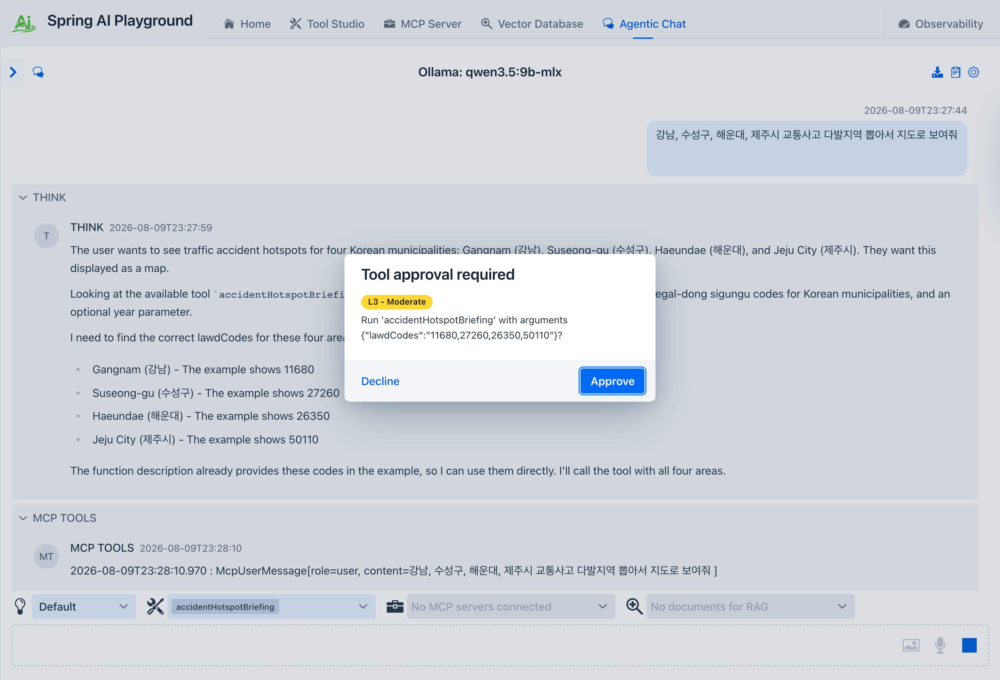
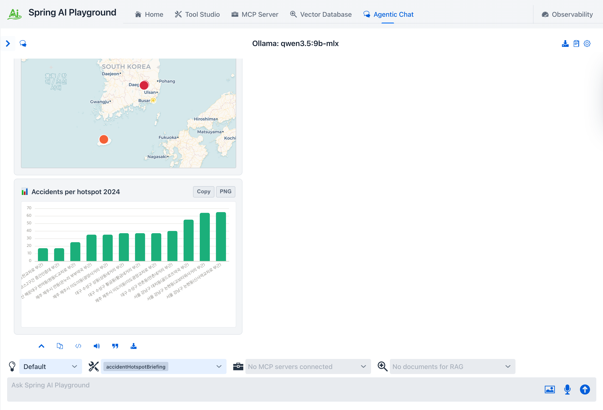
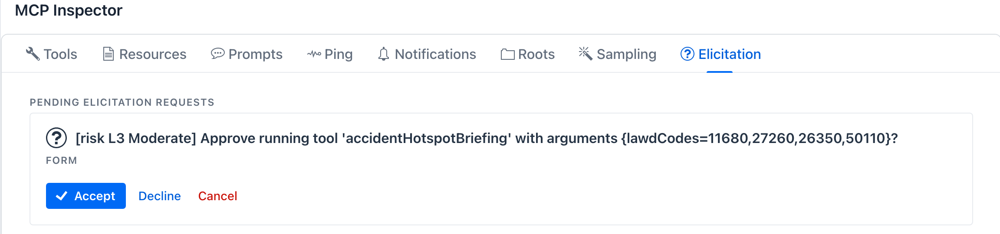

description: Tutorial 16 - wrap a public REST API you already have access to as a tool, gate it behind human approval, and ship it with Shipyard as its own MCP server that any MCP client can call.

# Tutorial 16 - From a Public API to Your Own MCP Server

**Time** 25 min · **Difficulty** ★★★ · **Surfaces** Tool Studio + Agentic Chat + MCP Server + Shipyard

!!! abstract "Goal"
    Take a REST API your organisation already has credentials for, wrap it in Tool Studio, put a **human approval gate** in front of it, and watch it go live on the built-in MCP server the moment it earns its Local Pass. Then ship that one tool as **its own MCP server** with Shipyard and run it in Docker, so Claude Desktop, Claude Code, or any other MCP client can call it - with the approval gate still in force and the API key still outside every file.

This is the end-to-end path the earlier tutorials cover in pieces. [Tutorial 8](8-default-tool-recipes.md) composes default tools inside one JS action; [Tutorial 11](11-human-approval.md) approves a call from chat. Here the two meet, and the result is shipped: a running MCP server that is yours, that publishes exactly the tools you vetted, and that asks before it acts.

The walkthrough uses a Korean government open-data service, because "we already have this API, can an agent use it?" is where most of these projects actually start. Any JSON REST API works the same way - substitute your own URL and key.

## What you need { #prerequisites }

- Spring AI Playground running (see [Getting Started](../getting-started/index.md)).
- Docker installed and running, for the last section.
- A **data.go.kr service key**. The walkthrough calls [KoROAD traffic-accident hotspots by municipality](https://www.data.go.kr/data/15057467/openapi.do). Sign in, click **활용신청**, and the development account is approved automatically.

!!! tip "No key? Run the same capstone against USGS"
    Every step below except the exact numbers is API-agnostic. To do the whole walkthrough with no credentials, copy [`getRecentEarthquakes`](../features/default-tools/global.md) instead of the traffic tool - it calls the USGS public catalog with no auth and already returns `latitude`, `longitude` and `magnitude`, so the same two action cards (a `plotPointsOnMap` weighted by magnitude and a ranked bar chart) fall out of it. Name the copy `earthquakeBriefing`, set **Network mode (fetch)** to `strict`, and skip straight to section 3. The approval dialog, the `L3 → L2 - Low` chip, the elicitation card and the Shipyard hand-off all behave identically.

!!! warning "Use the Decoding key, not the Encoding key"
    data.go.kr issues both forms. The Encoding key ends in `%3D%3D`, which is already URL-escaped. Every data.go.kr tool in this catalog runs the key through `encodeURIComponent`, so an Encoding key gets escaped twice and the service rejects it. Copy the **일반 인증키 (Decoding)** value.

    A freshly approved key can take a while to become active. If the first call returns `SERVICE_KEY_IS_NOT_REGISTERED_ERROR`, the key is probably fine and not yet propagated - wait and retry before you go hunting for a bug.

Set the key as an environment variable so it never lands in a file. In the desktop launcher use the **Environment Variables** card; for a source or Docker run, export it:

```bash
export DATA_GO_KR_TRAFFIC_KEY=your-decoding-key
```

## 1. Start from the bundled tool { #copy }

The catalog already ships a thin wrapper for this service, so you do not start from an empty editor.

1. Open **Tool Studio** and select [`getTrafficAccidentHotspots`](../features/default-tools/korea.md#getTrafficAccidentHotspots) in the left rail.
2. Read the action. It takes a `lawdCode`, calls one endpoint, and normalises the response. That is the shape of a minimal API wrapper.
3. Click **Copy And New Tool**. You get the same parameters and code under a fresh `toolId`, named `getTrafficAccidentHotspots_COPY`, with a `Draft` badge.
4. Rename it to `accidentHotspotBriefing`.

!!! note "Why the copy needs a different name"
    A tool name must be unique, and the shipped default tools reserve theirs. **Copy And New Tool** saves the copy as `<name>_COPY`; renaming it back to the default's name is refused on save with `A tool with this name already exists.` (or, if that default was removed, `'<name>' is the name of a built-in default tool. Choose a different name.`). The reservation is what lets the integrity check tell a genuine default from a lookalike - see [Default integrity](../mcp-server-safety.md).

!!! tip "The undocumented part of this API"
    The service wants `siDo` and `guGun` codes and publishes no code table. They are the 5-digit legal-dong sigungu code split in two: first 2 digits are `siDo`, last 3 are `guGun`. Seongdong `11200` becomes `11` / `200`, Gangnam `11680` becomes `11` / `680`. The bundled tool takes the single `lawdCode` and splits it internally, which is also what [`getApartmentTradePrice`](../features/default-tools/korea.md#getApartmentTradePrice) takes, so one code works across both tools.

## 2. Rewrite the action { #action }

One municipality returns only its top 3 hotspots, which is thin. A briefing wants several municipalities at once, ranked, and drawn on a map. Spread them across the country rather than picking neighbouring districts: the map card fits its view to the points and caps the zoom, so a set confined to one city collapses into a single cluster.

Change **Parameter #1** from `lawdCode` to `lawdCodes` and set its Test Value to `11680,27260,26350,50110` (Gangnam in Seoul, Suseong in Daegu, Haeundae in Busan, and Jeju City). Leave `year` as is and delete `numOfRows`. Then replace the JS action:

````javascript
const codes = String(lawdCodes).split(',').map(s => s.trim()).filter(Boolean);
if (codes.length === 0) throw new Error('lawdCodes required');

const asked = (year == null || year === '') ? null : String(year).trim().slice(0, 4);
const thisYear = new Date().getFullYear();
const years = asked ? [asked] : [String(thisYear - 1), String(thisYear - 2), String(thisYear - 3)];
const num = v => v == null || v === '' ? null : Number(String(v).replace(/,/g, '').trim());

const spots = [];
let usedYear = null;

for (const code of codes) {
  for (const y of years) {
    const url = 'https://apis.data.go.kr/B552061/frequentzoneLg/getRestFrequentzoneLg'
              + '?serviceKey='   + encodeURIComponent(dataGoKrTrafficKey)
              + '&searchYearCd=' + y
              + '&siDo='         + code.slice(0, 2)
              + '&guGun='        + code.slice(2)
              + '&type=json&numOfRows=10&pageNo=1';
    const resp = await fetch(url, { headers: { 'Accept': 'application/json' }, maxLength: 3_000_000 });
    if (!resp.ok) continue;
    const d = resp.json();
    if (d && d.OpenAPI_ServiceResponse) continue;
    let raw = (d.items && d.items.item) || [];
    if (raw && !Array.isArray(raw) && typeof raw === 'object') raw = [raw];
    if (raw.length === 0) continue;
    if (!usedYear) usedYear = y;
    for (const s of raw) spots.push({
      name: s.spot_nm, accidents: num(s.occrrnc_cnt), casualties: num(s.caslt_cnt),
      deaths: num(s.dth_dnv_cnt), lat: num(s.la_crd), lng: num(s.lo_crd),
    });
    break;
  }
}

if (spots.length === 0) return { ok: false, reason: 'no hotspot data for ' + codes.join(', ') };
spots.sort((a, b) => b.accidents - a.accidents);

// plotPointsOnMap sizes and colours a marker from `weight` on an earthquake-magnitude
// scale (radius = 4 + (weight - 4) * 3.5), so raw accident counts would draw 200px blobs.
// Rank the spots into the 4-9 band instead: smallest stays yellow and small, worst goes red.
const most = spots[0].accidents;
const least = spots[spots.length - 1].accidents;
const band = a => most === least ? 6 : 4 + ((a - least) / (most - least)) * 5;

const map = {
  type: 'pointmap',
  title: 'Traffic accident hotspots ' + usedYear,
  points: spots.map(s => ({
    lat: s.lat, lng: s.lng,
    label: s.name + ' (' + s.accidents + ')',
    weight: Math.round(band(s.accidents) * 10) / 10,
  })),
};
const chart = {
  type: 'chart', chartType: 'bar', sort: 'asc',
  title: 'Accidents per hotspot ' + usedYear,
  labels: spots.map(s => s.name),
  series: spots.map(s => s.accidents),
  seriesName: 'accidents',
};

return 'Collected ' + spots.length + ' hotspots across ' + codes.length + ' municipalities for ' + usedYear + '.'
     + '\n\n```saip-action\n' + JSON.stringify(map) + '\n```'
     + '\n\n```saip-action\n' + JSON.stringify(chart) + '\n```';
````

Three things in that action are worth naming.

**The year walks backwards.** This dataset lags roughly 18 months, so the current year returns `resultCode 03` with no rows. Rather than hard-coding a year that goes stale, an omitted `year` tries the last three and stops at the first one with data.

**The coordinates are already WGS84.** `la_crd` and `lo_crd` come back as plain latitude and longitude, so they feed [`plotPointsOnMap`](../features/default-tools/visualization.md) directly. Many Korean public datasets ship central-origin TM coordinates that need converting first; this one does not.

**Two action cards from one call.** The chat renderer scans a tool result for every ` ```saip-action ` block, not just the first, so one tool call can return a map *and* a chart. See [action cards](../features/agentic-chat/index.md#action-cards).

## 3. Test and publish { #publish }

Click **Test & Publish**. The sandbox runs the action with your Test Values, and on success three things happen at once:

- the `Draft` badge is replaced by a green **Local Pass** chip
- the tool count in the **LOCAL PASS** section of the left rail goes up by one
- the tool joins the built-in MCP server immediately - open **Built-in MCP Server Native Tools** and the exposed count includes it, with no restart


*The copy has earned its Local Pass, so it moved out of `DRAFTS` and the button now reads **Test & Update**. `lawdCodes` carries the Test Value the sandbox actually runs with.*

Run it once more with **Test Run** and read the Debug Console.


*Twelve hotspots from four municipalities in one call. The static variable line is the important one: the key is printed **masked** because it resolved from `${DATA_GO_KR_TRAFFIC_KEY}` at call time rather than being stored on the tool.*

!!! warning "No Test Value, no Local Pass, no MCP"
    This is the same gate as [Tutorial 1](1-author-tool.md). A tool that cannot run locally never reaches an MCP client.

## 4. Confirm the approval gate { #hitl }

Expand **Sandbox & Capabilities**. **Copy And New Tool** does not carry the original's sandbox over - a fresh copy reads `Locked L0` with **Human-in-the-loop** on `Disabled`, and in that state `fetch` is not even defined in the action. Set **Network mode (fetch)** to `strict` (or `allowlist` plus the host). The posture badge flips to `Network strict L3`, and *that* is what pulls **Human-in-the-loop** to `Required - ask every run` on its own - every tool above `L0` defaults to Required. So you do not have to turn the gate on; you have to decide whether to leave it on.

Leave it on, and optionally set an **Approval prompt** so the question names what is about to happen:

```
Query accident hotspots for {args}. Proceed?
```

`{toolName}` and `{args}` are substituted at call time. Click **Test & Update** to save.

!!! note "Read-only data still deserves the gate"
    The gate is not only about destructive actions. It is also where you see the exact arguments a model chose before a call leaves your machine against a credentialed government endpoint. Full picture: [Human-in-the-Loop Approval](../features/human-in-the-loop.md).

## 5. Call it from chat { #chat }

1. Open **Agentic Chat**.
2. In the tool menu above the prompt, tick **Manual built-in tool selection**. A tool you authored is a **custom** tool, so it is in the **Custom tools for this chat** picker - the one above **Built-in tools for this chat**, which lists only the shipped catalog. Pick `accidentHotspotBriefing` there.
3. Ask for it in plain language:

    *"강남, 수성구, 해운대, 제주시 교통사고 다발지역 뽑아서 지도로 보여줘"*


*One tool selected, one question. The model has to map the district names to codes on its own.*

Chat stops and the **Tool approval required** dialog appears with an `L3` chip, your prompt, and the arguments the model chose. Check that the `lawdCodes` it picked are the municipalities you asked about, then click **Approve**.


*The gate fired before the call left the machine. The arguments are the point: check that each code is a municipality you named (this capture comes from an earlier ask for 강남, 서초, 송파, which became `11680,11650,11710`), and this dialog is where you catch it if it is not.*

The tool runs, and the answer comes back with the map and the bar chart rendered inline as action cards.


*One tool call, two cards. The marker size and colour come from the `weight` the action computed, so the worst spot in the country reads at a glance.*


*The same twelve spots as a ranked bar chart. `sort: 'asc'` is what makes the ranking read left to right.*

!!! note "You may be asked more than once"
    Nothing forces the model to batch all four municipalities into one call. If it decides to call the tool once per municipality, each call opens its own dialog, and an unanswered dialog expires after the approval wait (three minutes by default) without running the tool. Approve each one, or write the tool description so the batched form is the obvious call.

!!! tip "If the model does not call the tool"
    Small models are best-effort at tool selection. The shipped default is `qwen3.5:4b`; switch to `qwen3.5:9b` in **Settings → Model** if a turn comes back without a tool call. See [Picking a model](index.md#picking-a-model).

## 6. What an external client sees { #external }

Chat is one caller. Any MCP client that connects to the built-in server at `/mcp` is another, and the gate follows the tool rather than the surface.

Open **MCP Server**, scroll to the **Inspector**, and on the **Tools** tab fill `lawdCodes` on the `accidentHotspotBriefing` card and press its play button. Two things then happen.

The tool's chip reads **`L3 → L2 - Low`** rather than plain `L3`. That is the [HITL mitigation credit](../features/human-in-the-loop.md#expose): the inherent level is still L3, but because a human gates every call the *effective* band drops one.

The call itself does not return yet. The approval leaves the server as an MCP **elicitation** request. It shows up on the running card itself - `Approval needed: [risk L3 Moderate] ...` with **Accept**, **Decline**, a `m:ss left to answer` countdown and a **Review** link - and the same request is listed on the Inspector's **Elicitation** tab.


*The same gate, one protocol layer down. The message is prefixed with `[risk L3 Moderate]` because the elicitation protocol has no severity field of its own.*

!!! warning "Answer before the countdown runs out"
    The request stays open for the [approval wait](../features/human-in-the-loop.md#wait) (three minutes by default). Left unanswered, the server records `hitl.server.timeout` and the call ends with `Tool 'accidentHotspotBriefing' was not run: no approval within 180 s` - refused, fail-safe. **Decline** ends it with `... was not run: human-in-the-loop approval was not granted.`

!!! warning "A client that cannot ask cannot approve"
    If an MCP client does not support elicitation, a `Required` tool is **denied** rather than silently executed. That is the fail-safe direction, but it does mean a gated tool is unusable from clients without elicitation support. Check your client before you gate a tool it needs.

## 7. Ship it as its own MCP server { #ship }

The built-in server publishes everything you expose from this playground. To hand this one vetted tool to someone else, ship it as a separate server that carries only that tool. [Shipyard](../features/mcp-server/index.md#shipyard) does that without leaving the app.

1. With `accidentHotspotBriefing` open in **Tool Studio**, click **Ship MCP Server** (the anchor icon) in the header. The Shipyard ship flow opens with the tool already in its **What goes in** table, marked **Tool** with its description and `L3`.
2. Name the server `accident-hotspots`. Leave the version at `0.1.0` and **Advanced** at its defaults: Streamable HTTP plus stdio on host port `18282`, model-free.
3. Click **Ship**.


*One tool ticked, one name typed. **Advanced** stays collapsed because its summary line already says what you get. An amber line appears only on a development build, which pins the image tag `latest`; a release or milestone build pins its own `v<version>` image.*

Shipyard writes the bundle to `~/spring-ai-playground/mcp/bundles/accident-hotspots/`. Two files in its `home/` carry the server:

- `saip-bundle.json` - the manifest: the tool id, its risk level and approval requirement, content hashes, and the **names** of the environment variables the server needs.
- `tool/save/toolSpecsMcpSetting.json` - the tool's JavaScript, its sandbox posture, its human-in-the-loop mode and prompt, and an exposed list holding only this tool.

Next to them sit a `Dockerfile`, its `.dockerignore`, `compose.yaml`, a `README.md` and a starter `server.json` for the MCP Registry. None of them carries the API key. The static variable still reads `${DATA_GO_KR_TRAFFIC_KEY}`, and `compose.yaml` passes that variable through from whatever environment starts the container.

!!! note "Export Tool Specification is a different thing"
    The **Export Tool Specification** button in the Tool Studio header dumps the model-facing schema only - name, description, and the parameter JSON Schema. It has no code and no approval settings, so it is not a migration artifact. The bundle is.

## 8. Run it and connect a client { #run }

Docker is needed from here on. On the success panel, click **Run**. Leave **Target** on `local` (this machine). The run dialog shows the image it builds from the bundle (`saip-mcp/accident-hotspots:0.1.0`), the port, and the `docker compose up -d --build` command it is about to run. Every start serves a fresh copy of the bundle, so the run never writes into it. It also lists `DATA_GO_KR_TRAFFIC_KEY` as a password field: leave it empty to pass through the value this playground already runs with, or type a different key. Either way the value is injected at run time and never written to disk. If the port will be reachable from anything other than your own machine, fill **SAIP_MCP_AUTH_TOKEN** so the server requires `Authorization: Bearer <token>`; see [Require a bearer token](../getting-started/external-connections.md#bearer-token). Click **Run**.

The status chip reads **Starting on :18282** while the container boots, then turns into **Running on :18282** once the container's `/actuator/health` reports `UP` - no reload needed.


*The shipped server, running in its own container and serving exactly one tool. Every tab under **Connect** is the same connection written for a different client.*

Click **Test connection**. It reports **OK - 1 tool(s)**: the container serves the tool you shipped and nothing else from your playground.

The **Connect** section under it has everything a client needs, with the bearer token filled in when you set one:

- **Claude Code** - a `claude mcp add --transport http accident-hotspots http://localhost:18282/mcp` command.
- **Install in Cursor** / **Install in VS Code** - one-click install links.
- **Claude Desktop (stdio)** - a `claude_desktop_config.json` entry that runs the same `saip-mcp/accident-hotspots:0.1.0` image in stdio mode, and forwards `-e DATA_GO_KR_TRAFFIC_KEY` from the client's own environment so the key stays out of that file too.
- **Generic JSON** and a **curl handshake** for anything else.

Ask the client for the hotspots, and the approval request reaches it as an elicitation before the call runs: the same question as on the Inspector's **Elicitation** tab in section 6, ending with `Answer within 180 s, or the call is refused.`, plus a pre-ticked **Run this call** checkbox. Only **Accept** with the box still ticked runs the tool; unticking it, declining, cancelling or letting the wait run out refuses the call.

!!! tip "Taking it beyond your machine"
    The **Publish** tab lists the commands that push the image you just ran under your own registry name, and the `server.json` to submit to the MCP Registry. If you change the tool in Tool Studio later, the server page marks the bundle **Out of date**; stop the container and **Rebuild** it. Shipyard refuses to rebuild or delete a running one.

## What you learned { #recap }

- A REST API you already have credentials for becomes an agent-callable tool by wrapping it in one JS action.
- **Local Pass publishes**. The moment the local test passes, the tool is live on the built-in MCP server - no restart, no redeploy.
- **The approval gate travels with the tool**, not with the UI. Chat shows a dialog; external MCP clients get an elicitation card; clients that cannot elicit are denied.
- **A vetted tool ships as its own server.** Shipyard bundles the tool, its sandbox posture and its approval gate, but not the credential. The container reads the key from the environment, so the same bundle runs anywhere Docker does.

## Next steps

- Swap the endpoint for one of your own. [`callDataGoKrOpenApi`](../features/default-tools/korea.md#callDataGoKrOpenApi) reaches any other data.go.kr service, and the same pattern applies to any JSON API.
- Widen the briefing: [pedestrian](https://www.data.go.kr/data/15105289/openapi.do) and [bicycle](https://www.data.go.kr/data/15056681/openapi.do) accident hotspots use the same request shape, so one tool can layer all three on a single map.
- Re-expose someone else's MCP server through yours with the same gate: [Tutorial 10 - Proxy an MCP Server](10-proxy-external-tool.md).
- Understand the two gates and loopback de-duplication: [Human-in-the-Loop architecture](../hitl-architecture.md).
