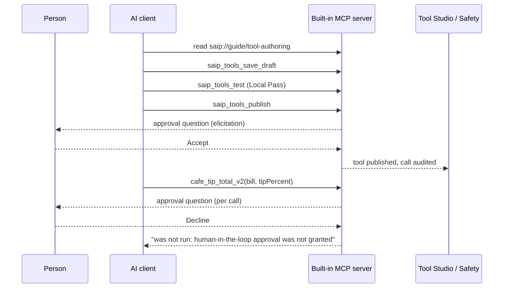
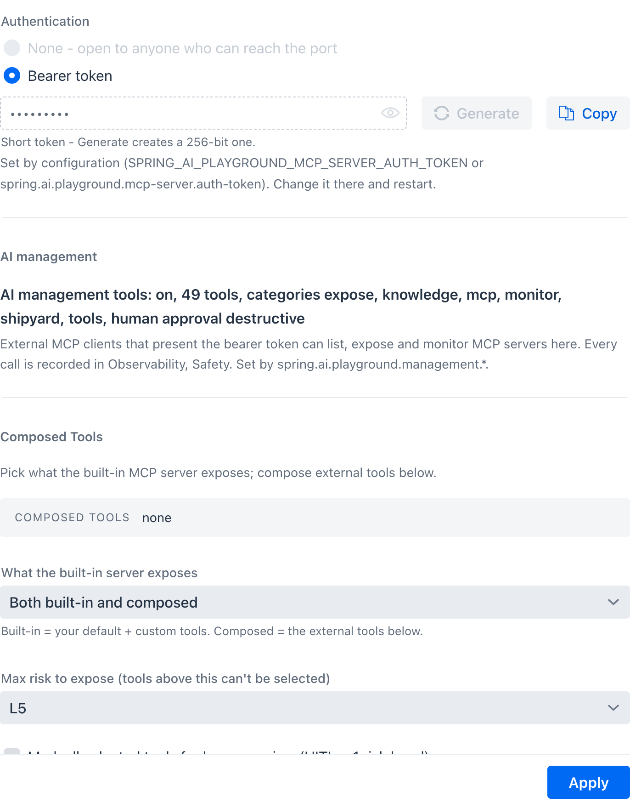
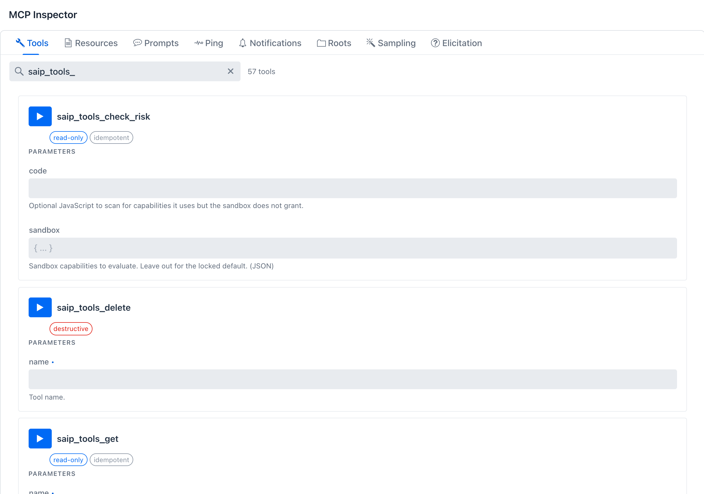
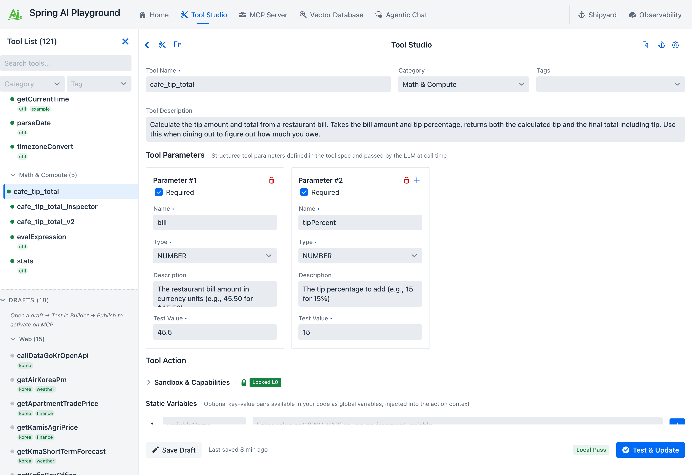
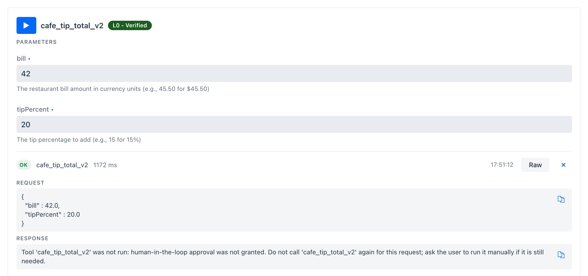
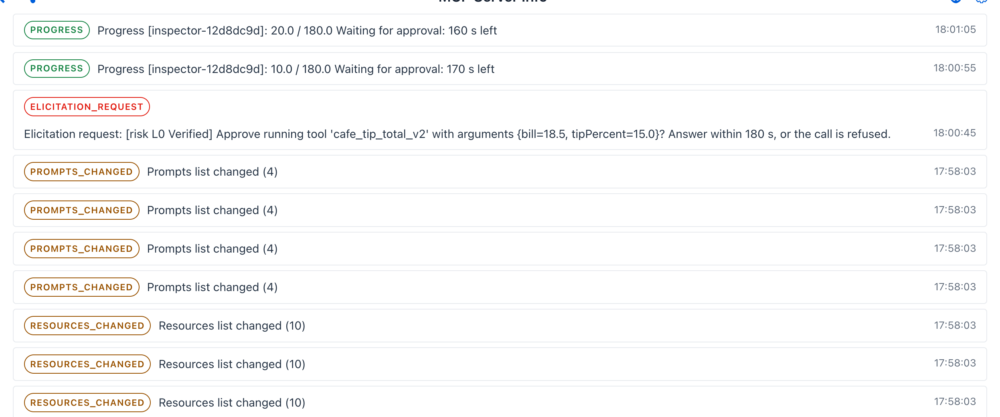

# Tutorial 18 - Let an AI Author a Tool

**Time** 20 min · **Difficulty** ★★☆ · **Surfaces** MCP Server + Tool Studio + Observability

!!! abstract "Goal"
    Hand the keyboard to an AI. An external MCP client connects to the built-in server with a bearer token, reads the authoring guide the app serves, and writes, tests and publishes a tool with the `saip_tools_*` [management tools](../features/mcp-server/management-tools.md#writing-a-tool). You take part at the gates only: you approve the publish, and later you decline a call. When it is done, Tool Studio shows a tool you cannot tell from one you wrote yourself, and the Safety dashboard lists every call the AI made.

[Tutorial 1](1-author-tool.md) authors a tool by hand. This tutorial lets an AI do the same job over MCP, under the same rules: a tool is a draft until it earns its Local Pass, only a published tool is offered to clients, and a person approves the publish. [Tutorial 11](11-human-approval.md) and [section 6 of Tutorial 16](16-public-api-to-mcp-server.md#external) showed the approval gate from chat and from an external client; here the gate also stands in front of the AI that builds the tool, not only the one that calls it.



## What you need { #prerequisites }

- Spring AI Playground running (see [Getting Started](../getting-started/index.md)).
- An MCP client that supports **elicitation**, the MCP request a server uses to ask the person a question. Claude Code, Claude Desktop and Cursor do. The walkthrough also shows every step on the app's own [MCP Inspector](../features/mcp-server/inspector.md), which needs nothing installed, so you can follow it with no client at all.
- No model of your own is required: the AI lives in the client. The app only runs the tool's test in its sandbox.

## 1. Switch the management surface on { #token }

Management tools are offered only when the built-in server requires a bearer token. Without one, anybody who can reach the port could manage the app, so the tools are not registered at all.

1. Open **MCP Server**. The built-in server is selected in the left rail.
2. Click the gear icon at the top right of **MCP Server Info**. Under **Authentication** pick **Bearer token**, generate or paste one, and copy it for the client. (`spring.ai.playground.mcp-server.auth-token` or `SPRING_AI_PLAYGROUND_MCP_SERVER_AUTH_TOKEN` sets the same token from configuration.)
3. Click **Apply**. The drawer's **AI management** line changes from `AI management tools: off (no bearer token on the built-in server)` to `AI management tools: on, 51 tools, categories chat, expose, knowledge, mcp, monitor, shipyard, tools, human approval destructive`.


*One switch. The token is what turns the management tools on; `human approval destructive` is the default approval mode, so publishing asks and drafting does not. Here the token came from configuration, which is why the field is read-only. This screenshot was taken with the `chat` category off, so it reads 49 tools.*

!!! note "Chat never sees these tools"
    The app's own Agentic Chat is not offered any `saip_` tool, whatever the token. Only external clients and the Inspector get them. See [Approval](../features/mcp-server/management-tools.md#approval) for the reasoning.

## 2. Connect the AI client { #connect }

Register the built-in server in your client with the token in the `Authorization` header. This is the shape Claude Code's `.mcp.json` and Cursor's `mcp.json` use; Claude Desktop takes the same URL and header in its connector settings.

```json
{
  "mcpServers": {
    "playground": {
      "type": "http",
      "url": "http://127.0.0.1:8282/mcp",
      "headers": { "Authorization": "Bearer <your token>" }
    }
  }
}
```

After the client connects, its tool list shows 51 `saip_` tools next to your own, nine of them `saip_tools_*`. Two more things arrive with them: the prompt `saip_create_tool`, which starts the authoring procedure, and the resource `saip://guide/tool-authoring`, the procedure itself, with `/runtime`, `/sandbox`, `/testing`, `/mistakes` and `/examples` beside it. The AI reads those instead of guessing; [AI Guides, Templates and Samples](../features/mcp-server/ai-guides.md#tool-authoring) shows them word for word.


*The same nine tools on the Inspector's Tools tab, which is how you call them by hand. The `read-only` and `destructive` chips are the MCP hints every management tool carries, so a client knows which calls to warn about.*

## 3. Ask for a tool { #ask }

Give the AI one sentence:

*"Make a tool named cafe_tip_total that takes a restaurant bill amount and a tip percent, returns the tip and the total, test it and publish it."*

What a local 9B model did with that sentence in this walkthrough, call by call, in under three minutes:

| Step | Call | What came back |
|---|---|---|
| 1 | `read_resource saip://guide/tool-authoring` | The procedure: six steps and the spec table |
| 2 | `saip_tools_list` with `query: "tip"` | The existing tools, so the name is free |
| 3 | `read_resource saip://guide/tool-authoring/examples`, then `saip://examples/stats` | A tested L0 example to copy the shape from |
| 4 | `saip_tools_save_draft` with parameters `bill` and `tipPercent` | `Saved draft 'cafe_tip_total' (risk L0, calls run without human approval). Drafts are saved on this app but are not visible to MCP clients.` |
| 5 | `saip_tools_test` with the draft passed as a JSON string | Refused by the schema: `draft` must be an object. The AI read the error and switched to testing by name |
| 6 | `saip_tools_test` with `name` | `Test passed (Local Pass) in 677 ms. Do not test it again, next: saip_tools_publish with name 'cafe_tip_total'.` |
| 7 | `saip_tools_publish` | **Your approval question**, then `Published tool 'cafe_tip_total'. Visible to MCP clients.` |

Step 7 is where you come in. The client shows you the question the server sent, word for word:

```
[DESTRUCTIVE] <client name and version> wants to run saip_tools_publish: Publish the tool 'cafe_tip_total'
(risk L0, locked sandbox). It will be visible to MCP clients as soon as it is published.
Calls run without human approval. Answer within 180 s, or the call is refused.
```

Read it the way it is written: who (the client's name and version), what (the tool and its risk), what changes (visible to clients), and how long you have. Click **Accept**. An external client shows the same question with one checkbox, **Run this call**, already ticked, and its own **Accept**.


*The publish question as the Inspector renders it, with the card's own countdown. An external client shows the same text in its own approval UI with one checkbox, **Run this call**, already ticked; the Inspector's **Accept** sends it as it is.*

!!! tip "A failing test teaches the AI"
    When a test fails, the result carries a hint next to the error (for a typo, `ReferenceError: amout is not defined` with the note that parameters are only available under the names you declared). A client fixes the draft from that hint and tests again; nothing is published until the test passes, because `saip_tools_publish` runs the test itself before it asks you. Step 5 above is the same mechanism one level up: a request in the wrong shape is refused with the reason, never guessed at.

!!! warning "Drafts are private"
    Until step 7 the tool exists only as a draft: it is not offered to any MCP client and cannot be called. Publishing is the one step that needs your approval precisely because it is the step that makes the tool reachable.

## 4. See it in Tool Studio { #tool-studio }

Open **Tool Studio** and select `cafe_tip_total` under **Math & Compute**.


*Nothing marks it as AI-written. Same badge, same category, same test values, same sandbox posture as a tool you would have built in Tutorial 1.*

It has a Local Pass because the AI ran `saip_tools_test` and the publish ran it again. It sits at `L0` because the code never asked for the network or the file system. Had the AI asked for `networkMode: open` or `fileWrite`, the test itself would have needed your approval even under the default mode, and with approval set to `none` it is refused - the sandbox baseline is not the AI's to raise on its own.

## 5. Call it, then make it ask every time { #call }

The tool is exposed the moment it is published (the exposure drawer's *auto-add* default), so the same client can call it right away:

```
cafe_tip_total {"bill": 18.5, "tipPercent": 15}
-> {"tip":2.78,"total":21.28}
```

No question this time: the tool is `L0` and `humanApproval` is off. Now ask the AI to change that:

*"Make cafe_tip_total require my approval for every call."*

A published tool cannot be edited over MCP. If the AI tries to save a draft under the same name it is told so: `'cafe_tip_total' is already published and is not changed here. Save the new version as a draft under another name, publish it, then delete the old tool with saip_tools_delete.` So it saves `cafe_tip_total_v2` with `humanApproval: true`, tests it, and publishes it - the question now ends with `A person approves every call.` - then deletes the old one, which is the second destructive question: `Delete the tool 'cafe_tip_total' (published and visible to MCP clients).` Two approvals, and the replacement is live.

From here each call is a question:

```
[risk L0 Verified] Approve running tool 'cafe_tip_total_v2' with arguments {bill=18.5, tipPercent=15}?
Answer within 180 s, or the call is refused.
```

Accept the first one and the result comes back as before. On the next call click **Decline**. The tool does not run, and the AI receives this instead of a result:

```
Tool 'cafe_tip_total_v2' was not run: human-in-the-loop approval was not granted.
Do not call 'cafe_tip_total_v2' again for this request; ask the user to run it manually if it is still needed.
```


*A decline is an answer, not a transport error. The text tells the AI what to do next: stop retrying and hand the decision back to you.*

!!! warning "Answer before the countdown runs out"
    Each question stays open for the [approval wait](../features/human-in-the-loop.md#wait), 180 seconds by default. The question says so, and a client that sent a `progressToken` with the call also receives a progress notification every 10 seconds (`Waiting for approval: 170 s left`). Left unanswered, the call is refused with `Tool 'cafe_tip_total_v2' was not run: no approval within 180 s`, counted as **server / timeout** on the Safety dashboard; an answer that arrives later is ignored.

## 6. What the app refuses on its own { #refusals }

Some things the AI cannot talk you into, because the app refuses them before any question is asked. Each is spelled out in the error the AI gets back, so it can correct course.

- **No test, no publish.** `saip_tools_publish` runs the Local Pass itself and stops on a failure.
- **A sandbox above the baseline always asks.** A test or publish with `networkMode: open`, `fileWrite` or extra Java classes is a high-risk action: it asks even when the approval mode is `destructive`, and is refused outright when it is `none`; the question names the setting: `[WRITE] <client> wants to run saip_tools_test: Run the tool code of 'cafe_open_probe' in the sandbox (risk L4, networkMode=open).`
- **Secrets never pass through.** A static variable or header that looks like a secret must be an environment reference: `Static variable 'apiKey' looks like a secret but holds a literal value. Secrets must not pass through this interface: set an environment variable on the machine that runs this app and reference it as ${ENV_NAME} instead.`
- **A client that cannot ask is refused.** Without elicitation support the publish ends with `Tool 'saip_tools_publish' was not run: it needs human approval and this client cannot ask for it (no elicitation support). Ask the user to run it from a client that supports elicitation, or to make the change in the app.` Nothing is published silently.
- **Published tools are replaced, not edited.** As section 5 showed, a new version is a new draft under a new name; the old tool goes through its own delete approval.
- **Names are checked.** A name starting with `saip_`, a name another tool uses, or a bundled tool's name is refused, and bundled tools cannot be deleted.

The full list is in [Rules that can refuse a change](../features/mcp-server/management-tools.md#rules-that-can-refuse-a-change).

## 7. Read the audit trail { #audit }

Open **Observability** and the **Safety** tab. **Management tool calls** lists every management call with the time, the outcome, the tool and its approval level, the client's name and version, and the duration. **HITL decisions** above it counts the per-call approvals of section 5 as *server / approved* and *server / declined*.


*The same trail from the person's side: which client called which management tool, at what level, with what outcome. Declined and refused calls appear here too.*

The AI can read the same trail: `saip_monitor_management_log` returns these rows and `saip_monitor_hitl` the approval counts, so an agent can check its own work before it reports to you. Both are kept in memory and start empty after a restart; the tools themselves, and their exposure, persist.

??? example "Optional: watch the wait as the client sees it"
    On the Inspector, call `cafe_tip_total_v2` and wait about 25 seconds before answering, then open the **Notifications** tab. The Inspector sends a `progressToken` with every call, so the rows read `Progress [inspector-...]: 10.0 / 180.0 Waiting for approval: 170 s left`, then `20.0 / 180.0 ... 160 s left`, ten seconds apart - the notifications an external client receives while its person decides. The elicitation request itself is listed just below them.

    

## 8. Clean up { #cleanup }

Ask the AI to delete the tool. `saip_tools_delete` is destructive, so one more question arrives (`Delete the tool 'cafe_tip_total_v2' (published and visible to MCP clients).`); accept it and the tool is gone from Tool Studio. Or delete it there yourself - the AI has no special standing, and the app does not care which of you presses the button.

## What you learned { #recap }

- The bearer token is the switch: without it the management tools do not exist on the server.
- An AI authors a tool through the same gates as a person: draft, Local Pass, publish, with the publish needing your approval.
- The approval question is text you can read, it says how long you have, and a decline tells the AI to stop.
- The app refuses the dangerous shortcuts on its own: no untested publish, no silent sandbox escalation, no literal secrets, no approval-free client, no editing a published tool in place.
- Everything the AI did is on the Safety dashboard, and the AI can read that trail too.

## Next steps

- [AI Operations Architecture](../ai-operations-architecture.md) describes the registration, the approval gate and the audit trail behind every call this tutorial made.
- [Tutorial 16](16-public-api-to-mcp-server.md) ships a tool like this one as its own MCP server with Shipyard; the `saip_shipyard_*` tools let an AI do that part as well.
- [AI Guides, Templates and Samples](../features/mcp-server/ai-guides.md) shows the guides, the `saip_create_tool` prompt and the example tools the AI read, and how to read them yourself.
- [Management MCP Tools](../features/mcp-server/management-tools.md) covers the other areas an AI can operate: exposing tools of registered servers, indexing knowledge, shipping servers and monitoring.
- [Human-in-the-Loop Approval](../hitl-architecture.md) explains the gates, the single wait and why a refusal is always explicit.
