# Tutorial 19 - Ship a Knowledge Server and Hand It to ChatGPT

**Time** 25 min · **Difficulty** ★★★ · **Surfaces** Vector Database + Shipyard + MCP Server + Observability

!!! abstract "Goal"
    Turn two documents into a knowledge MCP server that runs on its own in Docker, and give it to ChatGPT. Then let ChatGPT change it: through the [management MCP tools](../features/mcp-server/management-tools.md) it writes a tool, publishes it after your approval, and ships a new version of the server that carries the tool next to the knowledge. You take part at the approval cards only. At the end ChatGPT reports what it did from the app's own monitoring tools, and you open the Safety dashboard and see the same numbers.

[Tutorial 16](16-public-api-to-mcp-server.md) ships one hand-written tool with [Shipyard](../features/mcp-server/index.md#shipyard). [Tutorial 18](18-ai-authors-a-tool.md) lets an AI write a tool over MCP. This tutorial joins the two around a **knowledge** server: the thing shipped is a search over your documents, and ChatGPT both uses the server and extends it. The shipped server does not depend on the playground: in the last section you stop the app and the server keeps answering.

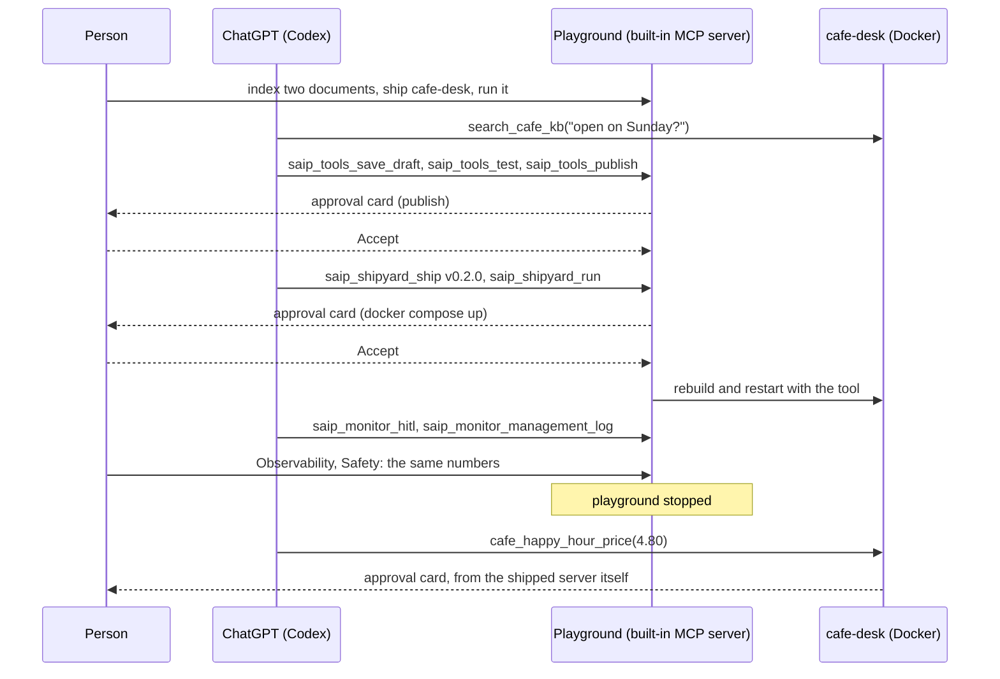

## What you need { #prerequisites }

- Spring AI Playground running (see [Getting Started](../getting-started/index.md)), with Ollama and `qwen3-embedding:0.6b` for indexing. No chat model is needed: the AI lives in ChatGPT.
- Docker installed and running.
- The **ChatGPT desktop app**. Since mid 2026 it contains Codex, OpenAI's coding agent, and Codex is the part that connects to MCP servers and shows approval cards. Any other MCP client that supports **elicitation** works the same way; the Claude Code configuration is shown next to the Codex one.
- The built-in MCP server switched to a **bearer token**, which is what turns the management tools on. [Section 1 of Tutorial 18](18-ai-authors-a-tool.md#token) shows the switch.
- Two short documents about a fictional cafe. Save them as `lighthouse-cafe-handbook.md` and `lighthouse-cafe-menu.md`:

??? example "The two documents"
    `lighthouse-cafe-handbook.md`

    ```markdown
    # Lighthouse Cafe staff handbook

    ## Opening hours
    The cafe is open Monday to Saturday from 07:00 to 19:00. On Sunday the cafe opens at 09:00
    and closes at 15:00. The kitchen closes one hour before the cafe closes.

    ## Happy hour
    Happy hour runs on weekdays from 15:00 to 17:00. Every drink on the menu gets a 20 percent
    discount. Food is not part of happy hour.

    ## Allergies
    Oat milk is the only milk alternative that is prepared in a separate jug. Nut-free pastries
    are baked before 06:30 and stored in the blue boxes. Always ask the guest about allergies
    before taking the order.

    ## Closing routine
    Wipe the espresso machine, empty the knock box, and count the register. Two people must be
    present when the safe is opened.
    ```

    `lighthouse-cafe-menu.md`

    ```markdown
    # Lighthouse Cafe menu

    ## Coffee
    - Espresso 3.00
    - Flat white, small 4.20, large 4.80
    - Cappuccino 4.40
    - Cold brew 4.90

    ## Tea
    - Black tea 3.20
    - Green tea 3.40
    - Chai latte 4.60

    ## Food
    - Butter croissant 3.10
    - Almond croissant 3.80
    - Ham and cheese toastie 6.50
    - Soup of the day 5.90, served from 11:30 until the kitchen closes

    ## Extras
    - Oat milk +0.50
    - Extra shot +0.80
    ```

A fictional cafe is the point: no model knows these hours or prices, so every correct answer later has to come from the server.

## 1. Give the server something to know { #index }

1. Open **Vector Database** and click the document-add icon to open **New Document & ETL Pipeline**. Drop `lighthouse-cafe-handbook.md` on it, leave the reader on `MARKDOWN`, click **Chunk Document** and then embed. Repeat for `lighthouse-cafe-menu.md`. Each file becomes four chunks. [Tutorial 3](3-index-document.md) walks through the dialog in detail.
2. Click **New RAG Pipeline**. On the **Retrieval** tab pick both documents as the search scope and leave the rest at its defaults. Save it as `Cafe KB`.
3. Run a similarity search for `large flat white` to see the menu chunk come back.

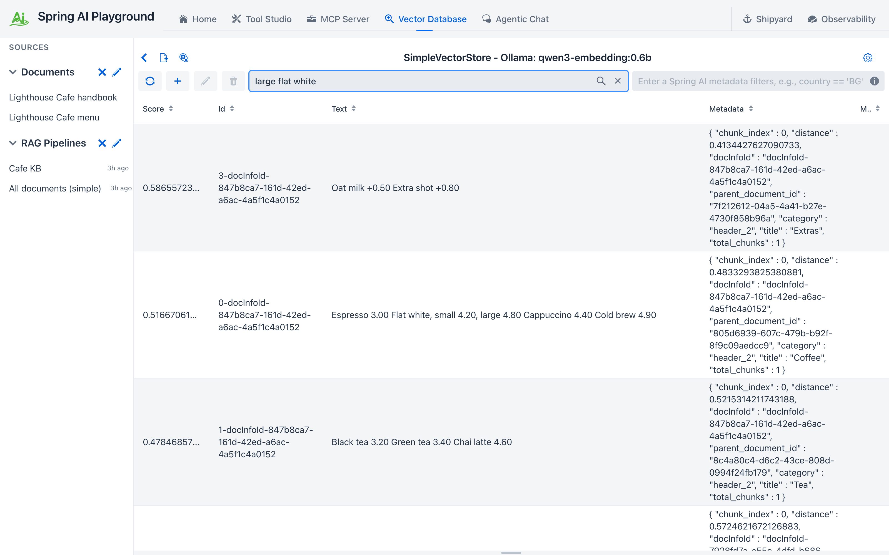
*Two documents, one pipeline. The search for a large flat white brings back the coffee chunk with the 4.80 price.*

The pipeline is what the server will ship: one search tool over exactly these two documents. Without a pipeline the ship flow offers each document as a tool of its own, which also works, but one tool is easier for the AI to pick.

## 2. Ship it as its own MCP server { #ship }

1. Open **Shipyard** and start a new server. In **What goes in** click **+ Knowledge** and tick `Cafe KB`. The row shows the tool the server will expose, `search_cafe_kb`, with a default `top_k` of 3. Expand the row and click **Try** with `Is the cafe open on Sunday?`: the excerpts you see are exactly what the shipped tool will return.
2. Name the server `cafe-desk`. Leave the version at `0.1.0` and **Advanced** at its defaults: Streamable HTTP plus stdio on host port `18282`, model-free except for the embedding model the pipeline was indexed with, which Shipyard reads from this app.
3. Click **Ship**, then **Run** on the success panel with **Target** left on `local`. The status chip reads **Starting on :18282** while Docker builds the image, then **Running on :18282**.
4. Click **Test connection**. It reports **OK - 1 tool(s)**.


*The ship form before shipping. Try runs the search the way the container will, and the preview lists what the server needs at run time.*


*The server is up. The Connect tabs hold the same connection for Claude Code, Claude Desktop, generic JSON and curl.*

The bundle under `~/spring-ai-playground/mcp/bundles/cafe-desk/` carries the pipeline as configured, the chunks and their vectors, so the container never re-indexes. What it needs at run time is the embedding model, to embed the question. The **Connect** section lists the same connection for several clients; the next section uses the URL from its **Generic JSON** tab.

## 3. Connect ChatGPT { #connect }

Codex, inside the ChatGPT app, reads its MCP servers from `~/.codex/config.toml`. Add two: the playground's built-in server with the bearer token, and the server you just shipped.

=== "ChatGPT (Codex)"
    ```toml
    [mcp_servers.playground]
    url = "http://127.0.0.1:8282/mcp"
    http_headers = { Authorization = "Bearer <your token>" }
    tool_timeout_sec = 200

    [mcp_servers.cafe-desk]
    url = "http://127.0.0.1:18282/mcp"
    ```

=== "Claude Code"
    ```bash
    claude mcp add --transport http playground http://127.0.0.1:8282/mcp --header "Authorization: Bearer <your token>"
    claude mcp add --transport http cafe-desk http://127.0.0.1:18282/mcp
    claude mcp list
    ```

    The last command reports both as `Connected`. Add `--scope user` to make the servers available in every project instead of the current one. The same two entries can be written by hand into `.mcp.json` as `{"type": "http", "url": ..., "headers": {...}}`, which is the form [Tutorial 18](18-ai-authors-a-tool.md#connect) shows.

Quit the ChatGPT app and open it again: Codex reads the file when it starts. In the **Codex** view start a new chat; the **Sources** panel on the right lists both servers once the first message is sent. Claude Code picks the servers up on its next start as well; the rest of this tutorial shows Codex, and the Claude Code notes say where that client differs.

!!! warning "`tool_timeout_sec` is not optional"
    Codex gives a tool call 60 seconds by default and then cancels it. The playground's approval cards stay open for 180 seconds (the [approval wait](../features/human-in-the-loop.md#wait)), so without the longer timeout a card you take a minute to read disappears, and the server records a decline you never made. 200 seconds leaves room for the whole wait.

## 4. Ask the cafe { #ask }

In the new chat:

*"Use the cafe-desk MCP server: is the cafe open on Sunday, and what does a large flat white cost?"*

Codex calls `search_cafe_kb` once and answers from the excerpts: open Sunday from 09:00 to 15:00, a large flat white is 4.80. Both facts live only in your two files, which is how you know the answer came from the server. The **Tools** tab of the `cafe-desk` page in Shipyard has a **Try** button that runs the same search through the container, if you want to see the raw excerpts.

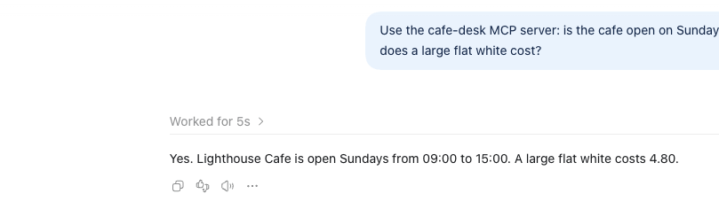
*Codex's answer, from one call to the shipped server. The Sources panel on the right shows which server it used.*

## 5. Let ChatGPT add a tool { #tool }

The handbook says happy hour takes 20 percent off every drink. Ask ChatGPT to turn that rule into a tool, through the playground this time:

*"Using the playground MCP server: read the resource saip://guide/tool-authoring, then author a tool named cafe_happy_hour_price that takes a menu price and returns the price after a 20 percent happy hour discount, with humanApproval turned on. Save it as a draft, test it, and publish it. Do not ship or run any servers, and do not call the tool yet. Report exactly what each step returned."*

The resource it names is the tool-authoring guide the app serves; [AI Guides, Templates and Samples](../features/mcp-server/ai-guides.md#tool-authoring) shows it word for word.

What ChatGPT did with that, call by call, in under two minutes:

| Step | Call | What came back |
|---|---|---|
| 1 | `read_resource saip://guide/tool-authoring` | The authoring procedure: check for similar tools, save a draft, test, publish; publishing needs a person |
| 2 | `saip_tools_check_risk`, `saip_tools_list` | `Risk L0`, and no existing tool with a similar name |
| 3 | `saip_tools_save_draft` with one parameter `menuPrice` | `Saved draft 'cafe_happy_hour_price' (risk L0, a person approves every call). Drafts are saved on this app but are not visible to MCP clients.` |
| 4 | `saip_tools_test` with `name` | `Test passed (Local Pass) in 797 ms.`, result `10.0` for the test value 12.5 |
| 5 | `saip_tools_publish` | **Your approval card**, then `Published tool 'cafe_happy_hour_price'. Visible to MCP clients.` |

Step 5 is where the card appears at the bottom of the chat. It is the question the server sent, word for word:

```
[DESTRUCTIVE] codex-mcp-client 0.166.0-alpha.5.1 wants to run saip_tools_publish: Publish the tool
'cafe_happy_hour_price' (risk L0, locked sandbox). It will be visible to MCP clients as soon as it is
published. A person approves every call. Answer within 180 s, or the call is refused.
```

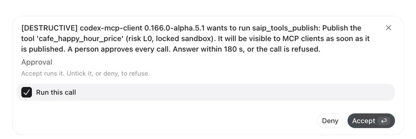
*The publish question as Codex shows it. The text is the server's; the buttons are Codex's.*

Codex renders it with one checkbox, **Run this call**, already ticked, above the buttons **Deny** and **Accept**. Click **Accept**. Unticking the box and then clicking Accept refuses the call, the same as **Deny**. The tool is now published, exposed on the built-in server, and visible in **Tool Studio** under **Math & Compute** with a Local Pass and an `L0` badge, the same as a tool you would have written yourself.

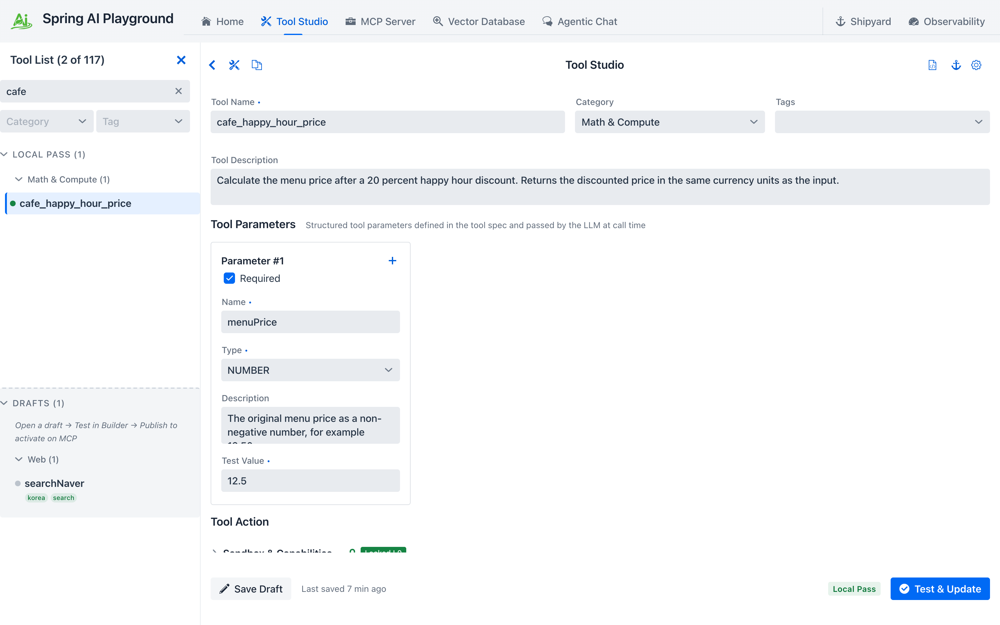
*The tool ChatGPT wrote, in Tool Studio. Nothing marks it as AI-authored; it went through the same draft, test and publish steps.*

!!! note "Published tools show up in a new chat"
    Codex fetches a server's tool list when a chat first uses that server and does not refresh it afterwards. The chat that published `cafe_happy_hour_price` cannot call it; a new chat can. Start one before the next prompt.

Now call it, twice:

*"Using the playground MCP server, call the published tool cafe_happy_hour_price with menu price 4.80 and tell me the result. Then call it again with menu price 8.50 and tell me the result. If a call is declined, say so and do not retry."*

Because the tool was created with `humanApproval` on, every call is a question:

```
[risk L0 Verified] Approve running tool 'cafe_happy_hour_price' with arguments {menuPrice=4.8}?
Answer within 180 s, or the call is refused.
```

**Accept** the first one: the result is `3.84`. **Deny** the second. The tool does not run, and ChatGPT receives this instead of a result:

```
Tool 'cafe_happy_hour_price' was not run: human-in-the-loop approval was not granted.
Do not call 'cafe_happy_hour_price' again for this request; ask the user to run it manually if it is still needed.
```

Its answer reads back the two outcomes: `4.80 -> 3.84`, and `8.50: declined, human approval was not granted. I did not retry.` A decline is an answer the AI can act on, not an error it should work around. Closing the card with its X, or pressing Escape, counts as a refusal too.

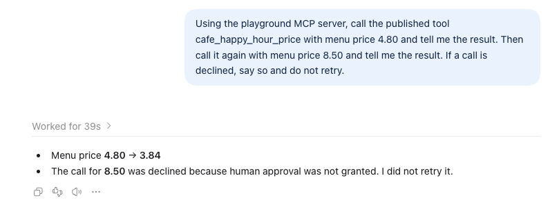
*One accepted, one denied. The AI reports the refusal as a result and stops.*

!!! note "Claude Code: interactive yes, headless no"
    In an interactive `claude` session the same question reaches you in the terminal and waits for your answer. **Run this call** is already set; Return moves to **Accept** and Return again runs the tool, Backspace unsets the choice, and Escape cancels:

    ```
    MCP server "playground" requests your input
    [risk L0 Verified] Approve running tool 'cafe_happy_hour_price' with arguments {menuPrice=4.8}?
    Answer within 180 s, or the call is refused.
    ❯ ✔ Approval: ▸ Run this call
         Accept runs it. Untick it, or deny, to refuse.
      Accept    Decline
    Esc to cancel · ↑/↓ to navigate · Backspace to unset · → to expand
    ```

    The headless form has nobody to ask: `claude -p "call cafe_happy_hour_price with 4.80" --allowedTools "mcp__playground__cafe_happy_hour_price"` cancels the question within seconds, the server records a decline, and Claude reports the refusal it received: `Tool 'cafe_happy_hour_price' was not run: human-in-the-loop approval was not granted.` A tool that needs a person cannot be driven from a script, which is the fail-safe direction. Tools without approval work headlessly: `claude -p "is the cafe open on Sunday?" --allowedTools "mcp__cafe-desk__search_cafe_kb"` answers from the shipped server.

!!! warning "What the AI cannot talk you into"
    Ask for a variant that fetches a URL with `networkMode: open`. The test itself asks even under the default approval mode, because the sandbox posture is above the baseline: `[WRITE] codex-mcp-client ... wants to run saip_tools_test: Run the tool code of 'cafe_menu_fetch' in the sandbox (risk L4, networkMode=open). Answer within 180 s, or the call is refused.` Deny it and the AI gets `Tool 'saip_tools_test' was not run: the user declined. Do not retry it for this request.` Nothing was saved. [Section 6 of Tutorial 18](18-ai-authors-a-tool.md#refusals) lists the other refusals the app makes on its own.

    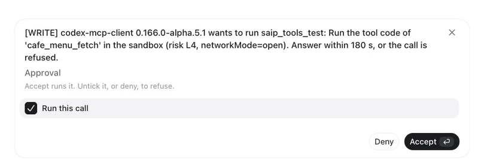

## 6. Ship version 0.2.0 with the tool { #reship }

The tool lives in the playground. To put it next to the knowledge in the standalone server, ChatGPT re-ships the server with the `saip_shipyard_*` tools:

*"Using the playground MCP server's saip_shipyard_* tools: the server cafe-desk v0.1.0 is running. Stop it, then validate and ship cafe-desk version 0.2.0 that carries the tool cafe_happy_hour_price and the knowledge source "Cafe KB" as search tool search_cafe_kb with topK 3, on host port 18282. Then run it and poll saip_shipyard_status until it is RUNNING. Report exactly what each step returned, including every approval question and its outcome. Do not create any other server."*

The sequence it runs, and which steps ask you:

| Call | Level | What happens |
|---|---|---|
| `saip_shipyard_list_servers`, `saip_shipyard_status` | read | Finds `cafe-desk` v0.1.0 `RUNNING` |
| `saip_shipyard_stop` | write | No question; the container stops. A running server cannot be rebuilt |
| `saip_shipyard_list_shippable` | read | The tested Tool Studio tools and the knowledge sources, with `cafe_happy_hour_price` and `Cafe KB` among them |
| `saip_shipyard_validate` | read | `Ready to ship: 2 tool(s), 1 warning(s).` The warning: `Server 'cafe-desk' already exists; shipping replaces its bundle` |
| `saip_shipyard_ship` | write | `Shipped 'cafe-desk' v0.2.0 to .../mcp/bundles/cafe-desk.` No question: a bundle on disk serves nothing yet |
| `saip_shipyard_run` | destructive | **Your approval card**, quoting the exact command: `Run 'cafe-desk' on Docker on this machine as localhost:18282. Runs the command: docker compose -f .../cafe-desk/compose.yaml up -d --build. Answer within 180 s, or the call is refused.` |
| `saip_shipyard_status`, repeated | read | `STARTING` while the image builds, then `RUNNING`, with the connection snippets |

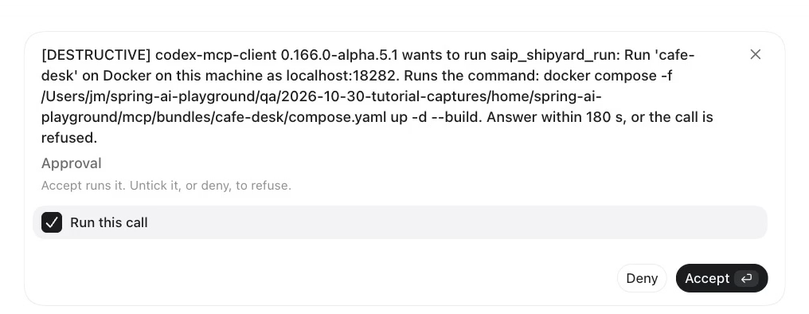
*The one card of this section. It names the exact command that will run on your machine.*

**Accept** the run. Within about a minute Codex reports `cafe-desk v0.2.0 is RUNNING locally at http://localhost:18282/mcp. It contains cafe_happy_hour_price and the Cafe KB knowledge source published as search_cafe_kb with topK 3.` The `cafe-desk` page in Shipyard shows **v0.2.0**, **2 tools**, and **Test connection** reports **OK - 2 tool(s)**.

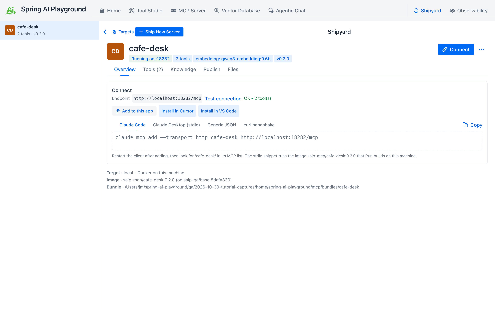
*Version 0.2.0, shipped by the AI, as the person sees it.*

!!! note "The AI does not see the card"
    The same report says `No approval questions were presented during the workflow.` That is accurate from where the AI sits: the question went from the server to the Codex UI and to you, and the AI only received the tool result after you answered. An approval is a conversation between the server and the person; the model is not a party to it.

## 7. Ask the AI what it did, then check for yourself { #audit }

Before anything is restarted, let ChatGPT audit itself with the `monitor` tools:

*"Using the playground MCP server's monitor tools only: call saip_monitor_hitl, saip_monitor_management_log with limit 30, and saip_monitor_proxied_calls. Then report how many approval requests were accepted and how many were declined since the app started, and list the management tool calls with their approval level, outcome and the client that made them. Do not change anything."*

Count your own clicks first. You accepted three cards (publish, the first call, the run) and denied two (the second call, the open-network test). `saip_monitor_hitl` returns exactly that: `approved: 3, declined: 2`, all on the `server` side. `saip_monitor_management_log` lists every `saip_` call of this tutorial with its level and outcome, each made by `codex-mcp-client <version>`; the one `saip_tools_test` you refused shows `DECLINED`.

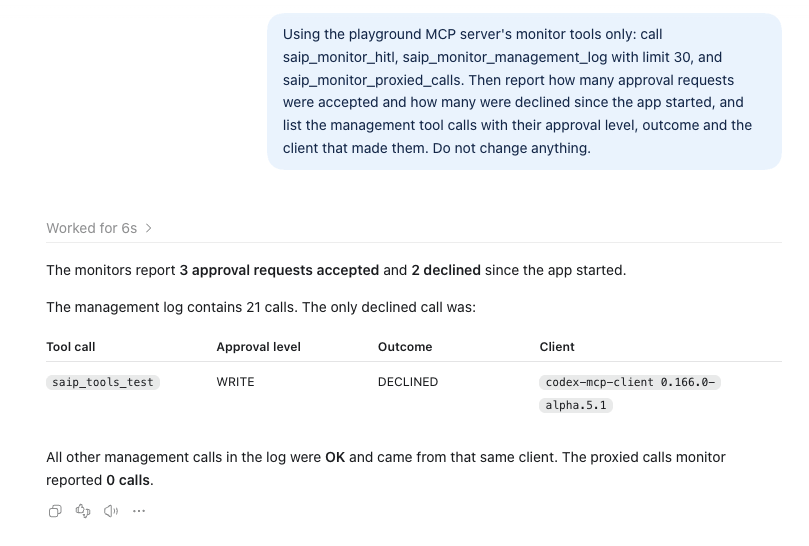
*The AI's own account of the session, read from the monitor tools.*

Now open **Observability** and the **Safety** tab. **HITL decisions** reads 5, the **HITL approval rate** 60%, and **Management tool calls** lists the same rows with the same client name, levels and outcomes. **Recent risk events** has a `MANAGEMENT` entry for each call that changed something or was refused. The AI's report and your dashboard describe the same facts because they read the same counters; neither side can tell a different story.

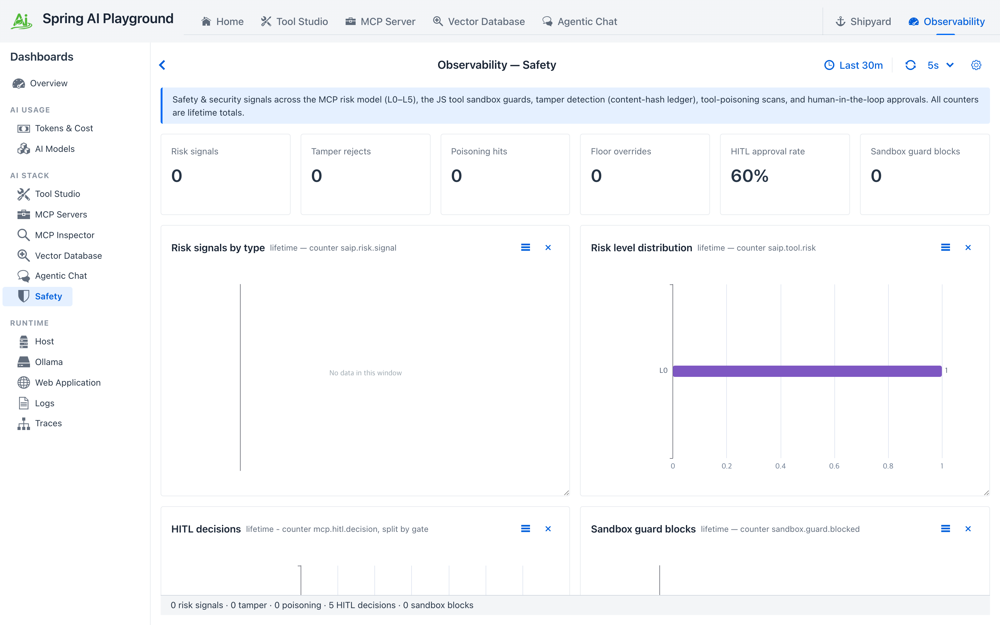
*The same session from the dashboard: five decisions, 60 percent approved.*


*Three approved, two declined, and the same calls the AI listed, with the same client name.*

!!! warning "Counters live in memory"
    The HITL decisions and the management log start empty when the app starts. Do this section before the next one, which stops the app. The tool, the server and its exposure persist; the counters do not.

## 8. The server stands on its own { #standalone }

Quit the playground. `cafe-desk` is a container that carries everything it needs, so nothing happens to it. In Codex start a new chat and talk to the shipped server directly:

*"Use only the cafe-desk MCP server: is the cafe open on Sunday, and when does the kitchen close? Then call its tool cafe_happy_hour_price with menu price 4.80 and tell me the result."*

The search answers as before (Sunday 09:00 to 15:00, the kitchen closes at 14:00). The tool call brings up a card, this time **from the shipped server itself**:

```
[risk L0 Verified] Approve running tool 'cafe_happy_hour_price' with arguments {menuPrice=4.8}?
Answer within 180 s, or the call is refused.
```

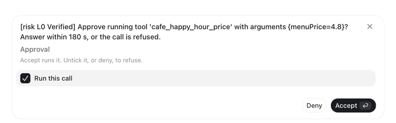
*The same question, from the container. The playground is not running.*

**Accept** it and the answer is `3.84`. The bundle carried the tool's `humanApproval` setting along with its code, and the shipped server runs the same approval gate the playground does. A gate you set in Tool Studio travels with the tool wherever the tool is served. Start the playground again when you are done.

## 9. Clean up { #cleanup }

Ask ChatGPT to stop and delete `cafe-desk` and to delete `cafe_happy_hour_price`; the delete calls are destructive, so each asks once. Or do it yourself in Shipyard and Tool Studio. Remove the two entries from `~/.codex/config.toml` if you do not want Codex to keep looking for them.

## What you learned { #recap }

- A RAG pipeline ships as a standalone MCP server: the documents, their vectors and one `search_` tool, running in Docker without the playground.
- ChatGPT connects to it like any other MCP server, and to the playground's management tools with a bearer token. Give Codex a tool timeout longer than the approval wait.
- The AI extends the server through the same gates as a person: draft, Local Pass, publish with your approval, then a new version shipped with your approval of the exact Docker command.
- Every approval is a card you can read; only Accept with **Run this call** ticked approves, and unticking it, Deny, X and Escape all refuse, and the AI is told to stop rather than retry.
- The AI can audit itself with the `monitor` tools, and the Safety dashboard shows the same numbers.
- The shipped server enforces the tool's approval gate on its own, with the playground stopped.

## Next steps

- [Tutorial 20](20-ai-registers-an-mcp-server.md) lets the same AI register someone else's MCP server from the catalog and expose one of its tools through the built-in server behind approval.
- [Tutorial 21](21-ai-builds-a-knowledge-server.md) lets the AI build the knowledge too: documents in, a dedicated MCP server out, with only the docker command to approve.
- [Shipyard](../features/mcp-server/index.md#shipyard) covers remote Docker targets, proxied tools inside a bundle, and what happens when a shipped bundle goes out of date.
- [Human-in-the-Loop Approval](../hitl-architecture.md) explains the gates, the single wait and why a refusal is always explicit.
- [Shipyard Architecture](../shipyard-architecture.md) and [AI Operations Architecture](../ai-operations-architecture.md) are the system view of what this tutorial did by hand and by AI.
