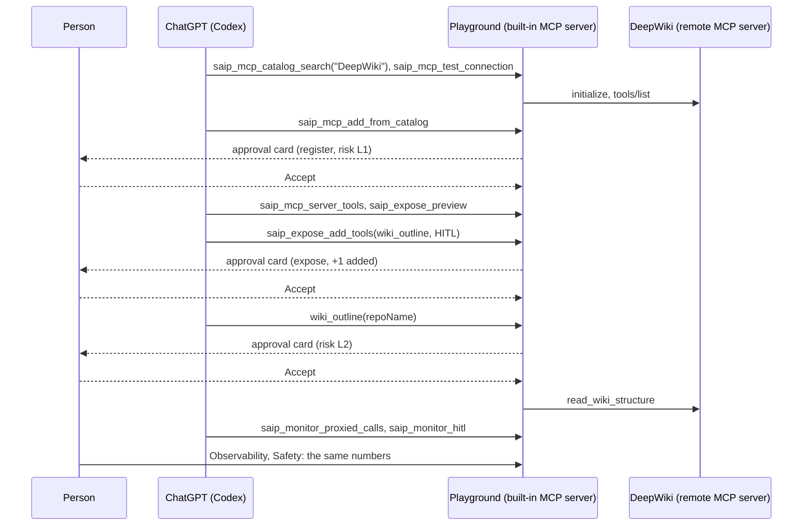
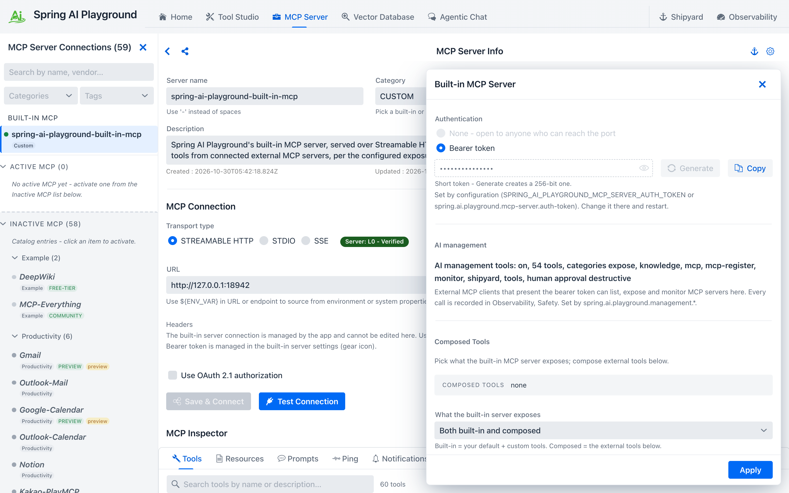
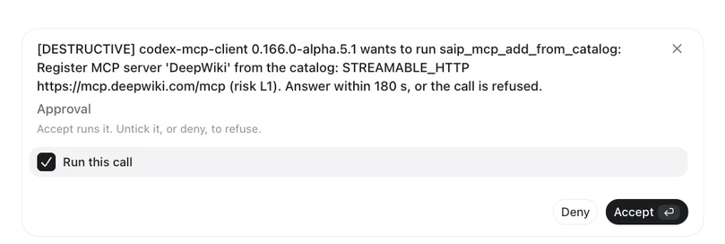
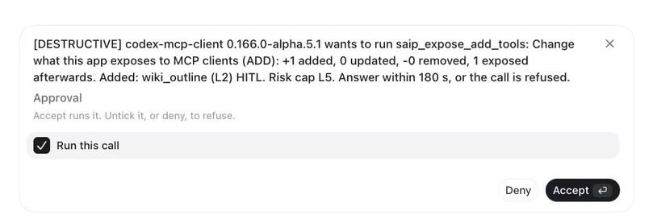
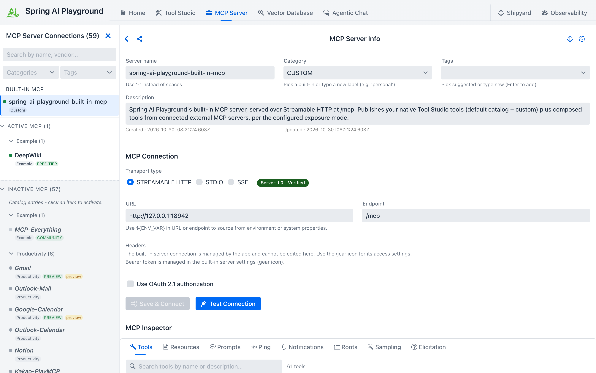
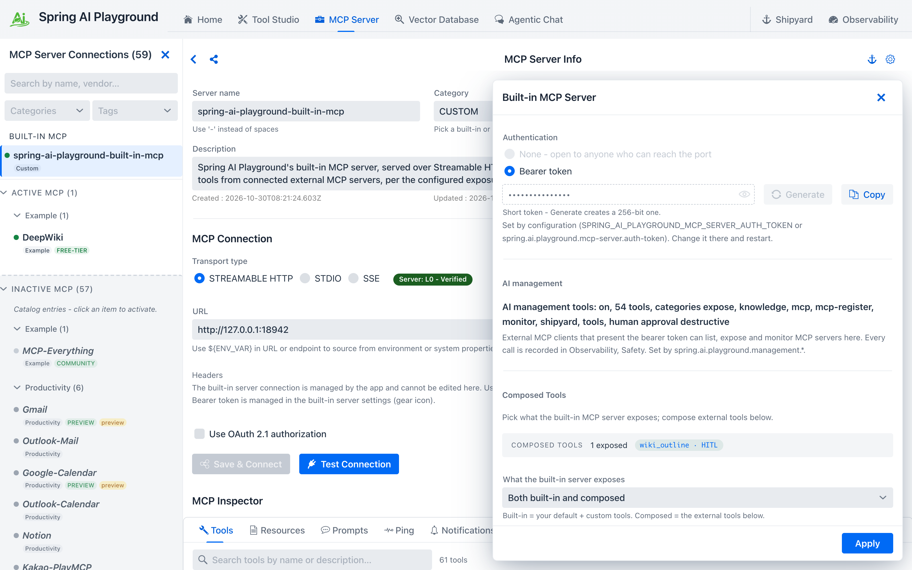
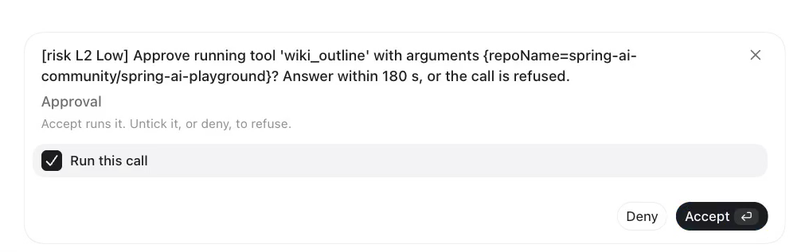
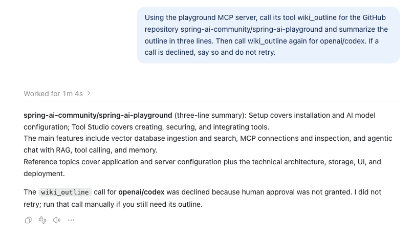
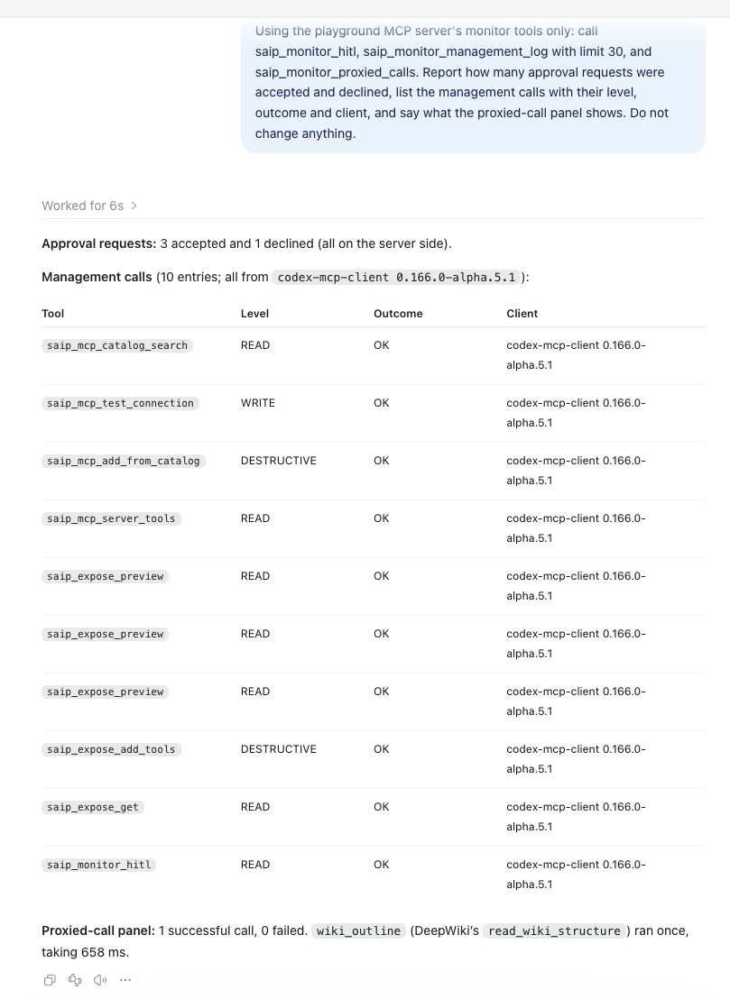
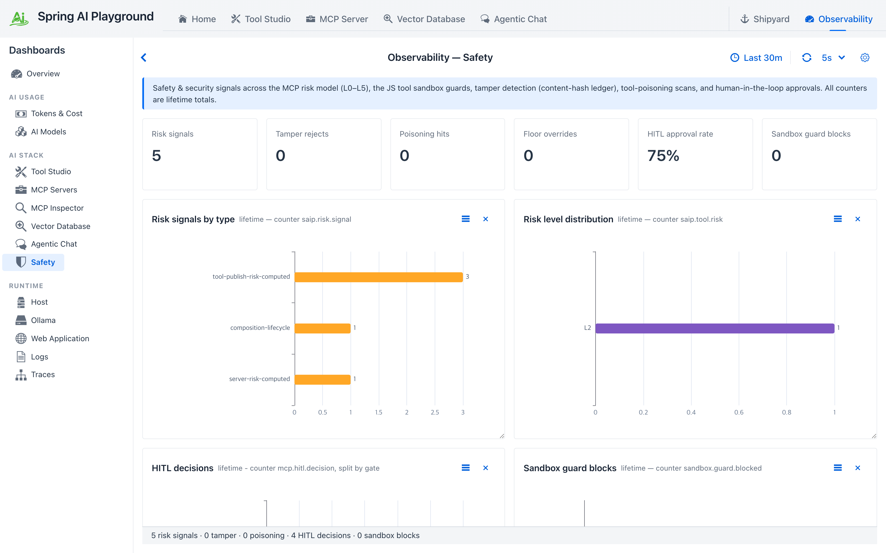

# Tutorial 20 - Let an AI Proxy External MCP Servers Through a Safety Net

**Time** 12 min · **Difficulty** ★★☆ · **Surfaces** MCP Server + Observability

!!! abstract "Goal"
    Connect your AI client to the playground once and use external MCP servers through it: you compose the tools it sees, risky calls wait for your approval, and every call is monitored from both your AI and the app. In [Tutorial 10](10-proxy-external-tool.md) you connected someone else's MCP server and re-published one of its tools through the built-in server, risk-capped and gated. Here ChatGPT does that for you over the [management MCP tools](../features/mcp-server/management-tools.md#exposing-the-tools-of-registered-servers): it searches the catalog, tests the connection, registers the server, reads the risk of each tool and exposes one of them under an alias with human approval on. Two of those steps ask you first. Then ChatGPT calls the proxied tool and you approve one call and refuse the next, and the AI's own monitoring report is checked against the Safety dashboard.

## Why go through the playground { #why }

Connected to each external MCP server directly, your AI gets several separate tool lists, no question before a risky call and no record of what ran. Connect it to the playground once instead and use the external servers through it:

{ loading=lazy }

- **Left to center** - your AI client connects to the built-in server at `/mcp` once, with a bearer token ([Connect your AI clients](../getting-started/external-connections.md#connect-your-ai-clients)).
- **1 Compose** - tools from several servers become one list under your names, risk-checked before they are exposed ([MCP Server Proxy](../features/mcp-server/proxy.md), [MCP Server Safety](../mcp-server-safety.md)).
- **2 Approve** - calls to the tools you marked wait for a card in your own client, the yellow arrow ([Human-in-the-Loop](../features/human-in-the-loop.md#external)).
- **3 Monitor** - every call is recorded; you see it in the app and your AI reads it with the `saip_monitor_*` tools, the blue arrows ([Safety dashboard](../features/observability/ai-stack/safety.md), [Watching the app](../features/mcp-server/management-tools.md#watching-the-app)).
- **Right** - catalog servers or your own ([Default MCP Servers](../features/default-mcp-catalog/index.md)).

The AI can set all of this up itself, as this tutorial shows, and every change it makes asks you first. It is a safety net in front of the external servers, not a sandbox around them: they still run where they run.

## The walkthrough at a glance { #flow }

The `mcp-register` category is the one management area that is **off by default**: the other areas work with what is already in the app; this one lets an AI add servers. Turning it on is a configuration decision, so this tutorial starts there.



## What you need { #prerequisites }

- Spring AI Playground running (see [Getting Started](../getting-started/index.md)), with the built-in MCP server on a **bearer token** ([Tutorial 18, section 1](18-ai-authors-a-tool.md#token)).
- The ChatGPT desktop app connected to the built-in server as in [Tutorial 19, section 3](19-knowledge-server-to-chatgpt.md#connect), or any other MCP client that supports elicitation.
- Internet access: the server registered here is [DeepWiki](https://docs.devin.ai/work-with-devin/deepwiki-mcp), a public remote MCP server with no authentication that answers questions about public GitHub repositories. It is in the app's catalog, so nothing has to be typed by hand.

## 1. Switch registration on { #register-on }

Add `mcp-register` to the management categories in the app's configuration and restart it:

=== "application.yaml"
    ```yaml
    spring:
      ai:
        playground:
          management:
            tools: tools, mcp, mcp-register, expose, monitor, shipyard, knowledge, chat
    ```

=== "Environment variable"
    ```bash
    export SPRING_AI_PLAYGROUND_MANAGEMENT_TOOLS=tools,mcp,mcp-register,expose,monitor,shipyard,knowledge,chat
    ```

Open **MCP Server**, click the gear icon of the built-in server and read the **AI management** line: `mcp-register` is now among the categories, and the tool count has grown by five. The five new tools are `saip_mcp_test_connection`, `saip_mcp_add_from_catalog`, `saip_mcp_add_custom`, `saip_mcp_remove_server` and `saip_mcp_reconnect`. Nothing an AI can call changes this list; it is read-only in the drawer and comes from configuration alone, see [Configuration](../features/mcp-server/management-tools.md#configuration).


*Before anything is registered: mcp-register among the categories, no composed tools yet. This screenshot was taken with the `chat` category off.*

## 2. Ask for the server { #ask }

Start a new chat in Codex and give it the whole job in one message:

*"Using the playground MCP server: search the MCP catalog for DeepWiki, test its connection, register it, then list its tools with their risk levels. Then preview and expose only the tool read_wiki_structure through this playground's built-in server under the alias wiki_outline with human approval required. Report exactly what each step returned, including any approval question and its outcome. Do not expose any other tool and do not ship or run servers."*

What ChatGPT did with it, in order:

| Step | Call | Level | What came back |
|---|---|---|---|
| 1 | `saip_mcp_catalog_search` with `query: "DeepWiki"` | read | One catalog entry: DeepWiki, official, Streamable HTTP, no authentication, three public tools |
| 2 | `saip_mcp_test_connection` | write | `Connected, 3 tool(s)`. Nothing is saved by a test |
| 3 | `saip_mcp_add_from_catalog` | destructive | **Your first approval card**, then `Registered 'DeepWiki': OK, 3 tool(s)` |
| 4 | `saip_mcp_server_tools` | read | `ask_wiki_question`, `read_wiki_contents` and `read_wiki_structure`, each `L2`, poisoning scan clean, none exposed yet |
| 5 | `saip_expose_preview` | read | `Preview: +1 added, 0 updated, -0 removed, 1 exposed afterwards`, the one row `wiki_outline` with `humanApproval: true` |
| 6 | `saip_expose_add_tools` | destructive | **Your second approval card**, then the change is applied and persisted |
| 7 | `saip_expose_get` | read | `1 tool(s) exposed from 1 server(s), mode BOTH, risk cap L5` |

!!! tip "If the AI stops at the preview"
    The `tools` list of a selection takes plain names or objects `{name, alias, hitl}`, and the alias is the exact exposed name. The tool description says so, but a model that only reads the top-level `aliasPrefix` field may preview `wiki_outlineread_wiki_structure`, see that it is not what you asked for, and stop without exposing anything. That is the right call on its part. Tell it to use the object form and it continues from the preview.

The first card registers a server, which is why it asks even though reading the catalog and testing the connection did not:

```
[DESTRUCTIVE] codex-mcp-client 0.166.0-alpha.5.1 wants to run saip_mcp_add_from_catalog: Register MCP
server 'DeepWiki' from the catalog: STREAMABLE_HTTP https://mcp.deepwiki.com/mcp (risk L1). Answer
within 180 s, or the call is refused.
```


*Registering a server is a change to your app, so it asks.*

The second one changes what your built-in server offers to every client, so it lists the change in full:

```
[DESTRUCTIVE] codex-mcp-client 0.166.0-alpha.5.1 wants to run saip_expose_add_tools: Change what this
app exposes to MCP clients (ADD): +1 added, 0 updated, -0 removed, 1 exposed afterwards. Added:
wiki_outline (L2) HITL. Risk cap L5. Answer within 180 s, or the call is refused.
```


*The exposure change, spelled out before it happens.*

Read `Added: wiki_outline (L2) HITL` the way it is meant: one tool, its risk, and the fact that it will ask a person before every call. Had the AI asked for a tool without approval, the question would say so in a separate sentence, because that is the part worth a second look. **Accept** both. As in Tutorial 19, the card's **Run this call** box is already ticked; unticking it refuses.

Open **MCP Server**: DeepWiki now sits in the left rail under **Active MCP**, and the built-in server's gear drawer lists `wiki_outline` under **Composed Tools** with the `HITL` flag, exactly as if you had done [Tutorial 10](10-proxy-external-tool.md) by hand.


*DeepWiki, registered by the AI, in the same list as a server you would add yourself.*


*One composed tool, with the approval flag the AI asked for.*

!!! note "The AI reports no question"
    Codex's own summary of these steps ends with `No approval question appeared during the operation.` It is not lying: the question went from the server to the Codex UI and to you, and the model only saw the result. Every approval in this app is a conversation between the server and the person.

## 3. Call it through the playground { #call }

The new tool is on the built-in server, so a **new chat** sees it (Codex reads a server's tool list once per chat). Ask:

*"Using the playground MCP server, call its tool wiki_outline for the GitHub repository spring-ai-community/spring-ai-playground and summarize the outline in three lines. Then call wiki_outline again for openai/codex. If a call is declined, say so and do not retry."*

The first call brings up a card from the proxy gate:

```
[risk L2 Low] Approve running tool 'wiki_outline' with arguments {repoName=spring-ai-community/spring-ai-playground}?
Answer within 180 s, or the call is refused.
```


*The proxy gate asks with the tool's own risk level and the exact arguments.*

**Accept** it. The playground forwards the call to DeepWiki as `read_wiki_structure` and ChatGPT summarizes the outline it got back. **Deny** the second card. ChatGPT reports `The wiki_outline call for openai/codex was declined because human approval was not granted. I did not retry; run that call manually if you still need its outline.`


*One outline summarized, one call refused and left alone.*

The alias is what the client sees; the upstream name is what the proxy calls. The risk prefix on the card is the tool's own `L2`, and the gate is there because you asked for it in step 6, not because of the level: a proxied tool with `hitl` off runs without a card, whatever its level, up to the risk cap.

## 4. Ask the AI what it did, then check for yourself { #audit }

*"Using the playground MCP server's monitor tools only: call saip_monitor_hitl, saip_monitor_management_log with limit 30, and saip_monitor_proxied_calls. Report how many approval requests were accepted and declined, list the management calls with their level, outcome and client, and say what the proxied-call panel shows. Do not change anything."*

You clicked Accept three times (register, expose, the first call) and Deny once. ChatGPT reports `Approval requests: 3 accepted and 1 declined (all on the server side).`, lists the management calls of section 2 with `codex-mcp-client` as the client and the two destructive ones marked, and reads the proxied-call panel: `1 successful call, 0 failed. wiki_outline (DeepWiki's read_wiki_structure) ran once`, with its latency.


*The AI's audit of its own registration, read from the monitor tools.*

Open **Observability** and the **Safety** tab. **HITL decisions** reads 4 and the **HITL approval rate** 75%. **Recent risk events** shows the trail the registration left before any approval was asked: `server-risk-computed DeepWiki → L1`, three `tool-publish-risk-computed DeepWiki/... → L2` rows, `composition-lifecycle Exposed Tools UPDATED`, and a `MANAGEMENT` row for each call that changed something. **Management tool calls** lists the same calls the AI reported, with the same levels and outcomes. The **MCP Servers** dashboard counts the proxied call.


*Four decisions, 75 percent approved, and the five risk signals the registration raised.*


*The trail the registration left, and the same calls the AI listed.*

An agent that wants to watch the result without a tool call reads the resources `saip://status/servers` and `saip://status/exposure`: the registered servers and the exposure as JSON, read fresh on every read.

## 5. What the app refuses on its own { #refusals }

- **Above the cap.** A tool whose inherent risk is above `maxRisk` (the `composed-tools-max-risk` setting) is rejected by name; HITL does not lift the cap.
- **Changed definition.** A tool whose description or schema changed since it was last approved is rejected with `The tool definition changed since ...` until the AI reviews it with `saip_mcp_server_tools` and lists it in `acknowledgeChanged`. The drawer asks the same of a person (**Definition changed**, **Accept new definition**); nothing re-approves a changed tool implicitly.
- **Names.** An alias must be unique, 1 to 64 letters, digits, `_` or `-`, and must not start with `saip_` or shadow one of your own tools.
- **Managed by configuration.** While `spring.ai.playground.mcp-server.composed-tools` sets the exposure, every change is refused and the drawer says so.
- **Mode.** With `exposure-mode: builtin-only` the tools are stored but not offered, and the result says `composedToolsVisible: false`.
- **Secrets and loops.** A registered header value that looks like a secret must be a `${ENV_NAME}` reference, and this app's own `/mcp` URL is refused as an upstream.

## 6. Clean up { #cleanup }

Ask ChatGPT to remove the DeepWiki server. `saip_mcp_remove_server` is destructive, so it asks once, and its question says what goes with the server: `Remove MCP server 'DeepWiki' and any tools it exposes`. The answer confirms it: `Removed 'DeepWiki' and 1 exposed tool(s).` Or do it in **MCP Server** yourself. If you do not want an AI to register servers from now on, take `mcp-register` out of the configuration again.

## What you learned { #recap }

- Your AI connects to the playground once and uses external MCP servers through it: the tools it sees are the ones you composed, calls you marked wait for your approval, and every call is recorded and visible from both your AI and the app.
- `mcp-register` is off by default; configuration, not an AI, turns it on.
- An AI can register a catalog server and expose its tools through the built-in server, and the two steps that change your app ask you first, with the full list of what changes and which tools would run without approval.
- The proxied tool keeps its alias, its risk and its approval flag; a call to it is a card the person answers, and a refusal tells the AI to stop.
- Registration leaves a risk trail of its own on the Safety dashboard, and the AI's report from the `monitor` tools matches the dashboard.

## Next steps

- [Tutorial 21](21-ai-builds-a-knowledge-server.md) has the AI build and ship a knowledge server of its own; register it here the same way to put it behind the proxy.
- [Tutorial 22](22-ai-chat-as-a-subagent.md) has the AI use this app's chat, with an exposed tool such as `wiki_outline`, as a sub-agent.
- [MCP Server Proxy](../features/mcp-server/proxy.md) explains the risk cap, the per-tool gate and the YAML form of the same exposure.
- [Management MCP Tools](../features/mcp-server/management-tools.md#exposing-the-tools-of-registered-servers) shows the `selections` shape that exposes several servers in one call.
- [AI Guides, Templates and Samples](../features/mcp-server/ai-guides.md#proxy) shows the proxy and risk-level guides and the `saip_proxy_server` prompt an AI can start this job with.
- [MCP Server Safety](../mcp-server-safety.md) covers the risk levels and the poisoning scan the registration ran.
- [AI Operations Architecture](../ai-operations-architecture.md) describes the gate that asked the two questions and the audit trail the report came from.
