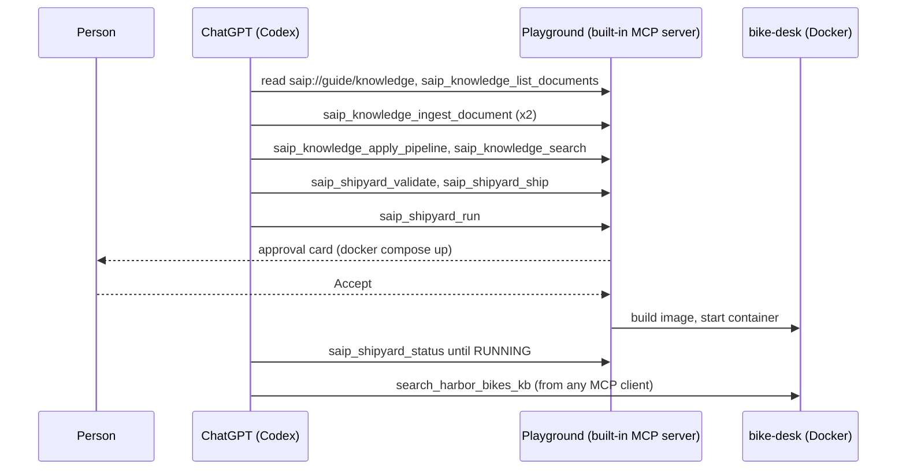
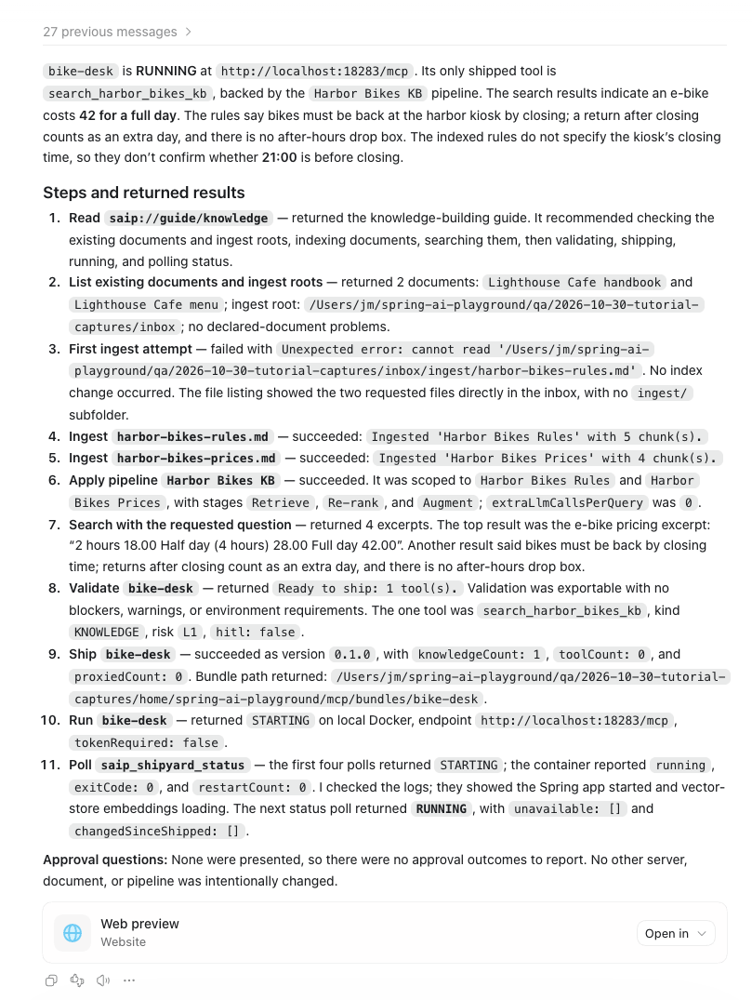
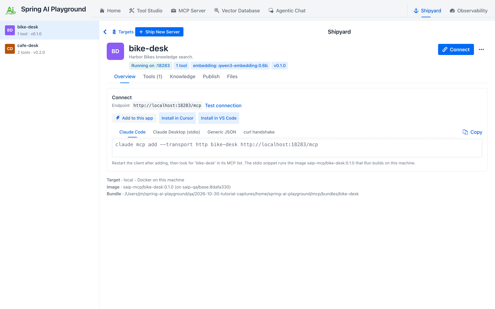
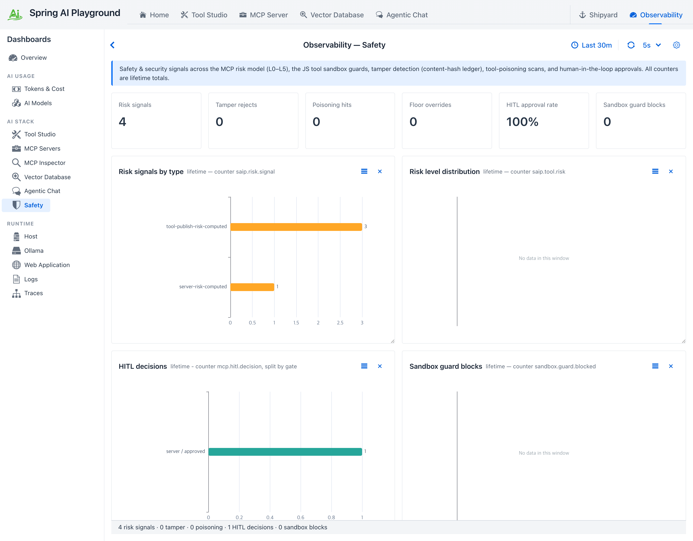

# Tutorial 21 - Let an AI Build and Ship a Knowledge Server

**Time** 15 min · **Difficulty** ★★★ · **Surfaces** Vector Database + Shipyard + MCP Server + Observability

!!! abstract "Goal"
    Two documents go in, a dedicated MCP server comes out, and an AI does every step in between. ChatGPT reads the app's knowledge guide, ingests the files, builds a RAG pipeline, checks it with a search, validates and ships a server that carries one search tool, runs it in Docker and polls it until it is up. You approve one thing: the `docker` command. Then any MCP client can ask the new server, and the Safety dashboard shows every step the AI took.

In [Tutorial 19](19-knowledge-server-to-chatgpt.md) you built the knowledge on the screens and ChatGPT extended the server afterwards. Here the AI builds the knowledge too, with the `saip_knowledge_*` and `saip_shipyard_*` [management tools](../features/mcp-server/management-tools.md#building-the-knowledge-behind-a-search-tool). The result is the same kind of server: a frozen snapshot of the chunks and their vectors, one `search_` tool, no playground needed at run time.



## What you need { #prerequisites }

- The management surface on: the built-in MCP server on a bearer token ([Tutorial 18, section 1](18-ai-authors-a-tool.md#token)).
- ChatGPT (Codex) connected to the built-in server as in [Tutorial 19, section 3](19-knowledge-server-to-chatgpt.md#connect), with `tool_timeout_sec = 200`. Any MCP client that supports elicitation works the same way.
- An embedding model (the Vector Database page shows which one; the walkthrough uses `qwen3-embedding:0.6b`) and Docker running on this machine.
- A folder the app may ingest from. MCP carries no file upload, so a document comes in by **path** inside `spring.ai.playground.rag.ingest-roots` (default `<home>/vectorstore/inbox`), by **URL**, or as inline **text**. Save the two files below into that folder:

??? example "The two documents"
    `harbor-bikes-rules.md`

    ```markdown
    # Harbor Bikes rental rules

    ## Opening hours
    Harbor Bikes is open every day from 08:00 to 20:00. From November to March it closes at 18:00.

    ## Returns
    Bikes must be back at the harbor kiosk by closing time. A bike returned after closing counts as an
    extra day. The kiosk has no after-hours drop box.

    ## Deposit and ID
    Every rental needs a photo ID. Standard bikes need no deposit. E-bikes need a 100 deposit, returned
    when the bike comes back with its battery and charger.

    ## Helmets and child seats
    Helmets are free and must be worn by riders under 16. Child seats fit city bikes only and cost 5
    per rental.

    ## Damage
    Flat tyres are repaired for free. A lost lock costs 25. Any other damage is charged at cost.
    ```

    `harbor-bikes-prices.md`

    ```markdown
    # Harbor Bikes price list

    ## City bike
    - 2 hours 9.00
    - Half day (4 hours) 14.00
    - Full day 20.00

    ## E-bike
    - 2 hours 18.00
    - Half day (4 hours) 28.00
    - Full day 42.00

    ## Tandem
    - 2 hours 16.00
    - Full day 34.00

    ## Discounts
    - Weekly rental: 7 days for the price of 5
    - Groups of 6 or more: 10 percent off every bike
    ```

A fictional bike rental is the point, as the cafe was in Tutorial 19: no model knows these prices, so every correct answer has to come from the server.

## 1. Ask for the server { #ask }

Start a new chat in Codex and give it the whole job:

*"Using the playground MCP server: read the resource saip://guide/knowledge first. Then index the two files harbor-bikes-rules.md and harbor-bikes-prices.md from the ingest folder as one knowledge base called Harbor Bikes KB, and check it with the question "Can I return a bike at 21:00, and what does an e-bike cost for a full day?". Then validate and ship it as an MCP server named bike-desk that carries only its knowledge search tool, on host port 18283, run it, and poll saip_shipyard_status until it is RUNNING. Report exactly what each step returned, including every approval question and its outcome. Do not touch any other server, document or pipeline."*

## 2. What the AI did { #steps }

In under two minutes, in this order:

| Step | Call | Level | What came back |
|---|---|---|---|
| 1 | read `saip://guide/knowledge` | - | The procedure: list, ingest, search, a pipeline when several documents share one tool, then the `saip_shipyard_*` tools |
| 2 | `saip_knowledge_list_documents` | read | `2 document(s).` (the cafe files of Tutorial 19) and `ingestRoots`, the folders a path may point into |
| 3 | `saip_knowledge_ingest_document` with a guessed `inbox/ingest/` subfolder | write | Refused: `'<inbox>/ingest/harbor-bikes-rules.md' does not exist; the ingest roots are [<inbox>]`. Nothing was registered |
| 4 | the same with `<inbox>/harbor-bikes-rules.md` and `extract.reader` `MARKDOWN` | write | `Ingested 'Harbor Bikes Rules' with 5 chunk(s).` |
| 5 | the same for the price list | write | `Ingested 'Harbor Bikes Prices' with 4 chunk(s).` |
| 6 | `saip_knowledge_apply_pipeline` named `Harbor Bikes KB`, scoped to the two titles | write | `Applied pipeline 'Harbor Bikes KB'.` with stages `Retrieve`, `Re-rank`, `Augment` and `extraLlmCallsPerQuery: 0` |
| 7 | `saip_knowledge_search` with the question | read | `4 excerpt(s).` The first: `E-bike 2 hours 18.00 Half day (4 hours) 28.00 Full day 42.00`; another says bikes must be back by closing time |
| 8 | `saip_shipyard_validate` | read | `Ready to ship: 1 tool(s).` The tool: `search_harbor_bikes_kb`, kind `KNOWLEDGE`, risk `L1`, `hitl: false` |
| 9 | `saip_shipyard_ship` | write | `Shipped 'bike-desk' v0.1.0` with `knowledgeCount: 1`. No question: a bundle on disk serves nothing yet |
| 10 | `saip_shipyard_run` | destructive | **Your approval card**, then `Container of 'bike-desk' is STARTING on Docker on this machine.` and the endpoint `http://localhost:18283/mcp` |
| 11 | `saip_shipyard_status`, repeated | read | `STARTING` four times while the image builds, then `'bike-desk' is RUNNING`, with no unavailable dependencies |

Step 3 is the app's input contract at work. A path must be absolute and inside an ingest root, and the refusal says what is wrong: a path that does not exist is named as missing, a relative one gets the absolute path to use instead (`'harbor-bikes-rules.md' is a relative path; give the absolute path of the file inside an ingest root, for example <inbox>/harbor-bikes-rules.md`), and one outside every root is refused with the property to extend. The AI corrects itself from the message; the app never guesses which file was meant. (The screenshots below come from a build that still worded this refusal as `Unexpected error: cannot read ...`; the current wording names the missing file.)

The only card is the run:

```
[DESTRUCTIVE] codex-mcp-client 0.166.0-alpha.5.1 wants to run saip_shipyard_run: Run 'bike-desk' on Docker
on this machine as localhost:18283. Runs the command: docker compose -f <home>/mcp/bundles/bike-desk/compose.yaml
up -d --build. Answer within 180 s, or the call is refused.
```


*The AI's progress, and the one question that reaches you. Everything above the card ran without asking.*

**Accept** it. About half a minute later ChatGPT reports `bike-desk is RUNNING at http://localhost:18283/mcp`, with every step and its result. As in Tutorial 19, the report says no approval questions were presented: the card went from the server to you, not to the model.


*The AI's account of the build, step by step.*

!!! note "Search before you ship"
    Step 7 decides whether the server will be any good. `saip_knowledge_search` runs exactly what the shipped `search_` tool will run, on the same chunks, so a wrong or missing excerpt here is the moment to change the chunking, `topK` or the documents, not after shipping. The guide tells the AI to do this, and ChatGPT reported what the search did and did not establish.

## 3. The person's view { #check }

Open **Vector Database**. The two documents and the `Harbor Bikes KB` pipeline are listed with the others, and nothing marks them as made by an AI. Run the similarity search `What does an e-bike cost for a full day?`: the top chunk is the e-bike price list.


*The chunks the AI made. Each one starts with its section heading.*

Every chunk of a Markdown document starts with the heading of its section. The reader splits `harbor-bikes-prices.md` at each `##`, and without the heading the e-bike chunk would only say `2 hours 18.00 Half day 28.00 Full day 42.00`: nobody reading the excerpt, person or model, could tell which bike the prices belong to.

Open **Shipyard**: `bike-desk` is listed as **Running on :18283** with one tool, its endpoint and the connect snippets for each client.


*The server the AI shipped, on the same page as the ones you ship yourself.*

## 4. Ask the shipped server { #use }

`bike-desk` is a plain MCP server. Add it to any client:

=== "ChatGPT (Codex)"
    ```toml
    [mcp_servers.bike-desk]
    url = "http://127.0.0.1:18283/mcp"
    ```

    Quit the ChatGPT app and open it again; Codex reads the file when it starts.

=== "Claude Code"
    ```bash
    claude mcp add --transport http bike-desk http://127.0.0.1:18283/mcp
    ```

Then, in a new chat:

*"Use only the bike-desk MCP server: can I return a bike at 21:00, and what does an e-bike cost for a full day? Also, is there a deposit for an e-bike?"*

The answer comes from the excerpts: an e-bike costs 42 for a full day, with a 100 deposit returned with the battery and charger. The search for that question did not bring back the opening hours, and ChatGPT says so instead of guessing a closing time. Ask the narrower question and the server finds it:

*"Ask bike-desk when the kiosk closes, then tell me if 21:00 is too late."*

`Yes, 21:00 is too late. The kiosk closes at 20:00, or 18:00 from November through March.`


*Two questions to the shipped server. The first answer does not invent what the excerpts do not say.*

A search tool returns the top excerpts for one query. When one question mixes topics, some excerpts lose out; a client asks again, or you raise `retrieval.topK` in the pipeline and ship again. `saip_knowledge_status` and the **Out of date** banner in Shipyard tell when a change to the documents or the pipeline needs a new ship.

## 5. Watch it { #watch }

Open **Observability** and the **Safety** tab. **HITL decisions** reads 1, the run, at an approval rate of 100%.


*One decision: the docker command.*

Further down, **Recent risk events** has a `MANAGEMENT` row for each step that changed something or failed (the refused ingest, the two ingests, the pipeline, the ship and the run), and **Management tool calls** lists every call with its level, outcome, client and duration. `saip_monitor_management_log` returns the same rows to an AI.


*The whole build on the audit trail, the refused path included.*

## 6. What the app refuses on its own { #refusals }

- **Paths.** Relative paths, paths outside the ingest roots and files that do not exist are refused with the reason. MCP has no upload, and the app reads nothing outside the folders you configured.
- **Names.** Document titles and pipeline names are keys: ingesting an existing title is refused (delete it first), applying an existing pipeline name updates it. A server name may only contain letters, digits, `.`, `_` and `-`; validation says so before anything is written.
- **Configuration.** Documents, pipelines and servers declared in configuration (`spring.ai.playground.rag.documents`, `rag.pipelines`, `shipyard.servers`) are read-only to the AI.
- **Docker.** Running, deleting and removing knowledge ask you; a client that cannot ask is refused. Bearer tokens for a shipped server never pass through these tools.

## 7. Clean up { #cleanup }

Ask ChatGPT to stop and delete `bike-desk` and to delete the pipeline and the two documents. `saip_shipyard_stop` is a write and does not ask; `saip_shipyard_delete`, `saip_knowledge_delete_pipeline` and `saip_knowledge_delete_document` are destructive and ask once each. Or do it yourself in Shipyard and Vector Database. Remove `bike-desk` from the client configuration.

## What you learned { #recap }

- An AI can take documents all the way to a running knowledge MCP server: ingest, pipeline, search, validate, ship, run.
- The person approves the step that runs something on the machine, and the card names the exact command. Building the knowledge and writing the bundle are recorded but do not ask.
- The app's refusals teach: a wrong path comes back with the reason, and the AI corrects itself without guessing.
- Search before you ship. The search the AI checks is the tool the server carries, and each Markdown chunk keeps its heading so an excerpt makes sense on its own.
- The shipped server answers any MCP client from its excerpts, and the Safety dashboard shows every step that built it.

## Next steps

- [Tutorial 19](19-knowledge-server-to-chatgpt.md) extends a knowledge server with a tool ChatGPT writes, and ships version 0.2.0 of it.
- [Tutorial 20](20-ai-registers-an-mcp-server.md) registers an external MCP server; register `bike-desk` the same way to put it behind this app's proxy and approval gate.
- [Tutorial 22](22-ai-chat-as-a-subagent.md) asks this app's chat questions over MCP, with a RAG source such as `Harbor Bikes KB`.
- [AI Guides, Templates and Samples](../features/mcp-server/ai-guides.md#knowledge) shows the knowledge and Shipyard guides the AI followed, and the `saip_knowledge_server` prompt that starts the same job.
- [Shipyard](../features/mcp-server/index.md#shipyard) and the [Vector Database](../features/vector-database.md) describe the screens behind these calls; [Shipyard Architecture](../shipyard-architecture.md) and [AI Operations Architecture](../ai-operations-architecture.md) describe the bundle and the gate behind them.
