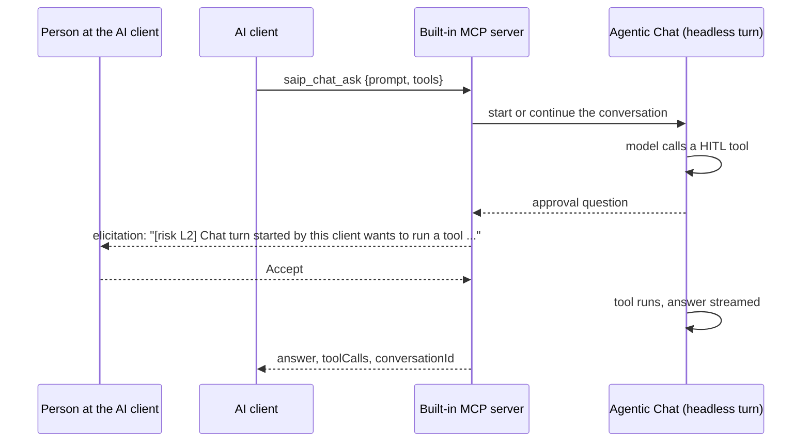

# Tutorial 22 - Let an AI Use the Chat as a Sub-agent

**Time** 15 min · **Difficulty** ★★☆ · **Surfaces** MCP Server + Agentic Chat + Observability

!!! abstract "Goal"
    An external AI asks this app's Agentic Chat a question with `saip_chat_ask` and gets the answer back: the local model, the tools you published here and the knowledge you indexed, used by another agent as a sub-agent. The turn is a real conversation that shows up in the chat history, and when the turn calls a tool that needs approval, the question comes to you in your own client. You approve one call and decline another, and you see what a client that cannot ask gets.

Every earlier tutorial with an AI ([18](18-ai-authors-a-tool.md), [19](19-knowledge-server-to-chatgpt.md), [20](20-ai-registers-an-mcp-server.md), [21](21-ai-builds-a-knowledge-server.md)) had the AI operate the app's settings. This one has it use the app's main surface. The gate is the same as in [Tutorial 11](11-human-approval.md); only the asker changes, which the [architecture page](../hitl-architecture.md#management-chat-gate) calls the third approval path.



## What you need { #prerequisites }

- The management surface on and a client connected with elicitation support ([Tutorial 18, sections 1 and 2](18-ai-authors-a-tool.md#token)). The `chat` category is on by default.
- A chat model that answers in the app (the default `qwen3.5:4b` does).
- For section 3, one exposed tool that needs approval: DeepWiki's `read_wiki_structure` exposed with HITL as in [Tutorial 20](20-ai-registers-an-mcp-server.md) (this walkthrough exposed it under its default name `deepwiki_read_wiki_structure`; Tutorial 20 uses the alias `wiki_outline`), or any tool with **Human approval** on.

## 1. A turn with no tools { #ask }

Ask your AI to use the app, or call the tool yourself from the Inspector:

```
saip_chat_ask {"prompt": "Reply with the single word pong."}
```

```
Answered in 22040 ms with 0 tool call(s); conversation Chat-06d6fdbc-8a69-44a8-9b7a-cd64775bf773.
{"conversationId":"Chat-06d6...","newConversation":true,"answer":"pong","toolCalls":[],"model":"qwen3.5:4b-mlx","durationMs":22040}
```

`saip_chat_ask` is a **write**-level tool: with the default approval mode `destructive` it runs without a question, with `all` it asks first (the question names the conversation, the tools and the first 80 characters of the prompt). A new conversation starts from the app's default preset; `conversationId` continues one instead:

```
saip_chat_ask {"prompt": "What word did you just reply with? Answer with that word only.",
               "conversationId": "Chat-06d6fdbc-8a69-44a8-9b7a-cd64775bf773"}
-> "pong", newConversation false
```

`saip_chat_list_conversations` lists the conversations newest first with their model and message count, so an agent can pick one up again later. A conversation created under another model provider is listed as read-only and refused for new turns, the same rule the chat screen applies.

## 2. A turn with a tool { #tools }

`tools` names the published or exposed tools the turn may call. A new conversation gets none unless they are named; an existing one keeps its own settings unless `tools` or `ragSourceId` is given.

```
saip_chat_ask {"prompt": "What time is it in UTC right now? Use the getCurrentTime tool and answer with the time.",
               "tools": ["getCurrentTime"]}
```

```
Answered in 27742 ms with 2 tool call(s); conversation Chat-c57dc880-....
toolCalls: toolSearchTool {"query":"getCurrentTime"} -> ["getCurrentTime"]
           getCurrentTime {} -> "2026-10-22T20:45:41.371+09:00"
answer: The current UTC time is **2026-10-22T11:45:41.371Z**.
promptTokens 2725, completionTokens 302
```

Two calls, because the default preset has [dynamic tool discovery](../features/agentic-chat/dynamic-tool-discovery.md) on: the model first searches for the tool, then calls it. `toolCalls` carries every call with its arguments and a short outcome, so the outer agent can show its own user what happened inside. `ragSourceId` adds a knowledge source in the same way: a pipeline id from `saip_knowledge_list_pipelines` or `doc:<documentId>` from `saip_knowledge_list_documents`.

Open **Agentic Chat**: the history lists the conversations, and the one above renders with its **MCP TOOLS** process detail (2 calls, the tool names), the token counts and the answer, as if typed in the box.

## 3. A tool that needs your approval { #approve }

```
saip_chat_ask {"prompt": "Use the deepwiki_read_wiki_structure tool for the GitHub repository modelcontextprotocol/java-sdk and list the first three documentation topics.",
               "tools": ["deepwiki_read_wiki_structure"], "timeoutSeconds": 600}
```

The turn starts, the model decides to call the tool, and the question reaches **your** client, not a dialog in the app:

```
[risk L2] Chat turn started by this client wants to run a tool. Run 'deepwiki_read_wiki_structure'
with arguments {"repoName":"modelcontextprotocol/java-sdk"}? Answer within 180 s, or the call is refused.
```

- **Accept**: the tool runs and the answer lists the topics (`Overview`, `Model Context Protocol`, `Client API` in this walkthrough, after 72 s with a 4B model). `toolCalls` shows the call and its outcome.
- **Deny** or **Decline** (the client's wording), or **Accept** with the box unticked: the tool does not run. The model is told so and answers accordingly: `The user declined to approve running the 'deepwiki_read_wiki_structure' tool; therefore, the requested action could not be completed.` The outer call still succeeds; the decline is content, not an error.
- **No answer** within the wait: counted as a timeout. The model is told `no approval within 180 s`.
- **A client that cannot ask**: a session without the elicitation capability gets the tool declined without a prompt (`mgmt.chat.hitl.declined reason=no-elicitation-capability` in the app log) and the same kind of answer. Nothing runs because nobody could be asked.

The wait is the one [approval wait](../features/human-in-the-loop.md#wait) every gate shares; `timeoutSeconds` (300 by default, 1800 at most) bounds the whole turn and should leave room for it. A client that sends a `progressToken` sees the stages (`Sending the prompt to qwen3.5:4b`, `Calling tool deepwiki_read_wiki_structure`, `Answering`) and the approval countdown as progress notifications.

## 4. What the app refuses on its own { #refusals }

- **Unknown tools.** `tools: ["nope"]` is refused with `Unknown tool(s) [nope]. Use the names of published or exposed tools; saip_tools_list shows them.` Drafts are not callable.
- **Management tools.** `tools: ["saip_chat_ask"]` is refused the same way: `saip_` names are never chat tools, so a turn cannot start another turn.
- **Unknown or locked conversations.** `Conversation 'Chat-missing' does not exist. Leave conversationId out to start a new one.`; a conversation from another provider is read-only.
- **Models.** `model` must be one of the app's models and downloaded; an existing conversation keeps its model, and asking for another is refused by name.

## 5. Watch it { #watch }

**Observability**, the **Safety** tab, then **Management tool calls** lists each `saip_chat_ask` with level write, the masked prompt and the outcome; **HITL decisions** counts the approvals and declines of section 3 on the server side. The turn itself is traced like any chat turn, one trace per turn with the tool spans, under **Traces**. `saip_monitor_management_log` and `saip_monitor_hitl` give the AI the same view.

## What you learned { #recap }

- `saip_chat_ask` turns this app into a sub-agent: the outer AI gets the local model, the tools and the knowledge configured here, one turn at a time, with the conversation kept in the history.
- The approval question for a tool the turn calls goes to the person at the client that asked, with the same wording and wait as everywhere else; a client that cannot ask gets the tool declined.
- Tools are named explicitly per turn, management tools are never among them, and every turn is on the audit trail.

## Next steps

- [Tutorial 20](20-ai-registers-an-mcp-server.md) and [Tutorial 21](21-ai-builds-a-knowledge-server.md) build the tools and knowledge a turn like this can use.
- [Human-in-the-Loop Approval](../hitl-architecture.md#management-chat-gate) describes how the question travels from the chat loop to the client.
- [Management MCP Tools](../features/mcp-server/management-tools.md#how-it-works) shows how the chat tool, the status resources and the gate fit together.
