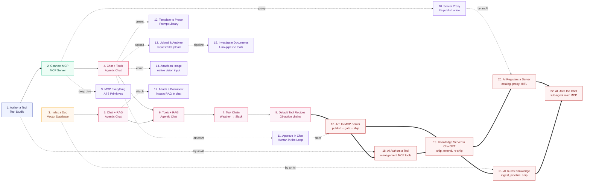

description: End-to-end Spring AI Playground tutorials - Tool Studio authoring, MCP servers, vector RAG, default-tool recipes, and Agentic Chat.

# Tutorials

These twenty-two tutorials take you from creating a single tool to composing chains over the bundled default catalog. Optional deep dives branch off the main path: the MCP protocol surface, re-publishing tools through the MCP Server Proxy, gating tool calls behind human approval, turning a Prompt Library template into a reusable preset, uploading a file for an agent to analyze, attaching an image for a vision model, investigating documents with a filesystem pipeline, and attaching a document to chat. A capstone ships one API all the way to a running MCP server. In the last stretch an external AI operates the app for you through the management MCP tools: it reads the guides the app serves, then authors a tool, extends and re-ships a knowledge server from ChatGPT, registers and proxies a server, builds and ships knowledge of its own, and uses the chat as a sub-agent. They follow the natural product workflow: build → validate → ground → compose.

The shipped chat default is **`qwen3.5:4b`** - fast, vision-capable, fine for the early tutorials. Switch to **`qwen3.5:9b`** or **`gemma4:e4b`** when you reach tutorials 4-7, where tool-calling reliability matters. Embeddings use **`qwen3-embedding:0.6b`** throughout. See [Picking a model](#picking-a-model) for the tradeoffs.

## How these tutorials connect



Tutorials 1-3 produce reusable assets (a tool, an MCP connection, an indexed document). Tutorials 4-8 compose those assets in chat (4-6) and as code-level chains over the bundled default catalog (7-8). Tutorial 9 is an optional **deep dive** off Tutorial 2 - activate MCP Everything from the Default MCP Servers and exercise every Inspector primitive (Tools / Resources / Prompts / Ping / Notifications / Roots / Sampling / Elicitation) end-to-end. Tutorial 10 is a second deep dive off Tutorial 2 - re-publish a connected server's tool through the built-in [MCP Server Proxy](../features/mcp-server/proxy.md) so chat and external clients can call it. Tutorial 16 is the capstone: it takes a public REST API through Tool Studio, an approval gate, the built-in MCP server, and finally ships it with Shipyard as its own MCP server running in Docker that any MCP client can connect to. Tutorial 18 turns the tables: an external AI client does the authoring of Tutorial 1 over the [management MCP tools](../features/mcp-server/management-tools.md), and you only approve or decline at the gates. Tutorials 19 to 22 continue that line with ChatGPT as the AI: it uses a knowledge server you shipped, adds a tool and ships a new version of it (19), registers an external server and exposes one of its tools behind approval (20), builds RAG knowledge from two documents and ships it as its own MCP server (21), and finally uses this app's chat as a sub-agent (22), each page written so that a person and an AI client can follow the same steps. Each tutorial is independently runnable in 4-25 minutes; the full main sequence takes about 65 minutes, plus about 65 minutes for the deep dives (9-15 and 17), 25 minutes for the capstone, and about 90 minutes for the AI-operated tutorials 18-22.

!!! abstract "What you'll need"
    - Spring AI Playground running on `http://localhost:8282`. Follow [Getting Started](../getting-started/index.md) first if you haven't.
    - Ollama running, with these models pulled:
        ```bash
        ollama pull qwen3.5:9b
        ollama pull gemma4:e4b
        ollama pull qwen3-embedding:0.6b
        ```
    - For Tutorial 7 only: `SLACK_WEBHOOK_URL` set in the launcher's Environment Variables.

## Tutorial list

<div class="grid cards" markdown>

-   :material-wrench:{ .lg .middle } **[1. Author and Validate a Tool](1-author-tool.md)**

    ---

    `getWeather` from Starter 5 → Local Pass → MCP exposure.  
    **8 min** · ★☆☆ · Tool Studio + MCP Server

-   :material-connection:{ .lg .middle } **[2. Connect an External MCP Server](2-external-mcp.md)**

    ---

    Streamable HTTP / STDIO / SSE / OAuth 2.1, validated in the Inspector.  
    **8 min** · ★★☆ · MCP Server

-   :material-file-document-plus:{ .lg .middle } **[3. Index a Document for RAG](3-index-document.md)**

    ---

    Upload → pick a reader → chunk → embed → similarity-search validate.  
    **7 min** · ★☆☆ · Vector Database

-   :material-chat-question:{ .lg .middle } **[4. Chat With Tools](4-chat-tools.md)**

    ---

    Real tool call from a chat turn - see plan → call → answer.  
    **5 min** · ★★☆ · Agentic Chat

-   :material-book-search:{ .lg .middle } **[5. Chat With RAG](5-chat-rag.md)**

    ---

    Grounded chat on the indexed document, then the same question through a staged pipeline.  
    **7 min** · ★★☆ · Agentic Chat + Vector Database

-   :material-merge:{ .lg .middle } **[6. Tools and RAG Together](6-tools-and-rag.md)**

    ---

    One turn that retrieves chunks AND calls a tool - full composition.  
    **6 min** · ★★★ · Agentic Chat (full)

-   :material-link-variant:{ .lg .middle } **[7. Weather to Slack - A Two-Tool Chain](7-weather-to-slack.md)**

    ---

    `getWeather` → `sendSlackMessage` in one prompt - the agent loop.  
    **4 min** · ★★★ · Agentic Chat

-   :material-source-branch:{ .lg .middle } **[8. Default Tool Recipes](8-default-tool-recipes.md)**

    ---

    Five new custom tools, each chaining default-tool helpers inside one JS action.  
    **20 min** · ★★★ · Tool Studio + Agentic Chat

-   :material-flask-outline:{ .lg .middle } **[9. MCP Everything: All 8 Primitives in One Walkthrough](9-mcp-everything.md)**

    ---

    Activate the reference test server from the Default MCP Servers catalog and exercise every Inspector primitive - Tools, Resources, Prompts, Ping, Notifications, Roots, Sampling, Elicitation - in one sitting. OS-specific Node install or Docker alternative.  
    **12 min** · ★★☆ · MCP Server (catalog + Inspector) · *deep dive*

-   :material-transit-connection-variant:{ .lg .middle } **[10. Proxy an MCP Server](10-proxy-external-tool.md)**

    ---

    Re-publish a whole MCP server - or a curated mix of several - through the built-in server, each tool risk-capped, HITL-gated, and logged; then call it from chat and external `/mcp` clients.  
    **8 min** · ★★☆ · MCP Server · *deep dive*

-   :material-account-check:{ .lg .middle } **[11. Approve a Tool in Chat](11-human-approval.md)**

    ---

    Turn on human-in-the-loop approval, then approve or decline a tool call live in chat.  
    **6 min** · ★★☆ · Tool Studio + Agentic Chat · *deep dive*

-   :material-clipboard-text:{ .lg .middle } **[12. Build a Preset from a Template](12-template-to-preset.md)**

    ---

    Fill a template's variables and save the assembled prompt as a named, reusable preset with the Save as preset dialog.  
    **6 min** · ★★☆ · Agentic Chat · *deep dive*

-   :material-file-upload:{ .lg .middle } **[13. Upload and Analyze a File](13-upload-a-file.md)**

    ---

    Upload a CSV or Excel file with the interactive requestFileUpload tool, then have the agent read and analyze it.  
    **7 min** · ★★☆ · Agentic Chat · *deep dive*

-   :material-image-search-outline:{ .lg .middle } **[14. Attach and Analyze Images](14-analyze-an-image.md)**

    ---

    Attach images to the chat, have a local vision model read them, turn their EXIF into a table and a map, then re-reference one later with describeImage.  
    **8 min** · ★☆☆ · Agentic Chat · *deep dive*

-   :material-text-box-search-outline:{ .lg .middle } **[15. Investigate Documents with a Pipeline](15-investigate-documents.md)**

    ---

    Upload a contract with the Document detective preset and pull facts out of it the Unix-pipeline way - find, grep, slice, quote with line numbers.  
    **6 min** · ★★☆ · Agentic Chat · *deep dive*

-   :material-server-network:{ .lg .middle } **[16. From a Public API to Your Own MCP Server](16-public-api-to-mcp-server.md)**

    ---

    Wrap an API you already have credentials for, gate it behind human approval, then ship it with Shipyard as its own MCP server that any MCP client can call.  
    **25 min** · ★★★ · Tool Studio + Agentic Chat + MCP Server + Shipyard · *capstone*

-   :material-file-document-plus-outline:{ .lg .middle } **[17. Attach a Document and Ask](17-attach-a-document.md)**

    ---

    Drop a document on the chat prompt, get a summary and pinpoint answers with no indexing step, then register it in the Vector Database with one click.  
    **12 min** · ★☆☆ · Agentic Chat + Vector Database · *deep dive*

-   :material-robot-outline:{ .lg .middle } **[18. Let an AI Author a Tool](18-ai-authors-a-tool.md)**

    ---

    Switch the management tools on with a bearer token, let an external AI client read the guide the app serves, then write, test and publish a tool over MCP, approve the publish, decline a call, and read what it did on the Safety dashboard.  
    **20 min** · ★★☆ · MCP Server + Tool Studio + Observability · *AI operates the app*

-   :material-ferry:{ .lg .middle } **[19. Ship a Knowledge Server and Hand It to ChatGPT](19-knowledge-server-to-chatgpt.md)**

    ---

    Index two documents, ship them with Shipyard as a knowledge MCP server in Docker, connect ChatGPT, let it add a tool and re-ship the server through the management tools, then compare its own monitoring report with the Safety dashboard.  
    **25 min** · ★★★ · Vector Database + Shipyard + MCP Server + Observability · *AI operates the app*

-   :material-lan-connect:{ .lg .middle } **[20. Let an AI Proxy External MCP Servers Through a Safety Net](20-ai-registers-an-mcp-server.md)**

    ---

    Connect your AI to the playground once and use external MCP servers through it: ChatGPT registers DeepWiki from the catalog, exposes one tool behind approval and calls it, and its own monitoring report matches the Safety dashboard. Tool composition, HITL and monitoring for every external server.  
    **12 min** · ★★☆ · MCP Server + Observability · *AI operates the app*

-   :material-database-arrow-right:{ .lg .middle } **[21. Let an AI Build and Ship a Knowledge Server](21-ai-builds-a-knowledge-server.md)**

    ---

    Two documents in, a dedicated MCP server out: ChatGPT ingests, builds the pipeline, checks it with a search, validates, ships and runs the container, and you approve only the docker command. Then any client asks the new server.  
    **15 min** · ★★★ · Vector Database + Shipyard + MCP Server + Observability · *AI operates the app*

-   :material-robot-outline:{ .lg .middle } **[22. Let an AI Use the Chat as a Sub-agent](22-ai-chat-as-a-subagent.md)**

    ---

    An external AI asks this app's Agentic Chat over MCP with tools and knowledge; the approval for a gated tool reaches you in your own client, and the turn lands in the chat history.  
    **15 min** · ★★☆ · MCP Server + Agentic Chat + Observability · *AI operates the app*

</div>

## Picking a model

Tool calling and tool chaining quality depend heavily on the model. The selectable list in **Agentic Chat → Settings → Model** is driven by `application.yaml`'s `playground.chat.models`. The shipped default is the small one - start there, and only upgrade if a tool turn comes back empty.

=== "qwen3.5:4b (default)"
    The shipped default. **3.4 GB**. Fast on Apple Silicon, and the smallest build that ships vision tensors, so image attachments work out of the box. Use this for the chat sanity check **before** wiring up tools or RAG. Tool calling is best-effort - if a tool turn comes back empty, that is the signal to upgrade, not to rewrite the prompt.

=== "qwen3.5:9b"
    **6.6 GB**. Stronger tool calling and multi-turn reasoning. The first upgrade target when `qwen3.5:4b` skips a tool call.

=== "gemma4:e4b"
    **9.6 GB**. Strongest natural-language quality. Pick this for tutorial 7 (multi-step tool chains) where the model has to *reason about* a tool result rather than just call it.

=== "gpt-oss:20b"
    **13 GB**. OpenAI's open-weights reasoning model. A good cross-check when you suspect a result depends heavily on which model family you picked.

!!! tip "Where the model selector lives"
    Open Agentic Chat, click the **gear** icon at the top right, change `Model`, then click **Apply & New Chat**. The chat header reflects the change.

## Further Reading

- [Overview](../index.md): return to the main product overview and documentation map
- [Getting Started](../getting-started/index.md): install the app, configure providers, and choose a runtime
- [Architecture](../architecture.md): runtime layers, data flows, and extension points
- [Features](../features/index.md): the main product areas and what they do
